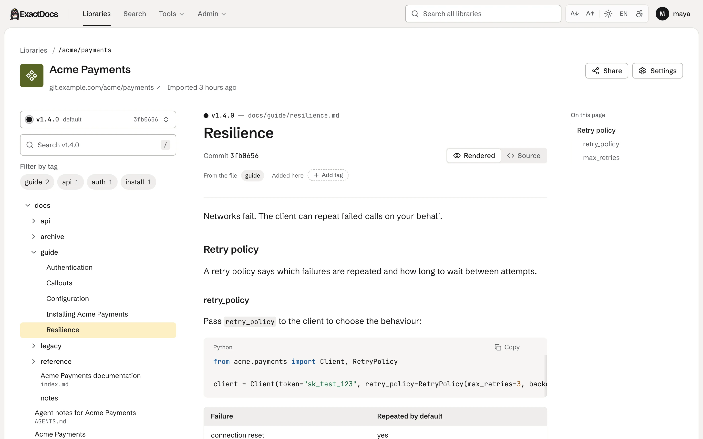
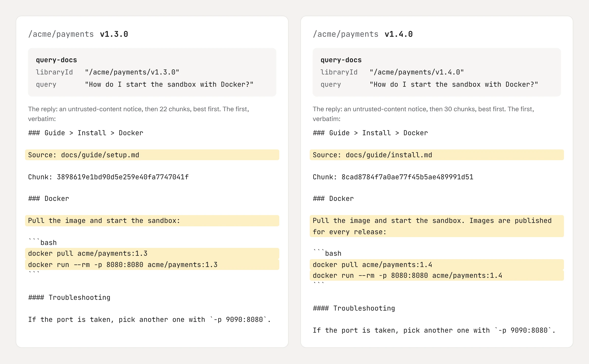
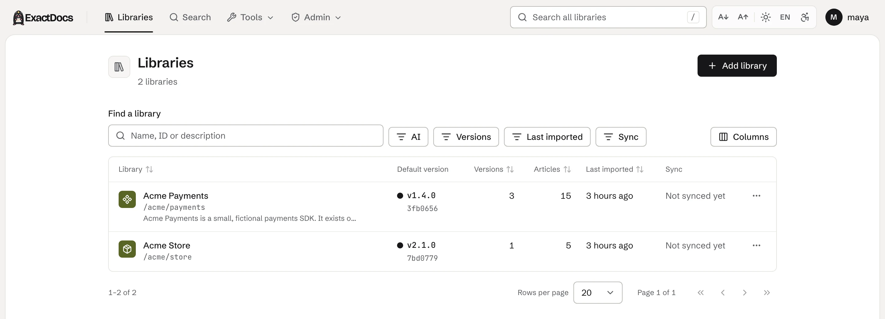
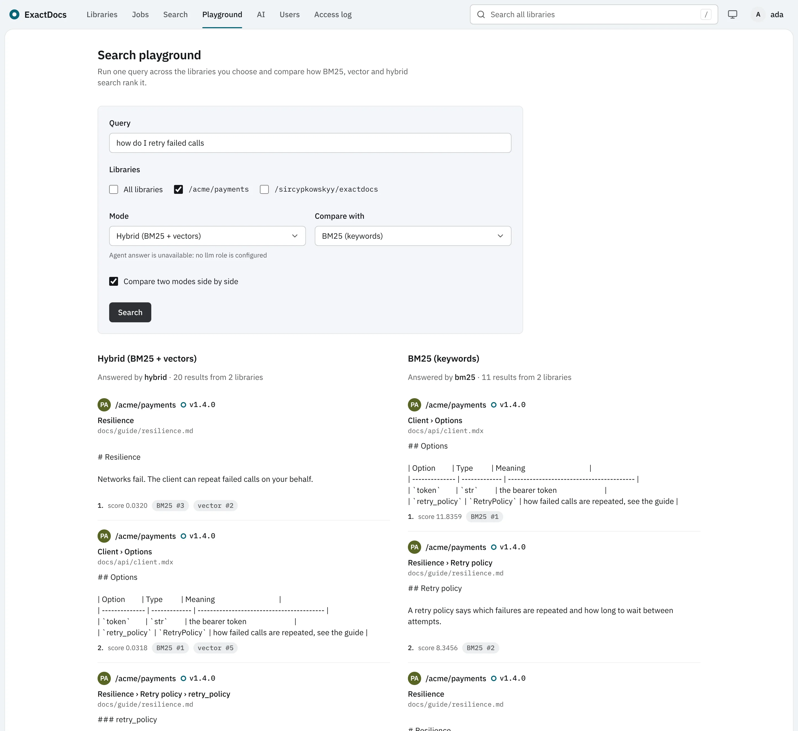

<p align="center">
  <a href="https://sircypkowskyy.github.io/ExactDocs/">
    <picture>
      <source media="(prefers-color-scheme: dark)" srcset="docs/assets/logo/exactdocs-lockup-dark.svg">
      <source media="(prefers-color-scheme: light)" srcset="docs/assets/logo/exactdocs-lockup-light.svg">
      
    </picture>
  </a>
</p>

<h3 align="center">Documentation, word for word.</h3>

<p align="center">
  A self-hosted MCP server that gives coding agents the docs of the library version you actually
  use, verbatim, with the file and commit they came from.
</p>

<p align="center">
  <a href="https://pypi.org/project/exactdocs/"></a>
  <a href="https://github.com/SirCypkowskyy/ExactDocs/actions/workflows/ci.yml"></a>
  <a href="LICENSE"></a>
  <a href="https://www.python.org/"></a>
  <a href="docs/deployment.md"></a>
  <a href="https://sircypkowskyy.github.io/ExactDocs/"></a>
</p>

<p align="center">
  <a href="https://sircypkowskyy.github.io/ExactDocs/"><b>Documentation</b></a> |
  <a href="#quick-start"><b>Quick start</b></a> |
  <a href="docs/mcp.md"><b>MCP tools</b></a> |
  <a href="docs/benchmark/index.md"><b>Benchmark</b></a> |
  <a href="https://github.com/SirCypkowskyy/ExactDocs/releases"><b>Releases and changelog</b></a> |
  <a href="CONTRIBUTING.md"><b>Contributing</b></a>
</p>

<picture>
  <source media="(prefers-color-scheme: dark)" srcset="docs/assets/screenshots/reader-dark.webp">
  
</picture>

Coding agents answer from whatever documentation they can reach, and it is often written for a
different version than the one in your lockfile. ExactDocs imports the Markdown docs of your git
repositories at the tags, branches or commits you choose, and serves them to your agent over MCP
and to your team in a web UI. Ask about `v1.3` and you get the text of `v1.3`, word for word,
with its path and commit, or an explicit "no result". You never get a plausible paragraph from
`v1.4`.

It runs on your laptop or your own server, so private docs stay on your network. Its MCP tools and
library IDs match context7's, so an agent already set up for context7 only needs a new URL.

> [!NOTE]
> The newest release is **v0.2.0** ([PyPI](https://pypi.org/project/exactdocs/), ghcr.io). This
> README describes the `develop` branch. AI retrieval, PostgreSQL, user accounts and sign-in,
> library sharing, webhooks, the sources file and the newer CLI commands ship in the next release.

## Why ExactDocs

- The version is a hard filter. Every library version is a git ref resolved to a commit SHA, and
  every search runs inside one version. In every configuration of the
  [benchmark](docs/benchmark/index.md), none of the 321 questions got a chunk of another version.
- Results are the original text. Markdown and MDX come back as written (Sphinx
  reStructuredText is converted to Markdown on import), with the file path, the heading, the
  commit SHA and a link to the file on your git host.
- It reads your repositories, public or private: GitHub, GitLab, Bitbucket, Gitea or any git
  server. You choose the folders and files, and it imports only those.
- It is light by default. The standard image bundles no model and runs a BM25 server on SQLite.
  Embeddings, rerankers and LLMs are optional, hosted or on your CPU.
- Nothing phones home. There is no telemetry, and the only outbound connections go to the git
  hosts, model endpoints and trace collector you configure. A test checks this.

## What it looks like

<picture>
  <source media="(prefers-color-scheme: dark)" srcset="docs/assets/screenshots/mcp-dark.webp">
  
</picture>

<sub>An agent asks two versions of the same library one question over MCP. Both replies are real
`query-docs` output from the test fixture library; the highlighted lines are the ones that
differ.</sub>

<table>
  <tr>
    <td width="50%">
      <picture>
        <source media="(prefers-color-scheme: dark)" srcset="docs/assets/screenshots/libraries-dark.webp">
        
      </picture>
      <br><sub>Each library with its imported versions; the default one shows its commit.</sub>
    </td>
    <td width="50%">
      <picture>
        <source media="(prefers-color-scheme: dark)" srcset="docs/assets/screenshots/playground-dark.webp">
        
      </picture>
      <br><sub>The search playground ranks one query in two retrieval modes side by side.</sub>
    </td>
  </tr>
</table>

## Quick start

```bash
docker run -d --name exactdocs -p 3000:3000 -v exactdocs-data:/data ghcr.io/sircypkowskyy/exactdocs:latest
# or, without Docker (needs git on your PATH)
uvx exactdocs serve
```

1. Open <http://localhost:3000> and create the admin account.
2. Choose **Add library**, paste a git URL, then pick a tag or branch and the folders to import.
3. Create an API token on the **Account** page and add the server to your agent:

   ```json
   {
     "mcpServers": {
       "exactdocs": {
         "url": "http://localhost:3000/mcp",
         "headers": { "Authorization": "Bearer <your-token>" }
       }
     }
   }
   ```

Then ask your agent something. It finds the library with `resolve-library-id` and reads it with
`query-docs`, the same way it would with context7.

On `develop`, `exactdocs config --client claude --new-token` prints this snippet for Claude Code,
Claude Desktop, Cursor, VS Code or Codex, with a token made for that client. A local agent that
only reads can run `uvx exactdocs serve --stdio` instead, with no token and no port.
[Getting started](docs/getting-started.md) covers the rest: the CLI, private repositories, the
sources file, webhooks, accounts and sign-in through an identity provider.

## Features

### For agents

The context7-compatible `resolve-library-id` and `query-docs`, plus tools to list,
browse, read and search one version: `list_libraries`, `list_articles`, `read_article`,
`article_outline`, `search_docs`, `search_all_docs` and `read_chunk`. In hosts with MCP Apps
(Claude, ChatGPT), `view_article` and `view_search` show an article or search results as UI.
Agents connect over Streamable HTTP with an API token or OAuth, or over stdio. Every tool is
read-only and marks what it returns as untrusted content. See [MCP](docs/mcp.md).

### Search

BM25 by default, with identifiers indexed whole and by their parts (`camelCase`,
`snake_case`, `pkg.mod.fn`). Hybrid search, HyDE, a reranker (a cross-encoder or an LLM judge) and
an agentic mode, where an LLM browses the version and picks the chunks, are optional. Each mode
stays inside the version and its budgets, and falls back to a cheaper mode with a reason instead
of failing. Articles are cut at their headings, never inside a code block or a table. See
[Search and AI models](docs/search.md).

### For the people who run it

- A web UI to add libraries with a preview of the files, read rendered articles, switch versions,
  search and compare retrieval modes.
- Local accounts, sign-in through OpenID Connect, OAuth2 or GitHub, and libraries shared with
  viewer, contributor, admin and creator roles that hold in the UI, over REST and over MCP.
- Branches kept fresh by hand, on a schedule or by a webhook from GitHub, GitLab or Bitbucket. New
  tags can be imported as they appear.
- Libraries declared in an `exactdocs.sources.yaml` that you review like code: `sources plan`
  shows the diff and `sources apply` makes it.
- SQLite or PostgreSQL (with several server processes), backups, health probes, OpenTelemetry
  traces and Prometheus metrics.
- Search and vector indexes in ExactDocs' own database, or in Azure AI Search, Chroma, DuckDB,
  Elasticsearch, OpenSearch, LanceDB, libSQL, Milvus, MongoDB, Pinecone, Qdrant or Redis. See
  [External index backends](docs/architecture.md#external-index-backends).

## Benchmark

ExactDocs is measured on a [golden set](docs/benchmark/golden-set.md) of 321 questions about the
docs of Starlette, Pydantic, TanStack Query, Zod and Electron, at three pinned versions each. With
no model at all, BM25 puts the section that answers in the top 5 for 81.7% of the 267 answerable
questions, at 57 ms p95. Hybrid search on a small local embedding model (bge-small) reaches up
to 84.6%. Hosted models and the agent benchmark have not run yet. [Benchmark](docs/benchmark/index.md) has
the method, every table and the known weak spots.

## How it works

An import fetches only the pinned commit and only the selected files, splits every article at its
headings and indexes it. A new version becomes visible in one step once it is complete, and a
re-sync of a branch re-chunks only the files that changed. The backend is a Python modular
monolith (FastAPI, FastMCP, pydantic-ai, DBOS for durable jobs) and the React UI is served by the
same process. [Architecture](docs/architecture.md) and [Flows](docs/flows.md) explain it.

The image comes in three variants: `:latest` (BM25, no model), `:latest-ai` (hosted and
self-hosted model providers) and `:latest-local` (two small local models, for instances with no
network). [Deployment](docs/deployment.md) covers a hardened container, reverse proxies, health
checks, upgrades, backups, PostgreSQL, Supabase and observability, and
[Configuration](docs/configuration.md) lists every setting.

## Roadmap

v0.2.0 (MVP-1) has the main loop for one admin with no external services: import from any git
URL, heading-based chunking, BM25 pinned to a version, the web UI and the MCP tools. `develop` adds
everything this README lists beyond that. Later: `llms.txt` and website crawling, docs resolved
from package registries and lockfiles, prebuilt index snapshots, and AsciiDoc and notebooks. The
[user stories](docs/user-stories.md) and the [delivery plan](docs/plan.md) have the details.

## Development

You need [uv](https://docs.astral.sh/uv/) (it installs Python 3.14), Node 26 LTS, pnpm 12 and
[just](https://just.systems).

```bash
git clone https://github.com/SirCypkowskyy/ExactDocs && cd ExactDocs
just setup        # Python workspace and web dependencies
just dev          # API and MCP on :3000, UI on :5173
just check        # everything CI runs
```

| Path | What |
|---|---|
| `packages/exactdocs/` | the app: one folder per domain, plus `bootstrap` (the composition root) |
| `packages/exactdocs-kernel/` | the shared kernel every domain uses |
| `web/` | the React UI (TanStack Router and Query, shadcn/ui), in vertical slices |
| `deploy/` | Dockerfile, smoke test, size budgets, self-hosted runner scripts |
| `docs/` | the documentation site (Zensical) |
| `.agents/skills/` | how agents work on issues, test and release |

Read [Architecture](docs/architecture.md) (modular monolith, ports and adapters) and
[Branching and releases](docs/releasing.md) before contributing.

## Contributing

Contributions are welcome. Please open an issue (Feature or Bug template) before a large change,
and see [CONTRIBUTING.md](CONTRIBUTING.md).

## License

Apache-2.0. Imported documentation stays under the license of its original repository.
