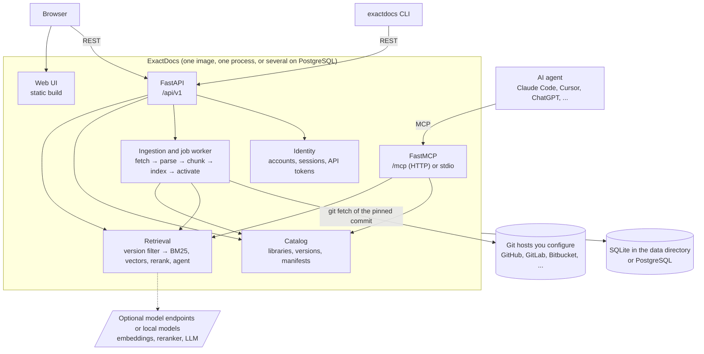

# ExactDocs

**Self-hosted, version-accurate documentation for AI coding agents.**

Point ExactDocs at a git repository, choose the Markdown docs you care about, and your AI agent can
search and read them over MCP, pinned to the exact tag, branch or commit you imported. People get
the same docs in a web UI. It is a self-hosted, drop-in alternative to context7.

[Documentation](https://sircypkowskyy.github.io/ExactDocs/) ·
[Getting started](docs/getting-started.md) ·
[MCP](docs/mcp.md) ·
[Configuration](docs/configuration.md) ·
[Deployment](docs/deployment.md)

> [!NOTE]
> The latest release is **v0.2.0** (MVP-1): one admin account and no external services, with the
> whole loop working in the web UI, over REST and over MCP. This README describes the `develop`
> branch, which also has the MVP-2 polish, the AI retrieval modes, PostgreSQL, local user accounts,
> sign-in through OIDC, webhooks, a sources file and observability; they ship in the next release. Anything marked *planned* is not
> built yet (see the [roadmap](#roadmap)).

## Why ExactDocs

Coding agents answer from whatever documentation they can find, and that is often the wrong
version. ExactDocs gives them your docs, at the version you use:

- It reads your docs from your repositories on GitHub, GitLab, Bitbucket, Gitea or any git
  server, public or private. You choose the folders and files, and it imports only those.
- The version is a hard filter. Every library version is a git ref resolved to a commit SHA.
  Ask about `v1.3` and you get `v1.3` or an explicit "no result", never a plausible answer from
  `v1.4`.
- Results are the original Markdown, verbatim, with its path, heading, commit SHA and a link to
  the file on your git host. Nothing is paraphrased.
- Sphinx documentation in reStructuredText (`.rst`, as SQLAlchemy, behave or CPython write it)
  imports like Markdown: headings, code blocks with their language, tables, admonitions,
  `include` / `literalinclude` and cross-references. It is parsed with docutils; nothing is built
  or executed.
- It is light by default. The standard image bundles no model: it is a fast BM25 server on SQLite.
  Embeddings, rerankers and LLMs are optional, either hosted or running locally on the CPU.
- It is context7-compatible. The MCP tools and library IDs are the same, so switching is a URL
  change.
- It stays private. There is no telemetry and no phone-home. The only outbound connections go to the git hosts,
  model endpoints and (opt-in) trace collector you configure, and a test proves it.

## Quick start

```bash
docker run -d --name exactdocs -p 3000:3000 -v exactdocs-data:/data \
  ghcr.io/sircypkowskyy/exactdocs:latest
# or, without Docker (needs git on your PATH)
uvx exactdocs serve
```

1. Open <http://localhost:3000> and create the admin account. Until it exists, every API request
   is refused with `403 setup_required`. From a terminal, `docker exec -it exactdocs exactdocs admin create`
   (or `uvx exactdocs admin create`) does the same.
2. Choose **Add library**, give a git URL, a ref and the paths to import, and wait for the import
   job to finish. **Preview** shows which files would be imported first.
3. Connect your agent. `exactdocs config` prints a ready-to-paste snippet:

   ```bash
   uvx exactdocs config --client claude --new-token   # claude, claude-desktop, cursor, vscode, codex
   ```

   Or configure it by hand with an API token from the **Account** page:

   ```json
   {
     "mcpServers": {
       "exactdocs": {
         "url": "http://localhost:3000/mcp",
         "headers": { "Authorization": "Bearer <your-token>" }
       }
     }
   }
   ```

4. Ask your agent something. It finds the library with `resolve-library-id` and reads it with
   `query-docs`, as it would with context7.

[Getting started](docs/getting-started.md) walks through the
same steps over REST, and covers the command line, private repositories, the sources file,
webhooks, user accounts and sign-in through an identity provider.

> [!NOTE]
> Web hosts that cannot paste a token (Claude, ChatGPT) connect with OAuth through one of your
> sign-in providers: set `EXACTDOCS_MCP_OAUTH_PROVIDER` ([MCP](docs/mcp.md#oauth-for-web-hosts)).

> [!TIP]
> For a local agent that only reads, `uvx exactdocs serve --stdio` needs no token, no port and no
> `git`. It opens an existing database read-only, so run `exactdocs serve` (or `admin create`) once
> first.

## What you get

### MCP tools

| Tool | What it does |
|---|---|
| `resolve-library-id` | context7-compatible: finds a library ID such as `/acme/payments` |
| `query-docs` | context7-compatible: whole chunks that answer a question, best first, within a size budget, from the default version or exactly the one named |
| `list_libraries` | libraries and their imported versions |
| `list_articles` | the article tree of a version |
| `read_article` | a whole article, verbatim |
| `article_outline` | an article's headings with their chunk IDs, without the text |
| `search_docs` | searches one version, in the retrieval mode you ask for |
| `search_all_docs` | searches the default version of every library at once |
| `read_chunk` | one chunk verbatim, such as a neighbour of a search result |
| `view_article`, `view_search` | an article or search results shown as UI in hosts with MCP Apps (Claude, ChatGPT), with a text fallback |

Articles are also MCP resources (`exactdocs://{owner}/{repo}/{path*}{?ref}`), and the two context7
operations are available over REST for integrations that do not speak MCP. Every tool is
read-only, and everything it returns is marked as external content, never instructions.
[MCP](docs/mcp.md) has the full reference.

### Retrieval

| Mode | Needs | How it searches |
|---|---|---|
| `bm25` (default) | nothing | full-text search, with identifiers indexed whole and by their parts (`camelCase`, `snake_case`, `pkg.mod.fn`) |
| `hybrid` | an embedding model | BM25 and vector search fused with reciprocal rank fusion |
| `hybrid_hyde` | an embedding model and an LLM | the LLM writes a hypothetical answer, whose embedding drives the vector half |
| `agentic` | an LLM | a pydantic-ai agent browses the version's tree in a sandbox and returns the chunks that answer, each with a reason |

A cross-encoder (hosted, TEI or local) or an LLM judge can rerank the results of any mode. Every
mode stays pinned to the version, stays within the budgets you set, and falls back to a cheaper
mode with a `fallback_reason` instead of failing. BM25 remains the default until the
[eval suite](docs/evals.md) shows that another mode beats it;
[Recommended defaults](docs/benchmark/defaults.md) has the
benchmark numbers. See [Search and AI models](docs/search.md).

### Chunking

Articles are cut at their Markdown headings, never inside a code block or table. A new library
gets the chunking the [retrieval benchmark](docs/benchmark/defaults.md) recommends: headings `#`
to `###` start a chunk, and a chunk longer than 4,000 characters is cut again at its deeper
headings (`split_level` 3, `max_chars` 4,000). BM25 finds the right section in the top 5 for
81.7% of the golden set's questions with it, against 79.8% when every heading starts a chunk.
Each library can choose its own split level and sizes, when it is added or later in its settings
([Chunks and tags](docs/search.md#chunks-and-tags)).

A library keeps the chunking it was added with. Libraries added with ExactDocs 0.4 or earlier
store the default of then (every heading starts a chunk, no size bound): upgrading changes and
re-chunks none of them.
To move one to the new default, set its chunking to `split_level` 3 and `max_chars` 4,000; its
versions are then re-chunked from the stored text, without fetching anything. A settings call or
sources file that sends `chunking` but leaves out `split_level` or `max_chars` gets the new
values for them, and `sources plan` shows such a change before `apply` makes it.

### The rest

- A web UI to add libraries (with a preview of the files), browse rendered articles, switch
  versions, search, manage tokens, users and AI settings.
- A command line that is a client of the REST API (`login`, `add`, `sync`, `remove`, `token`,
  `config`), plus `ctx7`-style `library` and `docs` commands.
- Libraries declared in an `exactdocs.sources.yaml` that you review like code: `sources plan`
  shows the diff, `sources apply` makes it.
- Local accounts managed by an admin, and sign-in through any OpenID Connect provider (Keycloak,
  Entra ID, Okta, Google, ADFS), OAuth2-only providers, or GitHub/GitHub Enterprise, with access
  and roles that follow verified groups and organization/team membership. See
  [GitHub setup](docs/configuration.md#github-and-github-enterprise-sign-in).
- Branch versions kept fresh by hand, on a schedule or by a webhook from GitHub, GitLab or
  Bitbucket; new tags imported automatically if you want.
- `context7.json` support, custom chunking, tags from front matter, path rules or by hand, images
  and relative links.
- SQLite or PostgreSQL (with several server processes), backups, health probes, OpenTelemetry
  traces and Prometheus metrics.
- The search and vector indexes in ExactDocs' own database by default, or in an external
  backend you run (`EXACTDOCS_SEARCH_BACKEND`, `EXACTDOCS_VECTOR_BACKEND`). The database keeps
  every chunk and vector, so the backend is derived data: each version is held apart,
  `exactdocs index check` reports what it lost and `exactdocs index rebuild` writes it again.
  A backend is an optional extra behind one adapter; a backend that fuses keyword and vector
  search itself serves hybrid search natively. See
  [External index backends](docs/architecture.md#external-index-backends). Available:
  - [Azure AI Search](docs/configuration.md#azure-ai-search) for the search and vector indexes
    (`exactdocs[azure-search]`), with native hybrid search (Azure's hybrid query) and API key or
    Entra ID (managed identity) sign-in.
  - [Chroma](docs/configuration.md#chroma) for the vector index (`exactdocs[chroma]` for a
    server or Chroma Cloud, `exactdocs[chroma-local]` embedded in a local directory), with
    ExactDocs' own embeddings.
  - [DuckDB](docs/configuration.md#duckdb) for the search and vector indexes
    (`exactdocs[duckdb]`), one embedded database file, no server.
  - [Elasticsearch and OpenSearch](docs/configuration.md#elasticsearch-and-opensearch) for
    either index (`exactdocs[elasticsearch]`, `exactdocs[opensearch]`), with native hybrid search.
  - [LanceDB](docs/configuration.md#lancedb) for the search and vector indexes
    (`exactdocs[lancedb]`), embedded in a local directory or in object storage, with native
    hybrid search.
  - [libSQL](docs/configuration.md#libsql) for the search and vector indexes: FTS5 and libSQL's
    native vector index, on a libSQL server (`sqld`, Turso) shared by several processes or in
    one local file (`exactdocs[libsql]`).
  - [Milvus](docs/configuration.md#milvus) for the vector index, with native hybrid search
    (BM25 and dense vectors fused by Milvus' RRF ranker): a server or Zilliz Cloud
    (`exactdocs[milvus]`), or Milvus Lite in a local directory (`exactdocs[milvus-lite]`).
  - [MongoDB](docs/configuration.md#mongodb) (Atlas Search and Atlas Vector Search, or MongoDB
    with `mongot`) for the search and vector indexes (`exactdocs[mongodb]`), with native hybrid
    search (`$rankFusion`).
  - [Pinecone](docs/configuration.md#pinecone) for the vector index (`exactdocs[pinecone]`), a
    serverless index, with optional sparse-dense hybrid search.
  - [Qdrant](docs/configuration.md#qdrant) for the vector index (`exactdocs[qdrant]`),
    self-hosted or Qdrant Cloud, with optional native hybrid search.
  - [Redis](docs/configuration.md#redis) 8 (its Query Engine) for the search and vector indexes
    (`exactdocs[redis]`), with optional native hybrid search.

## How it works



An import fetches only the pinned commit and only the selected files, splits every article at its
headings and indexes it. A new version becomes visible in one step, once it is complete, and a
re-sync of a branch re-chunks only the files that changed. The backend is a modular monolith with
ports and adapters; [Architecture](docs/architecture.md) and
[Flows](docs/flows.md) explain it.

## Deploying it

The image comes in three variants, built from one Dockerfile. All of them start as a BM25 server
until a model role is configured.

| Tag | Holds | For |
|---|---|---|
| `:<version>`, `:latest` | BM25 on SQLite or PostgreSQL; no model, no ML library | most installs |
| `:<version>-ai`, `:latest-ai` | the hosted and self-hosted model providers, sqlite-vec, pgvector | AI providers over the network |
| `:<version>-local`, `:latest-local` | the above plus two small local models (an embedding model and a cross-encoder) | air-gapped instances: hybrid search and reranking with no network |

A hardened single container, the way CI runs it:

```yaml
services:
  exactdocs:
    image: ghcr.io/sircypkowskyy/exactdocs:latest
    ports: ["3000:3000"]
    read_only: true
    tmpfs: [/tmp]
    cap_drop: [ALL]
    security_opt: ["no-new-privileges:true"]
    volumes: ["exactdocs-data:/data"]
volumes:
  exactdocs-data:
```

> [!IMPORTANT]
> Behind a reverse proxy, set `EXACTDOCS_ALLOWED_HOSTS` to the public host name and
> `EXACTDOCS_FORWARDED_ALLOW_IPS` to the proxy's own address. Otherwise the server refuses the
> host name, and every client looks like the proxy to the sign-in throttle.

[Deployment](docs/deployment.md) covers reverse proxies, health
checks, upgrades, backups, PostgreSQL and Supabase, and observability.
[Configuration](docs/configuration.md) lists every setting.

## Development

You need [uv](https://docs.astral.sh/uv/) (it installs Python 3.14), Node 26 LTS, pnpm 12 and
[just](https://just.systems).

```bash
git clone https://github.com/SirCypkowskyy/ExactDocs && cd ExactDocs
just setup        # Python workspace and web dependencies
just dev          # API and MCP on :3000, UI on :5173
just check        # everything CI runs
```

The backend is Python (FastAPI, FastMCP, pydantic-ai, DBOS for durable jobs) and the web UI is React
(TanStack Router and Query, shadcn/ui). The production image serves the built frontend from the
backend, so there is a single service to run.

| Path | What |
|---|---|
| `packages/exactdocs/` | the app: one folder per domain, plus `bootstrap` (the composition root) |
| `packages/exactdocs-kernel/` | the shared kernel every domain uses |
| `web/` | the React UI, in vertical slices |
| `deploy/` | Dockerfile, smoke test, size budgets, self-hosted runner scripts |
| `docs/` | the documentation site (Zensical) |
| `.agents/skills/` | how agents work on issues, test and release |

Read [docs/architecture.md](docs/architecture.md) (modular monolith, ports and adapters) and
[docs/releasing.md](docs/releasing.md) (branches, versions, tags) before contributing.

## Roadmap

**MVP-1**, released as v0.2.0: the main loop for one admin user, with no external services.

- [x] First-run admin account, sessions, API tokens
- [x] Add a library from any git URL (public or private), choose the ref and paths, import it
- [x] Heading-based chunking, front-matter and path-rule tags, BM25 search pinned to a version
- [x] Web UI: setup and sign-in, library list, article tree, rendered Markdown, version switcher, search, tokens
- [x] MCP tools, including the context7-compatible `resolve-library-id` and `query-docs`
- [x] Re-sync, removal, sync failures that keep serving, one-command Docker or `uvx` start

**MVP-2**, polish (on `develop`, not released yet):

- [x] Import preview, `context7.json`, custom chunking, manual tags, images, relative links
- [x] Search across all libraries, auto-import of new tags, resumable imports, upgrades without re-import
- [x] The CLI as a REST client (`login`, `add`, `sync`, `token`), `ctx7`-style commands and REST equivalents, `exactdocs config --client`

**Next** (partly on `develop`):

- [x] Optional embeddings (hybrid search), rerankers (cross-encoder or LLM judge), HyDE
- [x] Agentic retrieval with a pydantic-ai agent, and a cache for re-asked questions
- [x] Retrieval eval suite comparing modes, and published benchmarks
- [x] Local embedding and reranking models for air-gapped instances
- [x] PostgreSQL with several server processes, and Supabase
- [x] Local user accounts created, disabled and reset by an operator (no self-signup)
- [x] OpenTelemetry traces and metrics to your own collector, Prometheus metrics
- [x] Webhooks that sync a library on push
- [x] Sign-in through OIDC with groups from the identity provider
- [x] Libraries declared in an `exactdocs.sources.yaml` and applied with a dry-run diff
- [x] Sign-in through OAuth2-only providers and GitHub, with organization and team checks
- [ ] Sharing libraries with viewer, contributor, admin and creator roles, enforced in the UI, REST and MCP
- [ ] MCP Apps: articles and results rendered as UI in hosts that support them (Claude, ChatGPT)

**Later**

- [ ] `llms.txt` and website crawling, package-registry and lockfile resolution
- [ ] Prebuilt index snapshots, more formats (reST, AsciiDoc, notebooks)

The [user stories](docs/user-stories.md) and the
[delivery plan](docs/plan.md) have the details.

## Contributing

Contributions are welcome. Please open an issue (Feature or Bug template) before large changes,
and see [CONTRIBUTING.md](CONTRIBUTING.md).

## License

Apache-2.0. Imported documentation stays under the license of its original repository.
