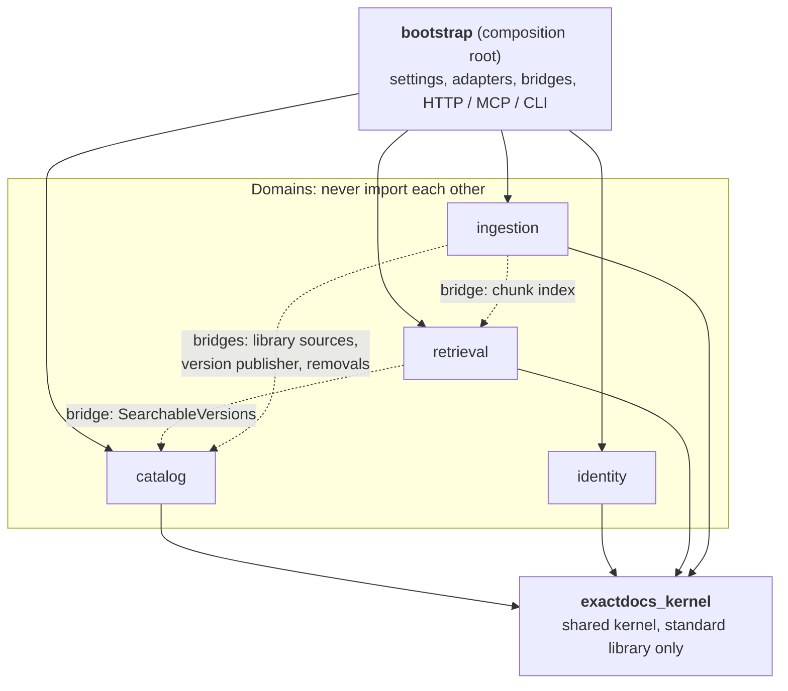
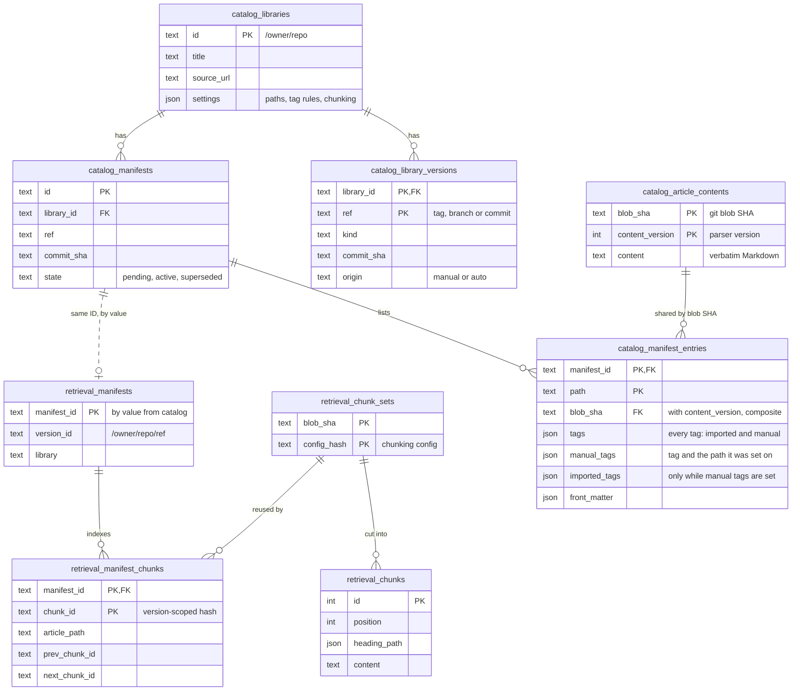
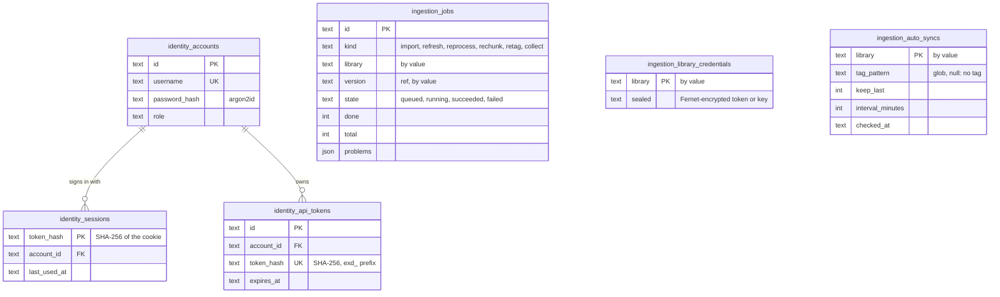
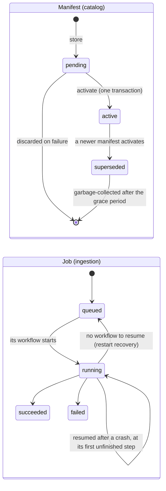
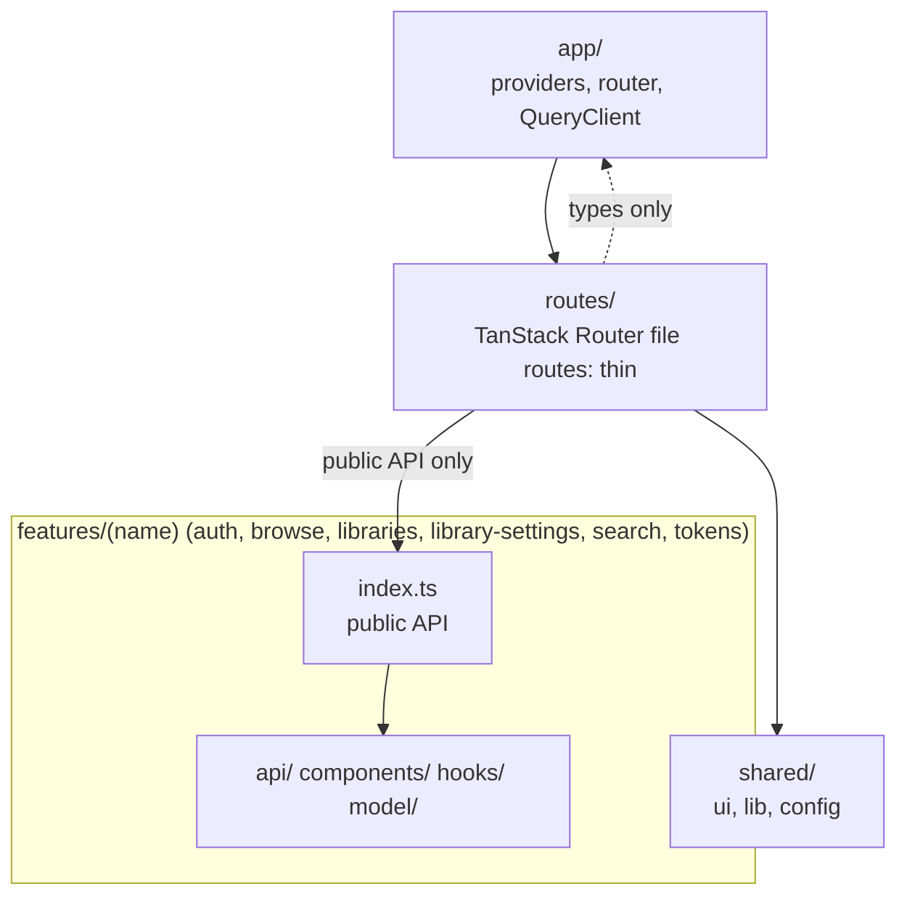

# Architecture

ExactDocs is a **modular monolith**: one deployable (one Docker image, one `uvx exactdocs`), split
into **domains** with hard boundaries. Inside every domain we follow **hexagonal architecture**
(ports & adapters) with the dependency rule of clean architecture. The React client mirrors the
same idea with **vertical slices**. All of this is enforced by tests, not by convention.

## Repository layout

| Path | What it is |
|---|---|
| `pyproject.toml` | uv workspace root: dev tools, ruff, ty, pytest and behave config, the `docs` group (Zensical) |
| `packages/exactdocs-kernel/` | shared kernel (`src/exactdocs_kernel/`), a separate, published package |
| `packages/exactdocs/` | the application, published as `exactdocs` (`src/exactdocs/`) |
| `packages/exactdocs/src/exactdocs/bootstrap/` | composition root: settings, container, bridges, migrations, HTTP / MCP / CLI entry points |
| `packages/exactdocs/src/exactdocs/catalog/` | domain: libraries, versions, manifests, article contents |
| `packages/exactdocs/src/exactdocs/identity/` | domain: the admin account, web sessions and API tokens |
| `packages/exactdocs/src/exactdocs/retrieval/` | domain: chunks, the BM25 index, `search_docs`, `query-docs`, `resolve-library-id` |
| `packages/exactdocs/src/exactdocs/ingestion/` | domain: jobs, the DBOS worker, git access, parsing, chunking and the import |
| `packages/exactdocs/src/exactdocs/_web/` | the built web UI (gitignored, added by CI / Docker) |
| `packages/exactdocs/tests/`, `packages/exactdocs/features/` | pytest (unit, integration, architecture) and behave (Gherkin acceptance scenarios) |
| `packages/exactdocs/evals/` | the retrieval eval suite (Pydantic Evals), not shipped; see [Retrieval evals](evals.md) |
| `web/` | React client (Vite, TanStack Router and Query, shadcn); see [web/README.md](https://github.com/SirCypkowskyy/ExactDocs/blob/develop/web/README.md) |
| `deploy/` | Dockerfile, smoke test, size-budget check, Mermaid check, self-hosted runner scripts |
| `e2e/` | the Playwright test of the whole loop in a browser |
| `docs/` | this site (Zensical) |

## Domains and what may import what



Solid arrows are imports; dotted arrows are runtime calls through a bridge that lives in
`bootstrap`, so the domains stay unaware of each other. `identity` needs no bridge.

| From \ may import | own domain | other domain | `bootstrap` | `exactdocs_kernel` |
|---|---|---|---|---|
| a domain | yes | **no** | **no** | yes |
| `bootstrap` | yes (any domain) | yes | yes | yes |
| `exactdocs_kernel` | - | **no** | **no** | yes |

**How domains talk to each other.** The consumer declares what it needs as a *driven port* in its
own vocabulary (`retrieval.ports.driven.SearchableVersions`). The composition root implements it with
a **bridge** that calls the provider's *driving port* (`bootstrap/bridges.py:CatalogSearchableVersions`
uses `catalog.ports.driving.GetActiveManifest` and `GetLibrary`). Neither domain knows the other exists, so a domain can
later move to its own package or service without touching the other.

### Bridges are one-way

Bridges point in one direction only: **retrieval → catalog** and **ingestion → catalog /
retrieval**. Catalog calls no other domain, and nothing calls ingestion, so the domain graph has
no cycles. An architecture test (`tests/architecture/test_bridge_direction.py`) reads the
imports of every bridge class in `bootstrap/bridges.py`: the consumer's `models` / `ports.driven`
on one side, the provider's `ports.driving` / `dtos` on the other, and only the edges above pass.

**Secrets every domain seals: one box, one port per domain.** The instance's secret box
(`bootstrap/secret_box.py:FernetSecretBox`: Fernet keyed from `EXACTDOCS_SECRET_KEY` with HKDF,
rotation through `EXACTDOCS_SECRET_KEY_PREVIOUS`, or a generated `secret.key` in the data
directory) lives in the composition root, not in a domain and not in the kernel (it needs
`cryptography`; the kernel uses the standard library only). A domain that stores a secret declares
its own small `SecretBox` driven port (`ingestion.ports.driven.SecretBox` today) and a driven adapter
takes it as a field (`SqliteCredentialVault(box=...)`). No domain imports `cryptography` (an
architecture test checks it), so none depends on another's adapter to seal a secret.

- **One key, one context per use.** Every box is built from the same secret key with a `purpose`:
  the HKDF `info` its Fernet key is derived for. `bootstrap/container.py` builds one box per use and
  passes it to that domain's adapter, so a text sealed for one use (a table, a domain) never opens
  in another. Ingestion's repository credentials use `CREDENTIALS_KEY_PURPOSE`
  (`b"exactdocs credentials v1"`, in `bootstrap/constants.py`), the context they were always
  sealed with: never change it, or every stored credential becomes unreadable. A new use takes a
  new context (`b"exactdocs <use> v1"`), and rotating the secret key covers every use at once.
- **A neutral error.** `open` raises `exactdocs_kernel.SealedTextUnreadableError` for a text of
  another key or purpose, or one that was altered. It is not a `DomainError` and never reaches a
  client: the adapter that opened the text translates it into its own domain's error (the
  credential vault: `CredentialsRequiredError`). The box imports no domain.

The kernel `NOTICE` constant (the untrusted-content notice every MCP result carries, see the
*MCP-07* story) is a reviewed kernel addition: it is shared text, not business logic, so it lives
in the kernel instead of being duplicated per domain.

**Why not a `shared` domain?** Everything shared ends up there. The kernel is a separate
*package* on purpose: adding to it is a visible, reviewed decision, it may only use the
standard library, and it cannot import the app. If two domains need the same *business*
concept, that is usually a missing domain, or a port plus a bridge.

**When to make a domain its own package.** When it gets its own release cadence, consumers
outside the app, or heavy dependencies (e.g. ML models for embeddings). Move
`src/exactdocs/<domain>` to `packages/exactdocs-<domain>/`; the structure stays the same.

## Inside a domain: the fixed module set

Every domain has exactly these modules. Each may start as a module (`models.py`) and grow into a
package (`models/__init__.py` + submodules) with the same name. No other top-level names.

| Module | Holds | May import |
|---|---|---|
| `constants.py` | every constant of the domain, `Final` and documented (or a `constants/` package) | kernel |
| `errors.py` | domain exceptions (subclasses of kernel errors) | kernel |
| `models.py` | entities, value objects: `@dataclass(frozen=True, slots=True, kw_only=True)`, `NewType` ids, pure logic | `errors`, kernel |
| `dtos.py` | boundary data: frozen Pydantic models (commands, queries, results) + `from_model` mappers | `models`, `errors` |
| `ports/driving.py` | **driving (primary) ports**: `Protocol`s for use cases the outside world calls | `dtos`, `models`, `errors` |
| `ports/driven.py` | **driven (secondary) ports**: `Protocol`s for what the domain needs (repositories, gateways, other domains) | `models`, `errors` |
| `use_cases.py` | one frozen dataclass per use case, `async __call__`, implements a driving port | all of the above |
| `module.py` | `<Domain>Module`: `build(**driven_adapters)` returns the wired driving ports | all of the above |
| `adapters/driving/` | `http.py` (FastAPI router factory), `mcp.py` (FastMCP tool registration), `cli.py` | `ports`, `dtos` (never `use_cases`/`module`) |
| `adapters/driven/` | `memory.py`, `sqlite.py`, `postgres.py`, `http_client.py`... implement driven ports | `ports`, `models` (never driving adapters) |
| `__init__.py` | public API for `bootstrap`: the `Module` | |

The core (`errors`, `models`, `dtos`, `ports`, `use_cases`, `module`) never imports FastAPI,
FastMCP, Starlette, uvicorn, httpx, SQLAlchemy or DBOS. `models` and `errors` don't import Pydantic
either. Frameworks live in adapters and `bootstrap`.

Naming follows Alistair Cockburn's own terms from *Hexagonal Architecture Explained* (2024):
**driving** / **driven** ports and adapters, rather than primary/secondary or inbound/outbound.

## Persistence: one data directory, one database

Everything ExactDocs stores lives in the **data directory**: `EXACTDOCS_DATA_DIR`, which the Docker
image sets to `/data`, else the platform user-data directory (so `uvx` and stdio MCP share it).
`bootstrap/database.py` creates it, refuses to start if it is not writable, and opens one SQLite
file in it (`EXACTDOCS_DATABASE_URL` overrides the path): SQLAlchemy **Core**, async, no ORM,
on aiosqlite, in WAL mode with a busy timeout and `foreign_keys=ON`. Next to it, DBOS keeps the
durable state of running jobs in `jobs.sqlite` (its own schema and migrations; see
[Background jobs](#background-jobs)): back up the data directory as a whole.

- **Each domain owns its tables**, prefixed with its name (`catalog_libraries`, `retrieval_...`).
  Foreign keys only between tables of the same domain; another domain's IDs are held by value
  and its tables are never read.
- **One Alembic history, owned by `bootstrap`** (`bootstrap/migrations/versions`), run on start
  (`Container.running()`) and reported by `/api/health` as `schema_revision`. A domain's
  revision is plain `op.create_table(...)`, not an import of the adapter's `Table` objects, so
  old revisions never change. Use `op.batch_alter_table` to change an existing table,
  `op.execute("CREATE VIRTUAL TABLE ... USING fts5(...)")` for FTS5. `migrate()` runs the
  revisions in one `BEGIN IMMEDIATE` transaction with `foreign_keys` off (a batch alteration
  recreates the table, and with the pragma on SQLite would cascade-delete the rows of tables
  that reference it) and fails, rolling back, if `PRAGMA foreign_key_check` finds a violation
  before the commit.
- **Version storage (catalog):** a version's articles are a **manifest** (`catalog_manifests`,
  `catalog_manifest_entries`: path, blob SHA, title, tags, front matter, size) over article
  content shared by git blob SHA (`catalog_article_contents`, stored once). A manifest is
  `pending` (invisible) until `ActivateManifest` flips it in one transaction: the previous
  manifest becomes `superseded`, this one `active` (a partial unique index allows one active
  manifest per version) and the version moves to the manifest's commit. Readers only ever see the
  active manifest. Other domains hold manifest IDs by value. Superseded manifests stay for a grace
  period, then `CollectGarbage` deletes them and the contents no manifest uses. `RemoveVersion` and
  `RemoveLibrary` delete a version's manifests at once (no grace: nothing serves them), and
  ingestion's `collect` job then runs each domain's collector, catalog first.
- **Manual tags (E4-06):** `catalog_manual_tags` holds the tags users set by hand per library and
  article path (`SetManualTags`). A manifest entry keeps `tags` as every tag of the article (what
  listings filter and count), `manual_tags` (each with the path it was set on, which is where it is
  changed), and `imported_tags` while it has manual ones, so removing
  them brings back exactly what the import gave. An entry gets the manual tags of its path and of every
  path the rename maps trace it back to, version by version (`ManualTagger`). Retrieval keeps a copy
  of the tags on each chunk row; ingestion's `TagArticle` (REST `PUT/DELETE .../tags?path=`) has the
  catalog re-tag the pending and active manifests and then the chunk rows (`RetagArticles`, an
  `UPDATE`, no re-chunking). An import applies them last (`ApplyManualTags`, then the chunk rows,
  then activation) under its library's lock (`TagLocks`, one object shared with `TagArticle`), so the
  older of two re-tags never lands last; one process runs jobs and serves the API.
- **Renames between versions (E3-12):** on import, `RenameSource.renames` (the system-`git`
  adapter) asks git which Markdown files (any letter case) moved between two commits. Which two
  (`previous_version`): a numeric tag (`v1.4.0`, `2.1`; `1.4` equals `1.4.0`) is compared with the
  highest lower numeric tag, never with itself, so a re-sync gives the same map. A branch or
  commit is compared with the commit the ref served before; its map **builds up** over syncs
  (`compose_renames`): earlier renames are kept, chained (A to B, then B to C gives A to C, the
  lower similarity) and dropped when their target is no longer an article. Pre-releases and other
  names have no order and get none. Old paths are filtered by the library's current selection.
  The previous version is the closest one imported *so far*, so an older tag imported later (add
  `v1.4.0`, then `v1.3.0`) is closer to the newer tags than what they were compared with: after
  its activation the import detects the map of each version whose previous version it now is
  again (git only, no re-chunking), replaces it (`ReplaceRenames`, which also re-tags the manifest
  from the new map) and copies the tags to the chunk rows, under the library's `TagLocks`. A map
  git cannot give leaves the newer version as it was; this never fails the older import. Every
  pending and active manifest of the library is then re-tagged, because a version after the newer
  one follows its map too (`v1.5.0` gets a tag through `v1.4.0`'s new map). Each import of a tag
  does this, a re-import too. A sync never re-imports a tag, so a map built in the wrong order
  before this existed (#216) is repaired by importing the older tag again: remove it and add it
  again, or re-import it when it moved (`versions/reimport`).
  The map (`from_ref`, old path, new path, similarity) is stored with the new version's manifest
  (`catalog_manifest_renames`, indexed both ways), so it is replaced, collected and removed with
  it. It is read through the `ResolveRenamedPath` port (forward: old to new; back: new to old),
  `ListRenames`, and REST `GET /libraries/{owner}/{repo}/renamed-path`. **One hop only:** a file
  moved over several versions is followed by asking once per version and chaining the answers (a
  version that was never imported breaks the chain). Detection never fails an import: any error
  means "no renames known" (a branch keeps its earlier map). Cost, measured on `fastapi/fastapi`
  0.100.0 to 0.115.0 (about 1,400 Markdown files, 12 renames, 4 of them exact): fetching the two
  trees (`--depth=1 --filter=blob:none`, no checkout) takes about 1 s and 250 KB, and
  `git diff-tree -M --diff-filter=R` over a case-insensitive `*.md`/`*.mdx` pathspec then fetches
  only the added and deleted Markdown files' blobs (about 1 MB, 1 s) to score renames with edits;
  exact renames need no blobs. Bounds: one fetch slot (the import has released its own first), a
  60 s deadline, the fetch size watchdog (which, with the deadline, bounds the download of a
  hostile repository), git's rename limit (400: above 400 x 400 added x deleted files the scoring
  is skipped and only exact renames are kept; it bounds CPU, not downloads), a 16 MiB cap on git's
  list and 10,000 renames kept.
- **Backup and restore (E10-06):** `bootstrap/backup.py`, behind the local `exactdocs backup` /
  `restore` commands. A backup is a gzipped tar: `manifest.json` (format, version, schema revision,
  a SHA-256 and size per member), the database copied with SQLite's online backup API in one step
  (one read transaction's view; WAL writers carry on), `jobs.sqlite` copied the same way *before* it
  (a resumed import may redo a step the database recorded, never skip one), `known_hosts`, and
  `secret.key` only on request. A restore reads only those member names, refuses a revision this
  build's Alembic history does not know, a data directory that holds any trace of an instance
  (database, `-wal`, `-shm`, `jobs.sqlite`), a member whose size differs from its manifest or does
  not fit in the free space, and any checksum mismatch, all before moving files into place; then
  `migrate()` brings an older schema to head. No domain is involved: it works on the files the
  bootstrap owns.
- **Search index format and `exactdocs reindex` (E10-04):** `retrieval_search_format` holds the
  format the FTS5 table was built in (`FORMAT` in `retrieval.adapters.driven.sqlite_fts`), read
  through the `SearchIndexMaintenance` port (`GetSearchIndexState`, `RebuildSearchIndex`). A
  change to how entries are made from chunks bumps `FORMAT`; the old index keeps answering, and
  `/api/health` reports `reindex_required` until the operator runs `exactdocs reindex` (local).
  The rebuild fills `retrieval_search_next` from `retrieval_chunks`, 500 chunks per write
  transaction (readers never wait in WAL mode), with a trigger that removes chunks deleted
  meanwhile; then one `BEGIN IMMEDIATE` transaction adds what was indexed since it began, drops the
  old table and renames the new one over it. A rebuild that died leaves its table behind; the next
  one starts over. A change of the table's columns stays an Alembic revision that rebuilds it on
  start (as `a91c4e7b3d02` did). See *Upgrades* in [Releasing](releasing.md).
- **Adding a table:** `just migration "add jobs table"`, fill in `upgrade()`/`downgrade()`, set
  `down_revision` to the current head if you rebased over another revision (a test fails if the
  history ever has two heads), then write the adapter.
- **Adapters** live in `adapters/driven/sqlite.py`, take the `AsyncEngine` and describe their
  tables with Core `Table` objects (`catalog.adapters.driven.sqlite` is the reference). They run
  in the same adapter contract test as the in-memory adapter. SQLAlchemy, Alembic and aiosqlite
  are imported only by driven adapters and `bootstrap` (architecture test).
- Tests build a container on an empty temporary data directory (`tests/conftest.py` points
  `EXACTDOCS_DATA_DIR` at one for every test) and seed data through the repository, so the
  catalog starts empty in production.

### Data model

Tables as created by the migrations in `bootstrap/migrations/versions`; the columns shown are the
ones that carry the design. A solid line is a real foreign key (same domain). A dotted line is an
ID held **by value**, which the database does not enforce.





Two derived facts worth knowing: a **chunk ID** is a hash of version, article path, heading path,
occurrence and content, so the same section keeps its ID when a branch moves but another version
of the same blob gets another one; and `retrieval_chunks` is keyed by *(blob SHA, chunking
config)*, so a blob shared by many versions is chunked once.

A manifest and a job each move through a small set of states:



## Identity: accounts and the setup guard

`identity` owns accounts (`identity_accounts`: username, password hash, `role`, created time).
Passwords are hashed by the `PasswordHasher` driven port; its adapter is **argon2id**
(`argon2-cffi`, RFC 9106 low-memory profile: 64 MiB, 3 passes), run in a thread, with `verify`
constant-time, and at most 4 at a time (more calls queue; a dropped request keeps its slot
until its thread is done). The use cases take the password as a `SecretStr`, an unknown username costs one
hash like a real check, and wrong password and unknown user raise the same error.

`AuthenticateUseCase` is the one place a password is checked, so the session sign-in and the
CLI's token login share its throttle. Attempts are counted per client address (IPv6 per /64)
and per username in the `FailedSignInLog` driven port (`FailedSignIns` in `models.py` holds the
free count and the doubling wait). `FailedSignInLog.charge` checks the wait and counts the
attempt in one atomic step, before the hash, so concurrent attempts cannot all pass the check;
an attempt that must wait raises `SignInThrottledError` (kernel `RateLimitedError`, 429 with
`Retry-After`) without a hash and without being counted. A right password refunds its attempt
on the address (putting back the earlier `last_at` when no later attempt came, so the wait is
not restarted), clears the username's count and is remembered as a known (username, address)
pair for 30 days; from a known address, the username's count does not apply. The adapter is
in-process memory, bounded to 10,000 counts and 10,000 pairs, and evicts counts that hold no
one back first; several processes (TEAM-01) would each count their own, and a shared adapter
must make `charge` atomic too.

`AccountRepository.add_first` stores an account only while the table is empty, in one atomic
statement under `BEGIN IMMEDIATE`, so two concurrent setups (or `exactdocs admin create` next to
the running server) can never create two admins. `bootstrap/rest.py:SetupGuard` answers
`403 setup_required` for everything under `/api/v1` until an account exists (default deny; the
exemptions are `POST /setup`, `GET /session` and `openapi.json`) and stops asking the database
once one does.

### Sessions

`POST /api/v1/session` starts a server-side session (`identity_sessions`): a 256-bit random token
goes to the browser in an HttpOnly, SameSite=Lax cookie (`Path=/api`, `Secure` over HTTPS), and
only its SHA-256 is stored, so a leaked database holds no usable token. A session ends after
7 days without use or 30 days in all (`models.IDLE_TIMEOUT`/`ABSOLUTE_TIMEOUT`, checked against the
kernel `Clock`); using it writes `last_used_at` at most once an hour. Signing out deletes the row,
so a copied cookie dies too, and `exactdocs admin reset-password` changes the hash first and then
deletes all the account's sessions. CSRF: SameSite=Lax plus the app-wide `OriginCheck` (foreign
`Origin` on an unsafe request is 403).

"Who is the caller" is one dependency, `identity.adapters.driving.http.build_current_caller`,
applied to the whole protected router in `bootstrap/http.py`; new domain routers go there, and
the open ones are pinned by a test. It accepts a bearer API token or the session cookie (any
`Authorization` header is judged on its own, never rescued by a cookie). `/mcp` never reads the
cookie: it is guarded by `identity.adapters.driving.mcp.ApiTokenVerifier` (a FastMCP `TokenVerifier` over the
`IdentifyToken` port), so the token acts as its account. Tokens (`ApiToken`, `identity_api_tokens`)
are `exd_` plus 256 random bits, stored as SHA-256, with an optional expiry; stdio MCP is not
authenticated: it runs on `ReadOnlyContainer` (database opened `mode=ro` + `query_only`, no identity,
worker or migration). Read-side wiring lives in `_build_read_side` in `bootstrap/container.py`;
anything new on the read path goes there so stdio inherits it.

## Background jobs

Long tasks (imports, syncs, GC) are **jobs** of the `ingestion` domain, never work done inside a
request. A `Job` has a kind, a library (and optionally a version), a state (`queued`, `running`,
`succeeded`, `failed`), `done`/`total` files, per-file problems (path, reason), an error and
timestamps; `GET /api/v1/jobs/{id}` and `GET /api/v1/libraries/{owner}/{repo}/jobs` read them.

- **Kinds** today: `import` (a version's first import), `refresh` (a re-sync of a branch version that moved, or the confirmed re-import of a moved tag, which reuses unchanged chunks and fails with `not_found` if the version was removed meanwhile), `reprocess` (every version of a library re-imported at its commit after its paths were edited; `version` is null), `rechunk` (every version cut again from its stored text after its chunking was edited, see below), `retag` (every version re-tagged from its stored articles after only its tag rules were edited: the catalog switches each version in one transaction and the search index's tag copies follow right after, as for manual tags) and `collect` (frees content nothing uses after a removal). **They are registered, not hard-coded.** `IngestionModule.build(handlers=..., recovery_hooks=...)`
  maps a kind to the `JobHandler` that runs it and, optionally, a `RecoveryHook`. Handlers report
  through a `JobProgress` port; every report is stored at once. Raising fails the job: a domain
  error's message is shown to users, anything else only as `unexpected <ErrorType>` (details go
  to the log).
- **The worker is DBOS** (durable workflows; `ingestion/adapters/driving/dbos_worker.py`),
  started in the app lifespan (`Container.running()`). Every job is one DBOS workflow whose ID is
  the job's ID and whose body is the `RunJob` driving port. `EnqueueJob` stores the job, then
  hands it to the `JobRunner` driven port (`adapters/driven/dbos.py` queues the workflow by
  name). The queue runs two jobs at once and one per library: the library is its partition key.
  DBOS keeps its workflows and their steps in its own SQLite file, `<data dir>/jobs.sqlite`; the
  `ingestion_jobs` table stays what the API reads. DBOS is imported only by ingestion's adapters
  and `bootstrap` (architecture test).
- **Durable steps.** A handler marks its steps with the `Checkpoints` driven port
  (`step(name, run)`, DBOS steps in production, `InMemoryCheckpoints` in tests): a completed
  step's result is stored, and a resumed job gets it back without running the step again. A
  handler must take the same steps in the same order on every run and keep each step safe to run
  twice. `STEPS_VERSION` (the DBOS application version) changes when a job's steps do; a
  workflow of another version is not resumed, its job starts over.
- **Restart.** Stopping the app lets running jobs finish for a second, then cancels them: the job
  stays `running` and its workflow pending. A process killed outright (`kill -9`, OOM, a deploy)
  leaves the same state. On the next start DBOS resumes the pending workflows: `RunJob` finds the
  job `running`, runs its kind's recovery hook (the import's discards a pending manifest the
  interrupted step may have left), resets its progress and runs the handler, whose completed
  steps are replayed from the stored results. Every other unfinished job (`RecoverJobs`: a job
  `running` without a workflow, e.g. one the in-process worker of an earlier release left behind,
  or queued while no worker ran) gets its hook, is queued again from the beginning and submitted.
  Workflows that ended, or of another `STEPS_VERSION`, are deleted at start; a job's workflow is
  deleted when it ends (its steps hold the whole text of an import). A hook that raises fails its
  job instead of blocking the start.
- **Polling.** DBOS looks for a queued job to start every `EXACTDOCS_JOB_POLL_SECONDS` (1 s), so
  an idle server costs next to nothing; a job starts within about that long. Every 30 s the
  worker hands the queued jobs to DBOS again (`SubmitQueuedJobs`; queuing an ID it already has is
  a no-op), so a job DBOS did not take when it was queued still runs without a restart. The test
  suites lower the interval.
- **DBOS's own environment.** DBOS reads `DBOS__CLOUD`, `DBOS__VMID` and `DBOS__APPVERSION` from
  the environment. Leave them unset: `DBOS__CLOUD=true` turns its local recovery off (jobs would
  no longer resume), and the other two change the executor and the version that recovery
  matches. ExactDocs sets the version itself (`STEPS_VERSION`), opens no DBOS Conductor
  connection (no key is configured) and keeps DBOS's logs at warnings.
- **One process runs jobs.** Only the HTTP server starts the worker (`serve --stdio`, `reindex`
  and the account commands do not), and DBOS allows one worker per process. Two servers on one
  data directory would both resume the same workflows; that needs DBOS executor IDs per process
  first. Manual tags rest on it too: `TagArticle` and an import's activation take turns
  through a per-library `asyncio.Lock` (`TagLocks`), which only orders one process's writes; with
  two, an older re-tag could land last in the chunk copies. So `serve` pins uvicorn to one worker
  (`workers=1`, whatever `WEB_CONCURRENCY` says).
- **The scheduled check (SYNC-02).** The worker also keeps a DBOS schedule
  (`exactdocs-scheduled-checks`, `EXACTDOCS_AUTO_SYNC_SCHEDULE`, a cron expression with seconds,
  every minute by default) whose workflow runs `RunScheduledChecks` outside its own workflow
  context (the jobs it queues are workflows of their own) and is deleted when it ends. The tick
  only wakes it up: the kernel `Clock` decides which libraries are due, from each one's
  `AutoSync` (`ingestion_auto_syncs`: tag pattern, `keep_last`, `interval_minutes`,
  `sync_branches`, when it was last checked and what failed, and a `revision` each save
  changes). `plan_auto_imports` is the pure rule: it imports the matching ordered tags among the
  newest `keep_last` of (those tags plus the `auto` versions), and removes only the `auto`
  versions outside the newest `keep_last` *versions*, so an old one goes after its replacement
  is imported; manual versions and the pinned default never count. Only a permanent import
  failure (`PERMANENT_IMPORT_FAILURES`: `no_articles`, `import_too_large`) holds a tag back
  until it moves; repeated `unexpected` failures at one commit back off (2^(n-1) - 1 more
  intervals after the n-th, at most a day), and anything else is tried at the next check. The schedule is paused
  while no library has one (`ScheduleSwitch`, `DbosScheduleSwitch` pauses or resumes it by
  name; the worker sets it from the stored schedules at start), so an idle server writes no
  tick workflow. A version's `origin` (`manual`/`auto`) travels from the job through the import's
  `StoreManifest` to `catalog_manifests.origin`, and the activation that creates the version
  gives it that origin (`catalog_library_versions.origin`); later imports never change it. A
  tick that meets one still running does nothing, and a check is recorded by a compare-and-set
  on the `revision` and `checked_at` it read (`AutoSyncStore.record_check`), so a save made
  meanwhile is kept. With both a pattern and `sync_branches`, the refs are listed once.
- `RunNextJob` (claim the oldest queued job whose library has none running, in one atomic
  statement, and run it inline) remains for tests that drive jobs one at a time.

### The import: a complete version or nothing

The `import` kind is `ImportVersionUseCase` (built by `ingestion.import_job`, which also returns
its recovery hook). It imports the commit the job was pinned to: fetch, read and parse every
selected file, tag, chunk, then **store** the articles as a pending catalog manifest, **index**
their chunks in retrieval and **activate** the manifest. Readers see the previous state until
that last step, which is one transaction in the catalog.

- **Steps (resumable, E3-11).** The import is a sequence of durable steps: read the library's
  chunking settings (so a resumed import cuts and labels its chunks with the config its first run
  read, even if they were edited in between, `STEPS_VERSION` `jobs-4`); list the selected
  files; parse and chunk them `EXACTDOCS_IMPORT_BATCH_FILES` (100) at a time; read the README and
  the images; fetch the images outside the selection; detect renames; publish (store, index,
  activate). What follows the publish (renewing a newer version's rename map, #216, and the
  README/`context7.json` text) is no step: it never fails the import, works on what is imported
  now and replaces whole maps, so a run killed there simply does it again. A killed import resumes at its first unfinished step: an import killed after 120 of
  200 files (batches of 20) parses and chunks files 121 to 200 only, and the version has each
  article once. A step's result carries everything later steps and the job's progress depend on
  (articles with their chunks, problems, bytes used), so a replay rebuilds the job as the first
  run left it. The commit is fetched only when a step needs its files: a resume with only
  publishing left fetches nothing. Each step reads the pinned commit, and what publishing writes is
  keyed by content (contents by blob SHA and parser version, chunk sets by blob SHA and chunking
  config) or replaced as a whole (a new pending manifest), so running a step twice changes
  nothing a reader sees. Each image is kept by the one step that read it. The results stay in
  `jobs.sqlite` only while the job runs: at the peak about 3x the version's text on disk (the
  text, its chunks, pickled and base64-encoded by DBOS), plus its images. The workflow is deleted
  when the job ends and the file is compacted (`VACUUM`) once no workflow is left in it, so it
  does not keep that size.
- **Steps of `reprocess`, `rechunk` and `retag`** (#61, #67, `STEPS_VERSION` `jobs-2`, then
  `jobs-4`): first the library's
  versions (so a resumed job takes the same ones in the same order, even if one was added
  meanwhile), then **one step per version**: `re-import <ref>` runs the refresh import inside it
  without steps of its own, `re-chunk <ref>` the version's re-chunk, `re-tag <ref>` its re-tag. The import's own steps are not
  used there: it reads the library and its credential before its first step, so a version that
  failed there and succeeded on a resume would take steps another version recorded. A version's
  result (files, chunk counters, problems, its failure) rebuilds the job's progress on a replay.
  A version killed halfway starts over (the recovery hook discards its pending manifest; a re-tag
  is safe to redo); the versions finished before are not done again, nor is a recorded failure
  retried by that job.
- **Per-library chunking (E4-05).** A library's settings hold its chunking (`split_level`,
  `min_chars`, `max_chars`, `chunker`; `ChunkingConfig`), and `Chunker.configured(config)` gives
  the chunker an import cuts with; the config hash keys its chunk sets (the default config keeps
  the hash it had before the sizes existed). Editing it queues a `rechunk` job: per version, the
  catalog's `CopyManifest` copies the active manifest into a pending one in one transaction
  (entries with their tags, images, renames; `INSERT ... SELECT`) and returns the stored text;
  ingestion re-derives the imported tags (`SetImportedTags` on the copy), takes the chunk sets
  retrieval already has for the new hash (`GetChunkSets`), cuts the other blobs, indexes the copy
  and activates it like an import (manual tags last, under the tag lock). Nothing is fetched:
  the stored text is what the parser gave, and whether its front matter was malformed is
  recovered from it and the blob SHA (`CopiedArticle.parsed`: the file was exactly that text).
  When they cannot tell (a front matter that loaded to nothing, then a block YAML refuses; or
  invisible characters the parser stripped), the version is re-imported at its commit instead
  (#228), so a re-chunk never cuts a blob differently from its import. The cost: a version
  holding such a file is fetched again by every re-chunk to a config its blob has no chunk set
  for yet, and that re-chunk fails while the repository is unreachable. Recording at import
  whether the front matter was malformed (with the manifest entry) would remove this; that is
  a possible follow-up. A version whose text was stored by another parser
  version (`content_version`) is refused by the copy and re-imported at its commit instead: a
  chunk set keyed with the current parser must not be cut from older text. The copy is pending,
  so readers keep the old chunks until the activation; the recovery hook discards it after a
  crash. `reprocess` re-imports with the new chunking too, and `rechunk` re-tags, so one job of
  the widest kind needed is queued.
- **Undo.** Any failure after the store (an exception or a cancellation) discards the pending
  chunks and then the pending manifest. The order matters: retrieval asks the catalog and only
  removes a manifest it is told is still pending. After a crash the recovery hook does the same
  for the library's pending data before the job resumes or runs again (a library has one running
  job).
- **Heading records (#251).** Each chunk records every heading it holds, in order (heading path,
  anchor, whether it starts the chunk), so `article_outline` lists headings a chunking config
  merged into one chunk. They are stored with the chunk set (`retrieval_chunks.headings`, NULL for
  chunks stored before) and travel back through `GetChunkSets`, but are not part of the set's
  digest (a set stored without them and one cut again with them share a key; the first write
  wins). A config that cannot merge headings (split level h6 and no `min_chars`; `max_chars` only
  cuts whole sections) keeps its hash; the others' hash names `MERGED_HEADINGS_VERSION`, so their
  chunk sets are cut again, with the records, when a version is imported at a new commit (a
  re-sync of an unmoved version re-cuts nothing) or when the library's chunking is changed, which
  queues a `rechunk` of every version. Until then their outlines list each chunk's first heading.
- **Reuse.** Content is keyed by git blob SHA and the parser version, chunk sets by blob SHA and
  the chunking config, so a blob that an earlier import chunked is not chunked again. The
  stored chunks are read back through retrieval's `GetChunkSets`. Parsing is skipped too (#164)
  for a file some manifest of the library holds at the same path, blob SHA and parser version
  (`FindStoredArticles`): the title and the image links depend on the path, the rest on the bytes
  and the parser. The version's own active manifest is looked in first (by primary key), then the
  library's other manifests, one probe per file through the blob-SHA index, so the lookup stays
  far cheaper than the parse whatever the size of the catalog. Title, front matter and text are taken as stored; the tags are derived again
  from the stored front matter and the library's rules now, the image links from the text. Whether
  a text that starts with a `---` block was malformed front matter (kept in the text, with a
  note to list again) is told from the blob SHA (`stored_front_matter_problems`, shared with the
  re-chunk); a text it cannot tell (a front matter that loaded to nothing before a block YAML
  refuses, or invisible characters the parser stripped, #228) is parsed anyway. Importing a commit again changes nothing a reader can
  see.
- **Memory.** The selected text is held in memory until stored, and again as chunks, as DTOs in
  the bridges and as SQL parameters: several times over, and the worker runs two jobs at once
  (a resumed import loads its stored steps back into memory the same way).
  `EXACTDOCS_MAX_IMPORT_BYTES` (256 MiB) bounds the text an import takes; above it the import
  fails with `import_too_large` instead of the process being killed. The CPU-heavy part of
  storing and indexing (DTO validation, sorting, chunk-ID hashing) runs in a thread so the event
  loop keeps serving requests. Progress is stored every 100 files or 250 ms, and at the end.
- **Images.** Articles' relative `` images are collected at parse time (resolved against
  the article's folder, as the web renderer does; absolute URLs, `data:` and paths leaving the
  repository are ignored). The first checkout already holds those inside the selected paths; the
  rest come from a second, literal-path `GitGateway.fetch_files` (glob characters escaped, no
  README, its own download limit). Each image is read like an article (plain file, never a
  symlink), at most `EXACTDOCS_MAX_IMAGE_BYTES` (2 MiB), and its type is **sniffed from the
  bytes**: PNG, JPEG, GIF, WebP or SVG, anything else is `not_an_image`. A version keeps at most
  1000 images and `EXACTDOCS_MAX_IMAGES_BYTES` (64 MiB); the rest, and images the repository
  lacks, are listed as skipped problems of the job and never fail it. The catalog stores each
  blob once (`catalog_image_blobs`, keyed by git blob SHA) and lists them per manifest
  (`catalog_manifest_images`), so they are activated, superseded, removed and collected (#45)
  together with the articles. Served by `GET /api/v1/libraries/{owner}/{repo}/asset?ref=&path=`
  (signed-in callers only, like every `/api/v1` route; no `ref` means the default version) with
  the stored type, `X-Content-Type-Options: nosniff`, `Cache-Control: private, no-cache` and
  `ETag` = blob SHA (`If-None-Match` answers 304), and `Content-Security-Policy: default-src
  'none'; style-src 'unsafe-inline'; sandbox`. **SVG** is served, not rasterized or refused (it
  is what diagrams are made of): in an `` a browser runs no script and loads nothing, and
  opened directly it is an attachment under that CSP, so a hostile SVG can neither run nor
  phone home. SVGs declaring entities are refused. Not stored: images in raw HTML, MDX
  components or front matter.
- **Relative links and images in the UI.** A link to `.md`/`.mdx` stays in the app (same
  version, resolved path, same `#anchor`); any other repository file opens on the host's blob page
  at the commit; a link to an article the import left out lands on "Not in this version", which
  offers the same file on the host. An image loads from `/asset` first (public and private
  libraries alike); if that fails (404: a version imported before #64, or an image skipped as too
  large), a **public** library falls back to the host's raw URL at the commit, and a private one,
  or a failed fallback, shows the alt text. Images are `loading="lazy" decoding="async"`; their size
  is not stored, so CSS bounds them (`max-width: 100%`) and no `width`/`height` is set. A path the
  version does not have is first looked up in the version's renames (`renamed-path`, forward,
  one hop, short timeout, no retry): an article git saw moved when the version was imported opens
  at its new path, same version and `#anchor`. The URL is replaced, so Back skips the old path,
  and a "Moved from" line above the article (carried in history state) names it. No rename, or a
  failed lookup, keeps the "Not in this version" page.
- **Kind of ref.** `AddLibrary` records on the job whether the version is a tag, a branch or a
  bare commit, so the import never asks the remote again; a deleted tag does not break it.
- **Replays.** A crash right after the activation commits, before the publish step's result is
  stored, publishes again on resume: storing the same commit again activates an equal manifest,
  so nothing a reader sees changes.
- **Files.** Only regular files are read (a symlink could point out of the checkout), none over
  `EXACTDOCS_MAX_ARTICLE_BYTES` (2 MiB), and only valid UTF-8. A skipped file (also an
  unreadable one or one with a file name that is not UTF-8) is recorded as a job problem (the
  first 1000) and counted as processed. A folder that cannot be listed fails the import. `done`/`total` count the selected files.
- **Bridges** (`bootstrap/bridges.py`): `CatalogLibrarySources`, `CatalogVersionPublisher`
  (`StoreManifest`, `ActivateManifest`, `DiscardPendingManifests`), `CatalogVersionCopier`
  (`CopyManifest`) and `RetrievalChunkIndex` (`IndexManifest`, `GetChunkSets`,
  `DiscardPendingChunks`).

## Telemetry

Off by default, and then nothing is set up: only the OpenTelemetry *API* is imported (FastAPI,
FastMCP and DBOS use it too), which records nothing without an SDK. With `EXACTDOCS_TELEMETRY=otlp`
or `EXACTDOCS_METRICS`, `bootstrap/telemetry.py:start_telemetry` (called by `create_app` and
`serve --stdio`) loads `bootstrap/otel_sdk.py`, which sets up the plain OpenTelemetry SDK: for OTLP, a
tracer and a meter provider exporting over OTLP/HTTP to the collector the `OTEL_EXPORTER_OTLP_*`
variables name, never to the console; for metrics, a Prometheus reader on the meter provider.
A process's providers are set once and cannot be replaced, so each test that turns telemetry on runs in a process of its own. (The Telemetry decision named Logfire as the SDK; it
was dropped in #87: its pydantic plugin loaded into every process, crashed on a malformed
`pyproject.toml` in the working directory and could export validated input, and the image had no
room for its 9 MB.)

- **Requests:** FastAPI's built-in OpenTelemetry (`FastAPI(telemetry=...)`, not
  `instrument_fastapi`, which records request arguments), with the health checks excluded and
  `auto_configure` off.
- **Scrubbing:** unless the operator opted in to query text, spans pass `ScrubbingExporter` on
  their way out: the query-text values in `url.query` become `REDACTED`, and exception events and
  error statuses lose their message and stack trace (a pydantic `ValidationError` quotes its
  `input_value`), keeping the exception type; FastMCP's `enduser.id` and `enduser.scope` (who
  called) are dropped. Health and readiness probes (`PROBE_PATHS`) get no request span.
- **Search:** retrieval declares a driven port, `SearchTracer`: each search use case opens a span
  for the search and one per stage (`version`, `rank`, `chunks`), in its mode. The query text is a
  separate argument, so the adapter (`adapters/driven/opentelemetry.py`) can leave it out. Without
  a tracer the use cases get `UntracedSearches`, which records nothing.
- **Jobs:** bootstrap wraps every job handler in `TracedJobHandler` (`ingestion.<kind>` spans);
  ingestion's code is unchanged. MCP tool calls get FastMCP's own spans.
- **Metrics:** the same adapters time what they span: `OpenTelemetrySearchTracer` records
  `exactdocs.search.duration` (by search, stage and mode) and `TracedJobHandler`
  `exactdocs.job.duration` (by job kind); FastAPI records the request metrics. Their attributes are
  bounded and anonymous: never the query, library, version or caller, so no opt-in changes them.
  Both adapters are wired when either `EXACTDOCS_TELEMETRY=otlp` or `EXACTDOCS_METRICS` is on.
- **Prometheus:** with `EXACTDOCS_METRICS`, `start_telemetry(..., scraped=True)` (from
  `create_app`; stdio MCP has no HTTP to serve it) adds a `PrometheusMetricReader` to the meter
  provider, beside the OTLP reader when that is on too, and `create_app` mounts `GET /metrics`
  (`build_metrics_router`), which renders `prometheus_client`'s default registry (chosen for its
  process and runtime collectors). It sits behind the Host check and takes no account sign-in
  (Prometheus has none; the metrics hold nothing user-specific); `EXACTDOCS_METRICS_TOKEN`, when
  set, makes it require that bearer token (`hmac.compare_digest`, 401 otherwise). The reader
  sends nothing. Scrapes, like the probes, get no request span or metric
  (`UNTRACED_PATHS`). Off, the route does not exist and `prometheus_client` is not imported. Any
  library that records through OpenTelemetry's global meter (pydantic-ai's
  `gen_ai.client.token.usage`, once the AI modes exist) shows up without more wiring.

## AI retrieval (planned)

Mostly not built yet; decided in [AI retrieval decisions](decisions/ai-retrieval.md) (#240) for the
*Next: AI retrieval* milestone. Built: **mode selection** (#89) and **provider profiles** (#241).

**Profiles and roles (#241).** Retrieval's models hold a `ProviderProfile` (a named endpoint with a
`kind`, validated per kind, never a plaintext key: a stored key is sealed, a file is named, an
environment key stays in bootstrap), `InstanceRoles` and a library's `LibraryAi` overrides
(AI on or off, its own `llm`/`judge`/`reranker`; never the embedding), and `bind_role` resolves
which `<profile>:<model>` a role uses for a library (the library's, else the instance's; the judge
else the LLM). `AiProviders` (in `use_cases`) puts the configured profiles (read-only, injected by
bootstrap from `EXACTDOCS_AI__...` and the `EXACTDOCS_CONFIG_FILE` TOML) in front of the
`ProviderProfiles` port (`retrieval_ai_providers`, managed over REST) and implements `ModelRoles`
(`ProfileModelRoles`): a role counts when it resolves to an existing profile, and a library with
AI off has none. Keys sent over REST go through retrieval's `SecretBox` port, which bootstrap
fills with the Fernet box under its own HKDF purpose (`AI_KEYS_PURPOSE`). The `ModelFactory` port
(`unsupported`, `chat_model`, `embedder`, `reranker`, `check`) is implemented in bootstrap by
`ai_models.PydanticAiModels`, which imports no SDK itself: the first call loads `ai_sdk.py`
(pydantic-ai, the OpenAI, Anthropic and Google SDKs, azure-identity) and builds every client with
explicit values. Each profile has one `httpx2` client (proxy on the transport, `trust_env=False`,
extra headers, no transport retries so the SDK's are the one layer, an overall timeout, and a
request hook that refuses any host but the profile's endpoint and drops `OpenAI-Organization` /
`OpenAI-Project` filled from the environment), rebuilt when the profile changes. `AiProviders.
model_for(role, library)` is the path every AI pipeline takes, so a profile edited over REST counts
at the next call. `exactdocs ai check` and `POST /api/v1/ai/providers/{name}/check` make one minimal
call per role. The socket-guard test (`tests/bootstrap/test_ai_no_outbound.py`) runs with the SDKs'
variables pointing at a trap.

**Mode selection (#89).** Each mode is a `RetrievalPipeline`
driven port (`run(PipelineRequest) -> PipelineAnswer`: one exact version in, hits and the mode that
really answered out, with a `fallback_reason` when a cheaper one did). `RetrievalModule.build`
registers `Bm25Pipeline` and any further pipelines it is given; `RetrievalModes` (in `use_cases`)
asks the `ModelRoles` port which roles the searched library may use (per library: one with AI off
has none), builds a `ModeRegistry` (a mode can run when it
has a pipeline and its roles), and picks the mode: the call's, else the library's (`LibraryModes`
port, `retrieval_library_settings`), else the instance's (`EXACTDOCS_AI__MODE`), else the best.
Removing a library drops its mode too (`ForgetLibrary`, called by the removal bridge after the
catalog). Later modes plug in as pipelines; their models come through the ports below. The `[ai]`
extra is declared and installed for development; the model-free test proves none of it is imported.
How the rest fits the structure above:

- **All in `retrieval`.** New driven ports: `Embeddings`, `Reranker`, `VectorIndex`, a spend store
  shaped like the harness `SpendStore` protocol, and ports for the HyDE writer, the judge and the
  agent explorer. Their adapters (pydantic-ai, fastembed, sqlite-vec, pgvector) live in
  `retrieval/adapters/driven/`, and the architecture test lists those libraries among the ones
  the core may not import. No new domain: every consumer is retrieval.
- **Wiring.** Bootstrap turns the configured provider profiles into pydantic-ai models and HTTP
  clients, and imports any of it only when a role is configured; with nothing configured the
  `exactdocs[ai]` and `exactdocs[local]` extras are never imported (the model-free test).
  Bootstrap implements retrieval's `ModelFactory` port (a resolved provider profile in, a callable
  model, embedder or reranker out), always with explicit URLs and keys, never the SDKs'
  environment variables. Retrieval declares its own secret-box port; the Fernet adapter that seals
  repository credentials moves from ingestion to `bootstrap` first (#248), so no domain depends
  on another's adapter.
- **Storage.** `retrieval_embedding_spaces` records each (model, dimensions, input format); its
  vectors sit in one adapter-managed table per space, keyed by `retrieval_chunks` row, searched
  exactly within the active manifest (sqlite-vec on SQLite, pgvector on PostgreSQL and Supabase).
- **Jobs.** Embedding runs are an `embed` ingestion job kind with resumable steps, reaching
  retrieval through a bridge, like indexing.
- **PostgreSQL** (#103) arrives with this milestone: psycopg 3, DBOS's tables in the same database
  (`system_database_url` plus `dbos_system_schema`), a per-library advisory lock replacing `TagLocks`, and a third search adapter
  (PostgreSQL full-text search) for databases without `pg_search`, such as Supabase.

## Python conventions

- **`Protocol`, not ABC.** Ports are structural. Adapters and use cases never inherit from them;
  `ty` checks conformance where they are wired (`CatalogModule.build(repository=...)`).
  Importing `abc.ABC` is banned by ruff. The only inheritance in the codebase is exceptions.
- **Immutable by default.** `@dataclass(frozen=True, slots=True, kw_only=True)` for entities,
  value objects, use cases, modules and adapters; `ConfigDict(frozen=True, extra="forbid")` for
  DTOs. A dataclass that cannot follow it says why on its decorator line, with a non-empty reason:
  `# conventions: allow-mutable-dataclass -- <reason>` (no `frozen`), `allow-positional` (no
  `kw_only`, e.g. a one-field value object built like a conversion, Starlette middleware) or
  `allow-dict` (no `slots`); several are comma-separated.
- **Constants in `constants.py`.** A module-level constant (an `UPPER_CASE` name, or anything
  `Final`) lives only in its package's `constants.py`, or in a `constants/` package whose
  `__init__.py` re-exports the public ones from private topic modules (`constants/_git.py`, see
  `ingestion`). Each is typed `Final[<type>]` and followed by an attribute docstring:

  ```python
  SESSION_IDLE: Final[timedelta] = timedelta(days=7)
  """Idle time after which a web session expires."""
  ```

  `constants` is a domain's innermost layer: it imports only the kernel and the standard library,
  so a value that needs a domain type is keyed by the enum's values (`"queued"`, not
  `JobState.QUEUED`) or becomes a method. Module-level framework objects (SQLAlchemy tables and
  clauses, a `TypeAdapter`, a parser, a lock) are not constants: they stay with the adapter that
  uses them and are named in lower case. Lower case is reserved for such objects: a fixed value
  (a number, a string, a pattern, a set or mapping of literals) is a constant whatever its name,
  and the checker only sees it when it is `UPPER_CASE` or `Final`, so write it that way. Enum
  members and `__all__` are not constants. A chained assignment (`A = B = 1`) and an assignment in
  a module-level `if`/`try`/`with` block define constants too.
- **Private by default.** A module, function, class or constant that is not part of its package's
  public API is private (`_name`); what other packages use is re-exported by the package's
  `__init__.py` and listed in `__all__`. Within a domain, a private name may be imported from the
  module that owns it (a private constant from `constants`).
- **Docstrings everywhere, Google style.** Every function, method and nested function has one,
  private ones included (ruff's own rules skip them). It lists every parameter under `Args:`
  (`self`/`cls` excluded), the result under `Returns:` (`Yields:` for a generator; a property
  describes the attribute instead) and raised domain errors under `Raises:`.
- **MCP tool descriptions come from a constant.** FastMCP publishes a tool function's docstring
  as the tool's description, `Args:` and `Returns:` included. So a new tool passes
  `description=` from a `Final` string in its domain's `constants.py` (written for the agent that
  picks the tool) and keeps a full Google docstring on the function, as `article_outline` does.
  Never add a tool to `conventions_baseline.txt` instead.
- **Field docstrings.** Every dataclass field and every pydantic field has an attribute docstring
  on the line after it. Pydantic models set `use_attribute_docstrings=True` (the domains' `_Dto`
  bases do), so the docstring is the field's description in OpenAPI and the MCP tool schemas;
  `Field(description=...)` is only for descriptions shared through a constant.
- **Use cases are callables.** `await catalog.list_libraries()` reads like the port name, and any
  `async def` with the same signature is a valid test double.
- **Explicit composition root, no DI container.** `bootstrap/container.py` builds everything
  once, in plain code. Tests build modules directly with in-memory adapters.
- **Python 3.14 idioms.** Lazy annotations (PEP 649, no `from __future__` and no
  `TYPE_CHECKING` blocks), `type` aliases (PEP 695), `typing.Self`, `NewType` for identifiers.
- **Errors.** Domains raise kernel error subclasses (`NotFoundError`...). The HTTP adapter maps
  them to status codes in one place (`bootstrap/http.py`); MCP returns them as tool errors.
- **Async all the way.** Ports are `async`; synchronous libraries are wrapped in adapters.

## What enforces it

| Rule | Tool |
|---|---|
| Domain isolation, layer direction, adapter rules, framework-free core, no cycles, kernel purity | ArchUnitPython, `packages/exactdocs/tests/architecture/test_architecture.py` |
| Fixed module set per domain, driving/driven split | same file (filesystem check) |
| Bridges point one way: retrieval to catalog, ingestion to catalog / retrieval | `test_bridge_direction.py` |
| No domain imports `cryptography` (the secret box is bootstrap's) | `test_architecture.py` |
| No `abc.ABC`, no relative imports, every ruff rule incl. preview, Google docstrings | ruff (`select = ["ALL"]`, `preview = true`, pydocstyle `google`) |
| Constants placement, `Final` and docstrings; docstrings on every function with complete `Args:` / `Returns:`; field docstrings; `use_attribute_docstrings`; dataclass flags and exception markers | `test_conventions.py` (AST checker over `packages/*/src`, a bad and a good fixture per rule; existing docstring gaps listed in `conventions_baseline.txt`, which may only shrink) |
| Protocol conformance, types | ty |
| Web: features don't import each other; `shared` imports no feature; routes use feature public APIs | fallow (`web/.fallowrc.json`) + Biome `noRestrictedImports` |

## Web client: vertical slices



A feature mirrors a backend use case or domain view. Features never import each other; if two
need the same thing it moves to `shared` (when generic) or stays duplicated (when it is business
logic that only looks the same). Details: [web/README.md](https://github.com/SirCypkowskyy/ExactDocs/blob/develop/web/README.md).
