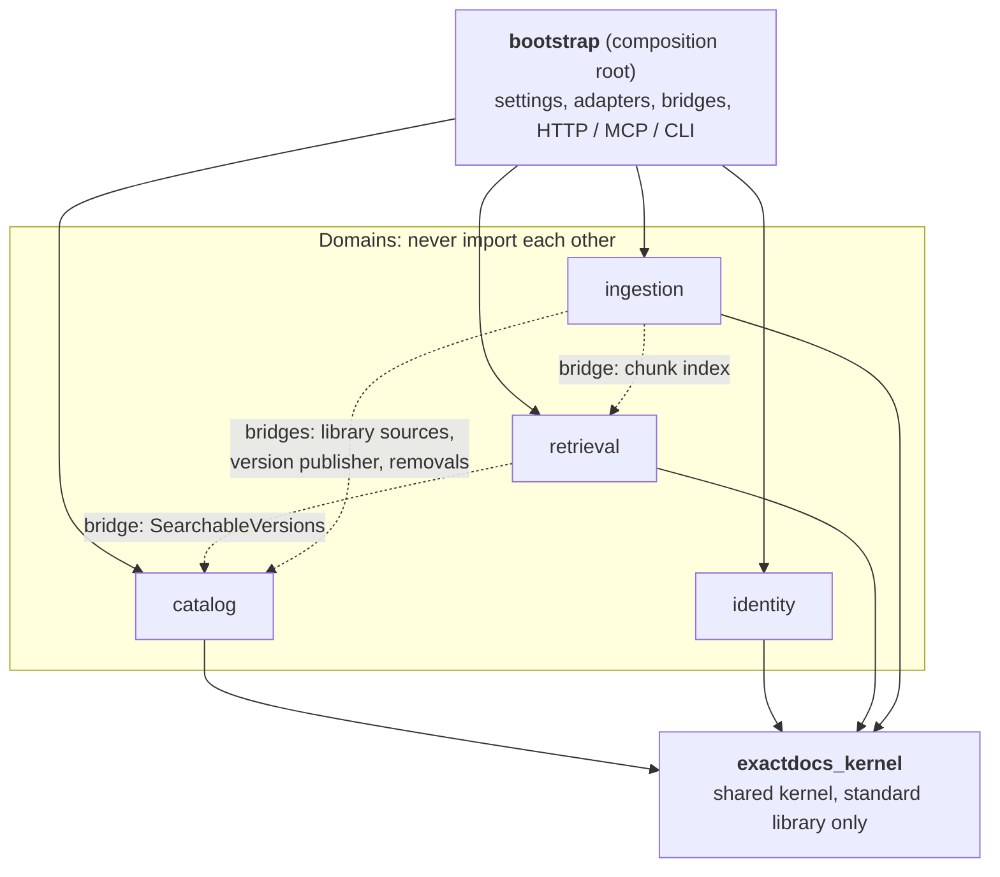
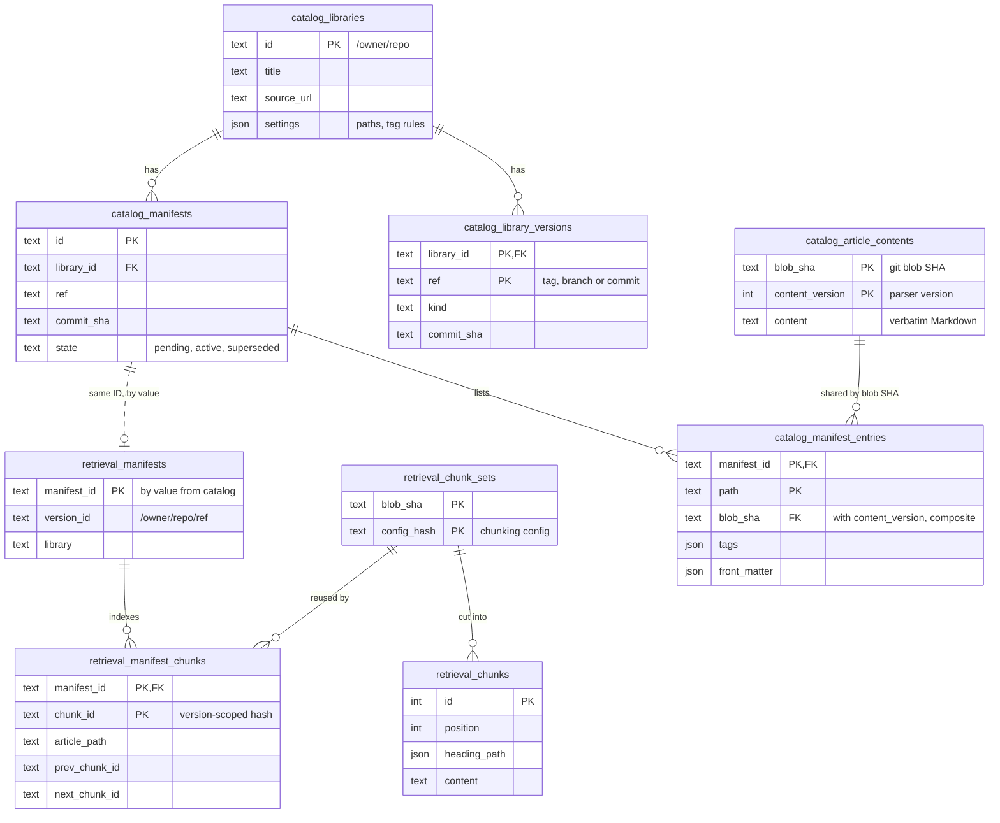
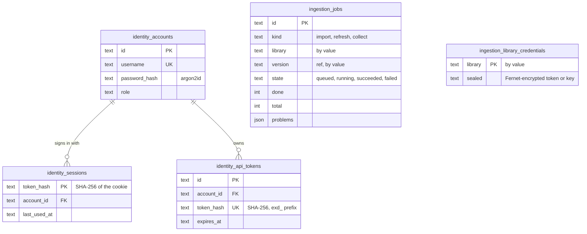
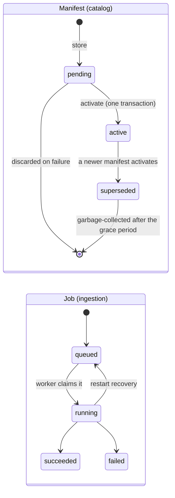
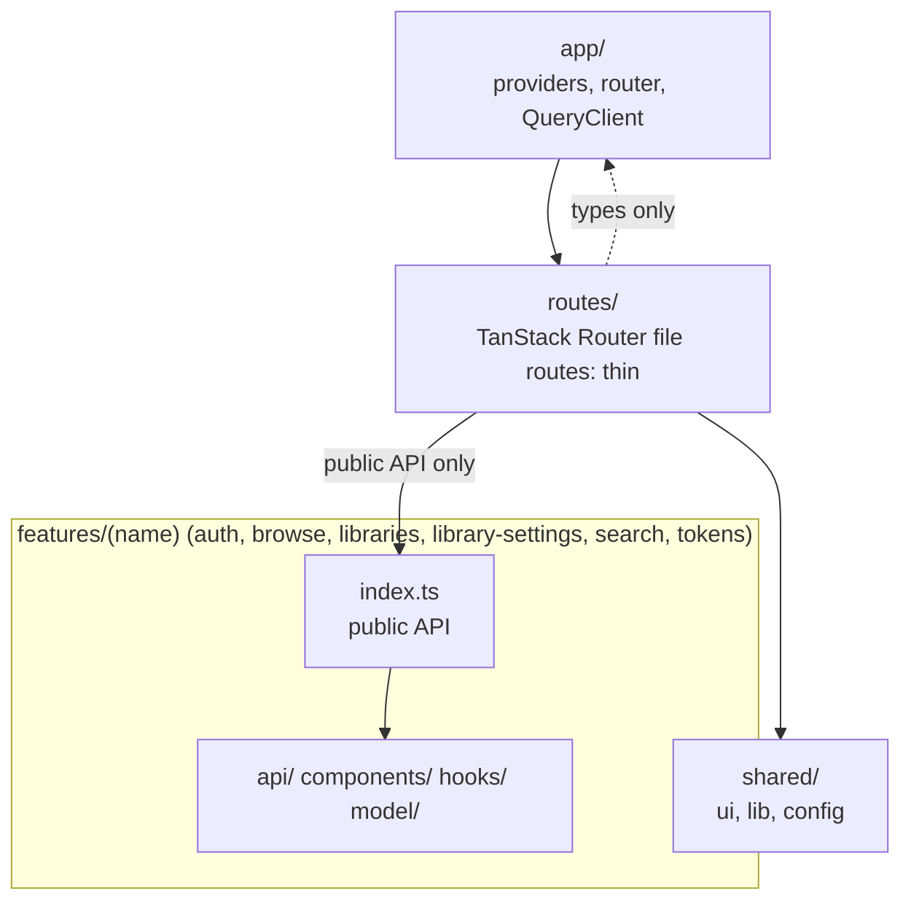

# Architecture

ExactDocs is a **modular monolith**: one deployable (one Docker image, one `uvx exactdocs`), split
into **domains** with hard boundaries. Inside every domain we follow **hexagonal architecture**
(ports & adapters) with the dependency rule of clean architecture. The React client mirrors the
same idea with **vertical slices**. All of this is enforced by tests, not by convention.

## Repository layout

| Path | What it is |
|---|---|
| `pyproject.toml` | uv workspace root: dev tools, ruff, ty, pytest and behave config, the `docs` group (Zensical) |
| `packages/exactdocs-kernel/` | shared kernel (`src/exactdocs_kernel/`), a separate, published package |
| `packages/exactdocs/` | the application, published as `exactdocs` (`src/exactdocs/`) |
| `packages/exactdocs/src/exactdocs/bootstrap/` | composition root: settings, container, bridges, migrations, HTTP / MCP / CLI entry points |
| `packages/exactdocs/src/exactdocs/catalog/` | domain: libraries, versions, manifests, article contents |
| `packages/exactdocs/src/exactdocs/identity/` | domain: the admin account, web sessions and API tokens |
| `packages/exactdocs/src/exactdocs/retrieval/` | domain: chunks, the BM25 index, `search_docs`, `query-docs`, `resolve-library-id` |
| `packages/exactdocs/src/exactdocs/ingestion/` | domain: jobs, the worker, git access, parsing, chunking and the import |
| `packages/exactdocs/src/exactdocs/_web/` | the built web UI (gitignored, added by CI / Docker) |
| `packages/exactdocs/tests/`, `packages/exactdocs/features/` | pytest (unit, integration, architecture) and behave (Gherkin acceptance scenarios) |
| `web/` | React client (Vite, TanStack Router and Query, shadcn); see [web/README.md](https://github.com/SirCypkowskyy/ExactDocs/blob/develop/web/README.md) |
| `deploy/` | Dockerfile, smoke test, size-budget check, Mermaid check, self-hosted runner scripts |
| `e2e/` | the Playwright test of the whole loop in a browser |
| `docs/` | this site (Zensical) |

## Domains and what may import what

Solid arrows are imports; dotted arrows are runtime calls through a bridge that lives in
`bootstrap`, so the domains stay unaware of each other. `identity` needs no bridge.

| From \ may import | own domain | other domain | `bootstrap` | `exactdocs_kernel` |
|---|---|---|---|---|
| a domain | yes | **no** | **no** | yes |
| `bootstrap` | yes (any domain) | yes | yes | yes |
| `exactdocs_kernel` | - | **no** | **no** | yes |

**How domains talk to each other.** The consumer declares what it needs as a *driven port* in its
own vocabulary (`retrieval.ports.driven.SearchableVersions`). The composition root implements it with
a **bridge** that calls the provider's *driving port* (`bootstrap/bridges.py:CatalogSearchableVersions`
uses `catalog.ports.driving.GetActiveManifest` and `GetLibrary`). Neither domain knows the other exists, so a domain can
later move to its own package or service without touching the other.

### Bridges are one-way

Bridges point in one direction only: **retrieval → catalog** and **ingestion → catalog /
retrieval**. Catalog calls no other domain, and nothing calls ingestion, so the domain graph has
no cycles. An architecture test (`tests/architecture/test_bridge_direction.py`) reads the
imports of every bridge class in `bootstrap/bridges.py`: the consumer's `models` / `ports.driven`
on one side, the provider's `ports.driving` / `dtos` on the other, and only the edges above pass.

The kernel `NOTICE` constant (the untrusted-content notice every MCP result carries, see the
*MCP-07* story) is a reviewed kernel addition: it is shared text, not business logic, so it lives
in the kernel instead of being duplicated per domain.

**Why not a `shared` domain?** Everything shared ends up there. The kernel is a separate
*package* on purpose: adding to it is a visible, reviewed decision, it may only use the
standard library, and it cannot import the app. If two domains need the same *business*
concept, that is usually a missing domain, or a port plus a bridge.

**When to make a domain its own package.** When it gets its own release cadence, consumers
outside the app, or heavy dependencies (e.g. ML models for embeddings). Move
`src/exactdocs/<domain>` to `packages/exactdocs-<domain>/`; the structure stays the same.

## Inside a domain: the fixed module set

Every domain has exactly these modules. Each may start as a module (`models.py`) and grow into a
package (`models/__init__.py` + submodules) with the same name. No other top-level names.

| Module | Holds | May import |
|---|---|---|
| `errors.py` | domain exceptions (subclasses of kernel errors) | kernel |
| `models.py` | entities, value objects: `@dataclass(frozen=True, slots=True)`, `NewType` ids, pure logic | `errors`, kernel |
| `dtos.py` | boundary data: frozen Pydantic models (commands, queries, results) + `from_model` mappers | `models`, `errors` |
| `ports/driving.py` | **driving (primary) ports**: `Protocol`s for use cases the outside world calls | `dtos`, `models`, `errors` |
| `ports/driven.py` | **driven (secondary) ports**: `Protocol`s for what the domain needs (repositories, gateways, other domains) | `models`, `errors` |
| `use_cases.py` | one frozen dataclass per use case, `async __call__`, implements a driving port | all of the above |
| `module.py` | `<Domain>Module`: `build(**driven_adapters)` returns the wired driving ports | all of the above |
| `adapters/driving/` | `http.py` (FastAPI router factory), `mcp.py` (FastMCP tool registration), `cli.py` | `ports`, `dtos` (never `use_cases`/`module`) |
| `adapters/driven/` | `memory.py`, `sqlite.py`, `postgres.py`, `http_client.py`... implement driven ports | `ports`, `models` (never driving adapters) |
| `__init__.py` | public API for `bootstrap`: the `Module` | |

The core (`errors`, `models`, `dtos`, `ports`, `use_cases`, `module`) never imports FastAPI,
FastMCP, Starlette, uvicorn, httpx, SQLAlchemy or DBOS. `models` and `errors` don't import Pydantic
either. Frameworks live in adapters and `bootstrap`.

Naming follows Alistair Cockburn's own terms from *Hexagonal Architecture Explained* (2024):
**driving** / **driven** ports and adapters, rather than primary/secondary or inbound/outbound.

## Persistence: one data directory, one database

Everything ExactDocs stores lives in the **data directory**: `EXACTDOCS_DATA_DIR`, which the Docker
image sets to `/data`, else the platform user-data directory (so `uvx` and stdio MCP share it).
`bootstrap/database.py` creates it, refuses to start if it is not writable, and opens one SQLite
file in it (`EXACTDOCS_DATABASE_URL` overrides the path): SQLAlchemy **Core**, async, no ORM,
on aiosqlite, in WAL mode with a busy timeout and `foreign_keys=ON`.

- **Each domain owns its tables**, prefixed with its name (`catalog_libraries`, `retrieval_...`).
  Foreign keys only between tables of the same domain; another domain's IDs are held by value
  and its tables are never read.
- **One Alembic history, owned by `bootstrap`** (`bootstrap/migrations/versions`), run on start
  (`Container.running()`) and reported by `/api/health` as `schema_revision`. A domain's
  revision is plain `op.create_table(...)`, not an import of the adapter's `Table` objects, so
  old revisions never change. Use `op.batch_alter_table` to change an existing table,
  `op.execute("CREATE VIRTUAL TABLE ... USING fts5(...)")` for FTS5. `migrate()` runs the
  revisions in one `BEGIN IMMEDIATE` transaction with `foreign_keys` off (a batch alteration
  recreates the table, and with the pragma on SQLite would cascade-delete the rows of tables
  that reference it) and fails, rolling back, if `PRAGMA foreign_key_check` finds a violation
  before the commit.
- **Version storage (catalog):** a version's articles are a **manifest** (`catalog_manifests`,
  `catalog_manifest_entries`: path, blob SHA, title, tags, front matter, size) over article
  content shared by git blob SHA (`catalog_article_contents`, stored once). A manifest is
  `pending` (invisible) until `ActivateManifest` flips it in one transaction: the previous
  manifest becomes `superseded`, this one `active` (a partial unique index allows one active
  manifest per version) and the version moves to the manifest's commit. Readers only ever see the
  active manifest. Other domains hold manifest IDs by value. Superseded manifests stay for a grace
  period, then `CollectGarbage` deletes them and the contents no manifest uses. `RemoveVersion` and
  `RemoveLibrary` delete a version's manifests at once (no grace: nothing serves them), and
  ingestion's `collect` job then runs each domain's collector, catalog first.
- **Renames between versions (E3-12):** on import, `RenameSource.renames` (the system-`git`
  adapter) asks git which Markdown files (any letter case) moved between two commits. Which two
  (`previous_version`): a numeric tag (`v1.4.0`, `2.1`; `1.4` equals `1.4.0`) is compared with the
  highest lower numeric tag, never with itself, so a re-sync gives the same map. A branch or
  commit is compared with the commit the ref served before; its map **builds up** over syncs
  (`compose_renames`): earlier renames are kept, chained (A to B, then B to C gives A to C, the
  lower similarity) and dropped when their target is no longer an article. Pre-releases and other
  names have no order and get none. Old paths are filtered by the library's current selection.
  The map (`from_ref`, old path, new path, similarity) is stored with the new version's manifest
  (`catalog_manifest_renames`, indexed both ways), so it is replaced, collected and removed with
  it. It is read through the `ResolveRenamedPath` port (forward: old to new; back: new to old),
  `ListRenames`, and REST `GET /libraries/{owner}/{repo}/renamed-path`. **One hop only:** a file
  moved over several versions is followed by asking once per version and chaining the answers (a
  version that was never imported breaks the chain). Detection never fails an import: any error
  means "no renames known" (a branch keeps its earlier map). Cost, measured on `fastapi/fastapi`
  0.100.0 to 0.115.0 (about 1,400 Markdown files, 12 renames, 4 of them exact): fetching the two
  trees (`--depth=1 --filter=blob:none`, no checkout) takes about 1 s and 250 KB, and
  `git diff-tree -M --diff-filter=R` over a case-insensitive `*.md`/`*.mdx` pathspec then fetches
  only the added and deleted Markdown files' blobs (about 1 MB, 1 s) to score renames with edits;
  exact renames need no blobs. Bounds: one fetch slot (the import has released its own first), a
  60 s deadline, the fetch size watchdog (which, with the deadline, bounds the download of a
  hostile repository), git's rename limit (400: above 400 x 400 added x deleted files the scoring
  is skipped and only exact renames are kept; it bounds CPU, not downloads), a 16 MiB cap on git's
  list and 10,000 renames kept.
- **Adding a table:** `just migration "add jobs table"`, fill in `upgrade()`/`downgrade()`, set
  `down_revision` to the current head if you rebased over another revision (a test fails if the
  history ever has two heads), then write the adapter.
- **Adapters** live in `adapters/driven/sqlite.py`, take the `AsyncEngine` and describe their
  tables with Core `Table` objects (`catalog.adapters.driven.sqlite` is the reference). They run
  in the same adapter contract test as the in-memory adapter. SQLAlchemy, Alembic and aiosqlite
  are imported only by driven adapters and `bootstrap` (architecture test).
- Tests build a container on an empty temporary data directory (`tests/conftest.py` points
  `EXACTDOCS_DATA_DIR` at one for every test) and seed data through the repository, so the
  catalog starts empty in production.

### Data model

Tables as created by the migrations in `bootstrap/migrations/versions`; the columns shown are the
ones that carry the design. A solid line is a real foreign key (same domain). A dotted line is an
ID held **by value**, which the database does not enforce.

Two derived facts worth knowing: a **chunk ID** is a hash of version, article path, heading path,
occurrence and content, so the same section keeps its ID when a branch moves but another version
of the same blob gets another one; and `retrieval_chunks` is keyed by *(blob SHA, chunking
config)*, so a blob shared by many versions is chunked once.

A manifest and a job each move through a small set of states:

## Identity: accounts and the setup guard

`identity` owns accounts (`identity_accounts`: username, password hash, `role`, created time).
Passwords are hashed by the `PasswordHasher` driven port; its adapter is **argon2id**
(`argon2-cffi`, RFC 9106 low-memory profile: 64 MiB, 3 passes), run in a thread, with `verify`
constant-time, and at most 4 at a time (more calls queue; a dropped request keeps its slot
until its thread is done). The use cases take the password as a `SecretStr`, an unknown username costs one
hash like a real check, and wrong password and unknown user raise the same error.

`AuthenticateUseCase` is the one place a password is checked, so the session sign-in and the
CLI's token login share its throttle. Attempts are counted per client address (IPv6 per /64)
and per username in the `FailedSignInLog` driven port (`FailedSignIns` in `models.py` holds the
free count and the doubling wait). `FailedSignInLog.charge` checks the wait and counts the
attempt in one atomic step, before the hash, so concurrent attempts cannot all pass the check;
an attempt that must wait raises `SignInThrottledError` (kernel `RateLimitedError`, 429 with
`Retry-After`) without a hash and without being counted. A right password refunds its attempt
on the address, clears the username's count and is remembered as a known (username, address)
pair for 30 days; from a known address, the username's count does not apply. The adapter is
in-process memory, bounded to 10,000 counts and 10,000 pairs, and evicts counts that hold no
one back first; several processes (TEAM-01) would each count their own, and a shared adapter
must make `charge` atomic too.

`AccountRepository.add_first` stores an account only while the table is empty, in one atomic
statement under `BEGIN IMMEDIATE`, so two concurrent setups (or `exactdocs admin create` next to
the running server) can never create two admins. `bootstrap/rest.py:SetupGuard` answers
`403 setup_required` for everything under `/api/v1` until an account exists (default deny; the
exemptions are `POST /setup`, `GET /session` and `openapi.json`) and stops asking the database
once one does.

### Sessions

`POST /api/v1/session` starts a server-side session (`identity_sessions`): a 256-bit random token
goes to the browser in an HttpOnly, SameSite=Lax cookie (`Path=/api`, `Secure` over HTTPS), and
only its SHA-256 is stored, so a leaked database holds no usable token. A session ends after
7 days without use or 30 days in all (`models.IDLE_TIMEOUT`/`ABSOLUTE_TIMEOUT`, checked against the
kernel `Clock`); using it writes `last_used_at` at most once an hour. Signing out deletes the row,
so a copied cookie dies too, and `exactdocs admin reset-password` changes the hash first and then
deletes all the account's sessions. CSRF: SameSite=Lax plus the app-wide `OriginCheck` (foreign
`Origin` on an unsafe request is 403).

"Who is the caller" is one dependency, `identity.adapters.driving.http.build_current_caller`,
applied to the whole protected router in `bootstrap/http.py`; new domain routers go there, and
the open ones are pinned by a test. It accepts a bearer API token or the session cookie (any
`Authorization` header is judged on its own, never rescued by a cookie). `/mcp` never reads the
cookie: it is guarded by `identity.adapters.driving.mcp.ApiTokenVerifier` (a FastMCP `TokenVerifier` over the
`IdentifyToken` port), so the token acts as its account. Tokens (`ApiToken`, `identity_api_tokens`)
are `exd_` plus 256 random bits, stored as SHA-256, with an optional expiry; stdio MCP is not
authenticated: it runs on `ReadOnlyContainer` (database opened `mode=ro` + `query_only`, no identity,
worker or migration). Read-side wiring lives in `_build_read_side` in `bootstrap/container.py`;
anything new on the read path goes there so stdio inherits it.

## Background jobs

Long tasks (imports, syncs, GC) are **jobs** of the `ingestion` domain, never work done inside a
request. A `Job` has a kind, a library (and optionally a version), a state (`queued`, `running`,
`succeeded`, `failed`), `done`/`total` files, per-file problems (path, reason), an error and
timestamps; `GET /api/v1/jobs/{id}` and `GET /api/v1/libraries/{owner}/{repo}/jobs` read them.

- **Kinds** today: `import` (a version's first import), `refresh` (a re-sync of a branch version that moved, which reuses unchanged chunks and fails with `not_found` if the version was removed meanwhile) and `collect` (frees content nothing uses after a removal). **They are registered, not hard-coded.** `IngestionModule.build(handlers=..., recovery_hooks=...)`
  maps a kind to the `JobHandler` that runs it and, optionally, a `RecoveryHook`. Handlers report
  through a `JobProgress` port; every report is stored at once. Raising fails the job: a domain
  error's message is shown to users, anything else only as `unexpected <ErrorType>` (details go
  to the log).
- **The worker is a driving adapter** (`ingestion/adapters/driving/worker.py`): asyncio tasks
  started in the app lifespan (`Container.running()`) that poll `RunNextJob`. Its use case claims
  the oldest queued job **whose library has no running job** in one atomic statement, so two jobs
  for one library never run together while other libraries run alongside.
- **Restart.** Stopping the app lets idle workers finish and cancels a job still running after
  a short grace period, so it stays `running` in the database. On the next start `RecoverJobs`
  runs each one's recovery hook (no-op by default; the import registers the discard of its
  pending manifest), then re-queues it, and it runs from the beginning. A hook that raises fails
  its job instead of blocking the start.
- **One process runs jobs.** Only the HTTP server starts the worker and recovery
  (`serve --stdio` does not): recovery treats every `running` job as left over from a crash, so a
  second worker process on the same database would re-queue the first one's live jobs. The
  claim itself is safe across processes. Several job-running processes need a lease/heartbeat
  per job first.
- DBOS replaces the worker behind the same driving ports in MVP-2 (resumable imports).

### The import: a complete version or nothing

The `import` kind is `ImportVersionUseCase` (built by `ingestion.import_job`, which also returns
its recovery hook). It imports the commit the job was pinned to: fetch, read and parse every
selected file, tag, chunk, then **store** the articles as a pending catalog manifest, **index**
their chunks in retrieval and **activate** the manifest. Readers see the previous state until
that last step, which is one transaction in the catalog.

- **Undo.** Any failure after the store (an exception or a cancellation) discards the pending
  chunks and then the pending manifest. The order matters: retrieval asks the catalog and only
  removes a manifest it is told is still pending. After a crash the recovery hook does the same
  for the library's pending data before the job runs again (a library has one running job).
- **Reuse.** Content is keyed by git blob SHA and the parser version, chunk sets by blob SHA and
  the chunking config, so a blob that an earlier import chunked is not chunked again. The
  stored chunks are read back through retrieval's `GetChunkSets`; parsing is repeated, because
  the title and tags depend on the path as well as the bytes. Importing a commit again changes
  nothing a reader can see.
- **Memory.** The selected text is held in memory until stored, and again as chunks, as DTOs in
  the bridges and as SQL parameters: several times over, and the worker runs two jobs at once.
  `EXACTDOCS_MAX_IMPORT_BYTES` (256 MiB) bounds the text an import takes; above it the import
  fails with `import_too_large` instead of the process being killed. The CPU-heavy part of
  storing and indexing (DTO validation, sorting, chunk-ID hashing) runs in a thread so the event
  loop keeps serving requests. Progress is stored every 100 files or 250 ms, and at the end.
- **Images.** Articles' relative `` images are collected at parse time (resolved against
  the article's folder, as the web renderer does; absolute URLs, `data:` and paths leaving the
  repository are ignored). The first checkout already holds those inside the selected paths; the
  rest come from a second, literal-path `GitGateway.fetch_files` (glob characters escaped, no
  README, its own download limit). Each image is read like an article (plain file, never a
  symlink), at most `EXACTDOCS_MAX_IMAGE_BYTES` (2 MiB), and its type is **sniffed from the
  bytes**: PNG, JPEG, GIF, WebP or SVG, anything else is `not_an_image`. A version keeps at most
  1000 images and `EXACTDOCS_MAX_IMAGES_BYTES` (64 MiB); the rest, and images the repository
  lacks, are listed as skipped problems of the job and never fail it. The catalog stores each
  blob once (`catalog_image_blobs`, keyed by git blob SHA) and lists them per manifest
  (`catalog_manifest_images`), so they are activated, superseded, removed and collected (#45)
  together with the articles. Served by `GET /api/v1/libraries/{owner}/{repo}/asset?ref=&path=`
  (signed-in callers only, like every `/api/v1` route; no `ref` means the default version) with
  the stored type, `X-Content-Type-Options: nosniff`, `Cache-Control: private, no-cache` and
  `ETag` = blob SHA (`If-None-Match` answers 304), and `Content-Security-Policy: default-src
  'none'; style-src 'unsafe-inline'; sandbox`. **SVG** is served, not rasterized or refused (it
  is what diagrams are made of): in an `` a browser runs no script and loads nothing, and
  opened directly it is an attachment under that CSP, so a hostile SVG can neither run nor
  phone home. SVGs declaring entities are refused. Not stored: images in raw HTML, MDX
  components or front matter.
- **Relative links and images in the UI.** A link to `.md`/`.mdx` stays in the app (same
  version, resolved path, same `#anchor`); any other repository file opens on the host's blob page
  at the commit; a link to an article the import left out lands on "Not in this version", which
  offers the same file on the host. An image loads from `/asset` first (public and private
  libraries alike); if that fails (404: a version imported before #64, or an image skipped as too
  large), a **public** library falls back to the host's raw URL at the commit, and a private one,
  or a failed fallback, shows the alt text. Images are `loading="lazy" decoding="async"`; their size
  is not stored, so CSS bounds them (`max-width: 100%`) and no `width`/`height` is set. Links to
  renamed articles (#66) are not followed yet (#191).
- **Kind of ref.** `AddLibrary` records on the job whether the version is a tag, a branch or a
  bare commit, so the import never asks the remote again; a deleted tag does not break it.
- **Replays.** A crash right after the activation commits re-queues the job; importing the same
  commit again activates an equal manifest, so nothing a reader sees changes.
- **Files.** Only regular files are read (a symlink could point out of the checkout), none over
  `EXACTDOCS_MAX_ARTICLE_BYTES` (2 MiB), and only valid UTF-8. A skipped file (also an
  unreadable one or one with a file name that is not UTF-8) is recorded as a job problem (the
  first 1000) and counted as processed. A folder that cannot be listed fails the import. `done`/`total` count the selected files.
- **Bridges** (`bootstrap/bridges.py`): `CatalogLibrarySources`, `CatalogVersionPublisher`
  (`StoreManifest`, `ActivateManifest`, `DiscardPendingManifests`) and `RetrievalChunkIndex`
  (`IndexManifest`, `GetChunkSets`, `DiscardPendingChunks`).

## Python conventions

- **`Protocol`, not ABC.** Ports are structural. Adapters and use cases never inherit from them;
  `ty` checks conformance where they are wired (`CatalogModule.build(repository=...)`).
  Importing `abc.ABC` is banned by ruff. The only inheritance in the codebase is exceptions.
- **Immutable by default.** `@dataclass(frozen=True, slots=True, kw_only=True)` for entities,
  value objects, use cases and modules; `ConfigDict(frozen=True, extra="forbid")` for DTOs.
- **Use cases are callables.** `await catalog.list_libraries()` reads like the port name, and any
  `async def` with the same signature is a valid test double.
- **Explicit composition root, no DI container.** `bootstrap/container.py` builds everything
  once, in plain code. Tests build modules directly with in-memory adapters.
- **Python 3.14 idioms.** Lazy annotations (PEP 649, no `from __future__` and no
  `TYPE_CHECKING` blocks), `type` aliases (PEP 695), `typing.Self`, `NewType` for identifiers.
- **Errors.** Domains raise kernel error subclasses (`NotFoundError`...). The HTTP adapter maps
  them to status codes in one place (`bootstrap/http.py`); MCP returns them as tool errors.
- **Async all the way.** Ports are `async`; synchronous libraries are wrapped in adapters.

## What enforces it

| Rule | Tool |
|---|---|
| Domain isolation, layer direction, adapter rules, framework-free core, no cycles, kernel purity | ArchUnitPython, `packages/exactdocs/tests/architecture/test_architecture.py` |
| Fixed module set per domain, driving/driven split | same file (filesystem check) |
| Bridges point one way: retrieval to catalog, ingestion to catalog / retrieval | `test_bridge_direction.py` |
| No `abc.ABC`, no relative imports, every ruff rule incl. preview | ruff (`select = ["ALL"]`, `preview = true`) |
| Protocol conformance, types | ty |
| Web: features don't import each other; `shared` imports no feature; routes use feature public APIs | fallow (`web/.fallowrc.json`) + Biome `noRestrictedImports` |

## Web client: vertical slices

A feature mirrors a backend use case or domain view. Features never import each other; if two
need the same thing it moves to `shared` (when generic) or stays duplicated (when it is business
logic that only looks the same). Details: [web/README.md](https://github.com/SirCypkowskyy/ExactDocs/blob/develop/web/README.md).
