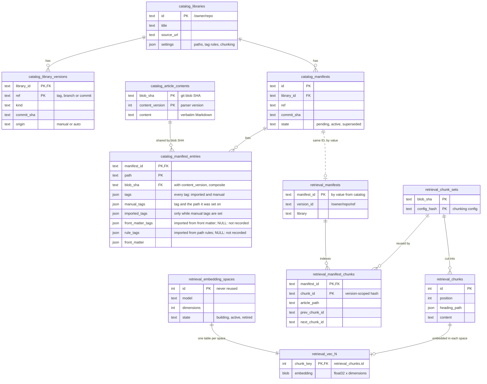
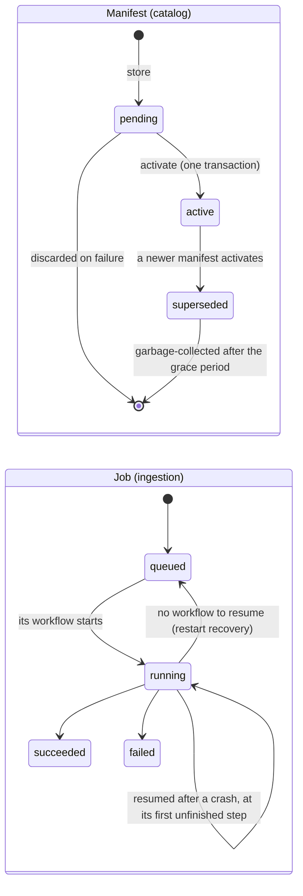

# Data model

!!! abstract "TL;DR"

    - The diagrams show the tables as the migrations in `bootstrap/migrations/versions` create
      them, with the columns that carry the design.
    - A solid line is a real foreign key (same domain). A dotted line is an ID held **by value**,
      which the database does not enforce.
    - A blob shared by many versions is chunked once; a chunk ID is scoped to its version.

- Tables as created by the migrations in `bootstrap/migrations/versions`; the columns shown are the
  ones that carry the design.
- A solid line is a real foreign key (same domain).
- A dotted line is an ID held **by value**, which the database does not enforce.

## Catalog and retrieval

## Identity and ingestion

```mermaid
erDiagram
    identity_accounts ||--o{ identity_sessions : "signs in with"
    identity_accounts ||--o{ identity_api_tokens : "owns"
    identity_accounts ||..o{ identity_library_grants : "holds roles by ID"
    identity_accounts ||..o{ identity_access_events : "changed access, by ID"
    identity_accounts ||--o| identity_preferences : "saved"

    identity_accounts {
        text id PK
        text username UK
        text password_hash "argon2id"
        text role
        text last_active_at "to the hour"
    }
    identity_sessions {
        text token_hash PK "SHA-256 of the cookie"
        text account_id FK
        text last_used_at
    }
    identity_api_tokens {
        text id PK
        text account_id FK
        text token_hash UK "SHA-256, exd_ prefix"
        text expires_at
    }
    identity_library_grants {
        text library PK "/owner/repo, lower-case"
        text kind PK "user or group"
        text subject PK "account ID or group name"
        text role "viewer, contributor, admin, creator"
    }
    identity_access_events {
        text id PK "UUIDv7: sorts in recording order"
        text library "/owner/repo, lower-case"
        text at
        text actor "account ID; null for the instance"
        text change "library_created, granted, revoked, ownership_transferred, library_deleted"
        text subject "account ID or group name; null for a deletion"
        text role
        text previous_role
    }
    identity_failed_sign_ins {
        text key PK "address:... or username:..."
        int failures
        text last_at "pruned after an hour"
        text previous_at "nullable, restored by a refund"
    }
    identity_known_sign_ins {
        text key PK "username@address"
        text signed_in_at "pruned after 30 days"
    }
    identity_preferences {
        text account_id PK, FK
        json preferences "theme, contrast, text size, ...; a missing key is its default"
    }

    ingestion_jobs {
        text id PK
        text kind "import, refresh, reprocess, rechunk, retag, collect, embed, push"
        text library "by value"
        text version "ref, by value"
        text state "queued, running, succeeded, failed"
        int done
        int total
        json problems
    }
    ingestion_library_credentials {
        text library PK "by value"
        text sealed "Fernet-encrypted token or key"
    }
    ingestion_auto_syncs {
        text library PK "by value"
        text tag_pattern "glob, null: no tag"
        int keep_last
        int interval_minutes
        text checked_at
    }
    ingestion_webhooks {
        text library PK "by value"
        text sealed "Fernet-encrypted secret"
        text created_at
    }
    ingestion_webhook_deliveries {
        text library PK
        text provider PK "github, gitlab, bitbucket"
        text delivery_id PK
        text received_at "pruned after 7 days"
    }
```

## Two derived facts

- A **chunk ID** is a hash of version, article path, heading path, occurrence and content. The same
  section keeps its ID when a branch moves, but another version of the same blob gets another one.
- `retrieval_chunks` is keyed by *(blob SHA, chunking config)*, so a blob shared by many versions is
  chunked once.

## States of a manifest and a job

A manifest and a job each move through a small set of states:

