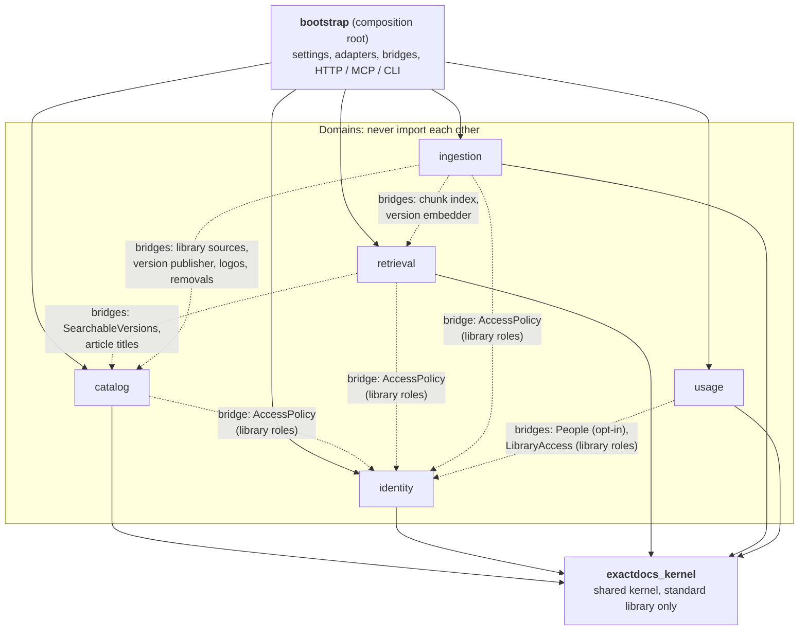

# Domains and boundaries

!!! abstract "TL;DR"

    - Five domains (`catalog`, `identity`, `retrieval`, `ingestion`, `usage`) never import each
      other or `bootstrap`; they may import only the shared kernel.
    - Domains talk through **bridges** in `bootstrap`: the consumer declares a driven port, the
      bridge calls the provider's driving port. Bridges point one way, so the graph has no cycles.
    - Secrets are sealed by one secret box in `bootstrap`, with one HKDF context per use.
    - Every domain has the same fixed set of modules, and its core imports no framework.

## Domains and what may import what

- Solid arrows are imports.
- Dotted arrows are runtime calls through a bridge that lives in `bootstrap`, so the domains stay
  unaware of each other.
- `identity` asks for nothing. The other four ask it what the caller may do with a library
  ([Library roles](identity.md#library-roles)).
- `usage` also asks who opted in to the people leaderboard ([Usage counts](usage.md)).

| From \ may import | own domain | other domain | `bootstrap` | `exactdocs_kernel` |
|---|---|---|---|---|
| a domain | yes | **no** | **no** | yes |
| `bootstrap` | yes (any domain) | yes | yes | yes |
| `exactdocs_kernel` | - | **no** | **no** | yes |

### How domains talk to each other

1. The consumer declares what it needs as a *driven port* in its own vocabulary
   (`retrieval.ports.driven.SearchableVersions`).
2. The composition root implements it with a **bridge** that calls the provider's *driving port*
   (`bootstrap/bridges.py:CatalogSearchableVersions` uses `catalog.ports.driving.GetActiveManifest`
   and `GetLibrary`).
3. Neither domain knows the other exists, so a domain can later move to its own package or service
   without touching the other.

### Bridges are one-way

Bridges point in one direction only:

- **retrieval → catalog**
- **ingestion → catalog / retrieval**
- **catalog / retrieval / ingestion → identity** (library roles)
- **usage → identity** (library roles and the people leaderboard's opt-in)

Identity and catalog call no domain for their own needs, and nothing calls ingestion or usage, so
the domain graph has no cycles.

An architecture test (`tests/architecture/test_bridge_direction.py`) reads the imports of every
bridge class in `bootstrap/bridges.py`: the consumer's `models` / `ports.driven` on one side, the
provider's `ports.driving` / `dtos` on the other. Only the edges above pass.

### When the catalog's answer needs another domain's data

The composition root composes it instead of adding a bridge against the direction: it wraps the
catalog's driving port and asks the other domain's driving port once per page.

- `ListLibrariesByAi` (`bootstrap/library_filters.py`) turns retrieval's AI switch into the IDs the
  catalog lists.
- `ListVersionsWithChunks` (`bootstrap/version_counts.py`) adds retrieval's chunk and embedded-chunk
  counts of a whole page of versions (`CountVersionChunks`) to the catalog's list, which counts the
  articles itself (#513).

### Secrets: one box, one port per domain

The instance's secret box is `bootstrap/secret_box.py:FernetSecretBox`:

- Fernet keyed from `EXACTDOCS_SECRET_KEY` with HKDF;
- rotation through `EXACTDOCS_SECRET_KEY_PREVIOUS`;
- or a generated `secret.key` in the data directory.

It lives in the composition root, not in a domain and not in the kernel: it needs `cryptography`,
and the kernel uses the standard library only. A domain that stores a secret declares its own small
`SecretBox` driven port (`ingestion.ports.driven.SecretBox` today), and a driven adapter takes it as
a field (`SqliteCredentialVault(box=...)`). No domain imports `cryptography` (an architecture test
checks it), so none depends on another's adapter to seal a secret.

- **One key, one context per use.**
    - Every box is built from the same secret key with a `purpose`: the HKDF `info` its Fernet key
      is derived for.
    - `bootstrap/container.py` builds one box per use and passes it to that domain's adapter, so a
      text sealed for one use (a table, a domain) never opens in another.
    - Ingestion's repository credentials use `CREDENTIALS_KEY_PURPOSE`
      (`b"exactdocs credentials v1"`, in `bootstrap/constants.py`), the context they were always
      sealed with.
    - A new use takes a new context (`b"exactdocs <use> v1"`). One example is the push webhook
      secrets' `WEBHOOK_SECRETS_PURPOSE`, `b"exactdocs webhook secrets v1"`, sealed by
      `SqliteWebhookSecrets`.
    - Rotating the secret key covers every use at once.
- **A neutral error.**
    - `open` raises `exactdocs_kernel.SealedTextUnreadableError` for a text of another key or
      purpose, or one that was altered.
    - It is not a `DomainError` and never reaches a client: the adapter that opened the text
      translates it into its own domain's error (the credential vault: `CredentialsRequiredError`).
    - The box imports no domain.

!!! warning "Never change `CREDENTIALS_KEY_PURPOSE`"

    Changing it makes every stored credential unreadable.

### The `NOTICE` constant

The kernel `NOTICE` constant is the untrusted-content notice every MCP result carries (see the
*MCP-07* story). It is a reviewed kernel addition: it is shared text, not business logic, so it
lives in the kernel instead of being duplicated per domain.

### Outbound connections: one resolution, in the kernel (#538)

`exactdocs_kernel.OutboundNetwork` decides, for every outbound connection:

- which proxy it goes through;
- which hosts `NO_PROXY` keeps direct: names and the names under them, addresses, CIDR ranges,
  ports, `*`; loopback and link-local always;
- which CA bundle TLS trusts.

`resolve_outbound` builds it from the standard variables (`HTTP(S)_PROXY`, `ALL_PROXY`, `NO_PROXY`,
`SSL_CERT_FILE`...) and the `EXACTDOCS_` overrides (`Settings.outbound()`). It is a reviewed kernel
addition: standard library only, no business concept, and the domains' driven adapters need it as
much as bootstrap does.

Bootstrap resolves it once and hands it to every client:

| Client | How it gets the resolution |
|---|---|
| the CLI's, the sign-in providers' and the AI profiles' HTTP clients | `outbound.RoutedTransport`[^routed] |
| git | `GitCli.network`: its environment, with the CA as `GIT_SSL_CAINFO` |
| `exactdocs models pull` | `hub_client.py` |
| the index backends' factories | `network=`, for the kinds marked `outbound` |
| the OpenTelemetry exporter | the same resolution |
| libraries that read only the environment | `cli.main` writes the resolution into the process's standard variables (`outbound.publish`) |

Proxy credentials are never shown: `redact_url` and `OutboundNetwork.redact` mask them in reprs,
logs and errors.

[^routed]: An `httpx2` transport that picks the direct or proxied connection per request, never
    reads the environment, and turns a failure on the way through a proxy into an error naming the
    proxy and the host.

### Why not a `shared` domain?

Everything shared ends up there. The kernel is a separate *package* on purpose:

- adding to it is a visible, reviewed decision;
- it may only use the standard library;
- it cannot import the app.

If two domains need the same *business* concept, that is usually a missing domain, or a port plus
a bridge.

### When to make a domain its own package

When it gets its own release cadence, consumers outside the app, or heavy dependencies (e.g. ML
models for embeddings). Move `src/exactdocs/<domain>` to `packages/exactdocs-<domain>/`; the
structure stays the same.

## Inside a domain: the fixed module set

Every domain has exactly these modules. Each may start as a module (`models.py`) and grow into a
package (`models/__init__.py` + submodules) with the same name. No other top-level names.

| Module | Holds | May import |
|---|---|---|
| `constants.py` | every constant of the domain, `Final` and documented (or a `constants/` package) | kernel |
| `errors.py` | domain exceptions (subclasses of kernel errors) | kernel |
| `models.py` | entities, value objects: `@dataclass(frozen=True, slots=True, kw_only=True)`, `NewType` ids, pure logic | `errors`, kernel |
| `dtos.py` | boundary data: frozen Pydantic models (commands, queries, results) + `from_model` mappers | `models`, `errors` |
| `ports/driving.py` | **driving (primary) ports**: `Protocol`s for use cases the outside world calls | `dtos`, `models`, `errors` |
| `ports/driven.py` | **driven (secondary) ports**: `Protocol`s for what the domain needs (repositories, gateways, other domains) | `models`, `errors` |
| `use_cases.py` | one frozen dataclass per use case, `async __call__`, implements a driving port | all of the above |
| `module.py` | `<Domain>Module`: `build(**driven_adapters)` returns the wired driving ports | all of the above |
| `adapters/driving/` | `http.py` (FastAPI router factory), `mcp.py` (FastMCP tool registration), `cli.py` | `ports`, `dtos` (never `use_cases`/`module`) |
| `adapters/driven/` | `memory.py`, `sqlite.py`, `postgres.py`, `http_client.py`... implement driven ports | `ports`, `models` (never driving adapters) |
| `__init__.py` | public API for `bootstrap`: the `Module` | |

- The core (`errors`, `models`, `dtos`, `ports`, `use_cases`, `module`) never imports FastAPI,
  FastMCP, Starlette, uvicorn, httpx, SQLAlchemy or DBOS.
- `models` and `errors` don't import Pydantic either.
- Frameworks live in adapters and `bootstrap`.

!!! note "Naming"

    Naming follows Alistair Cockburn's own terms from *Hexagonal Architecture Explained* (2024):
    **driving** / **driven** ports and adapters, rather than primary/secondary or inbound/outbound.
