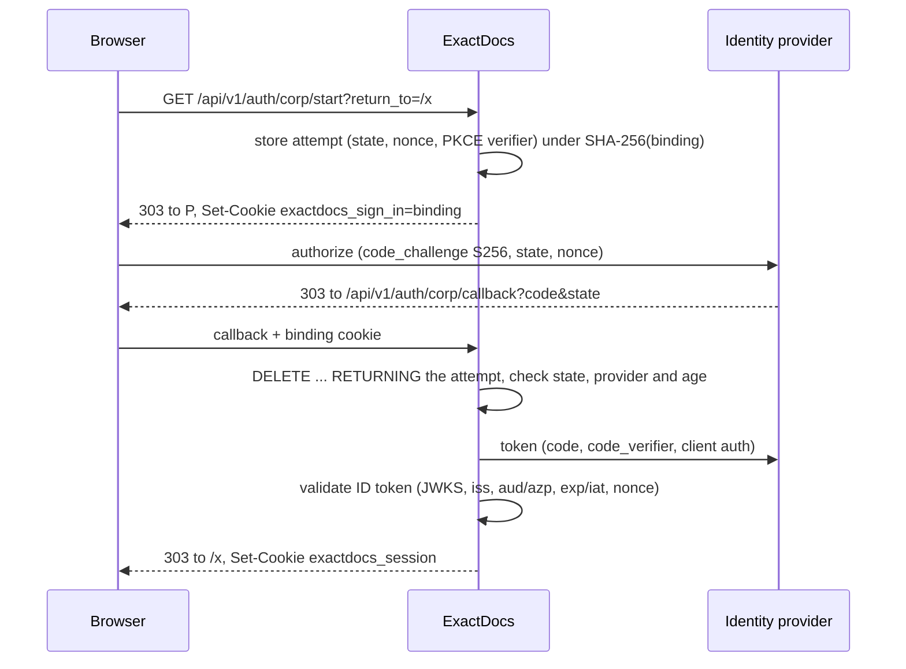

# Identity: accounts and the setup guard

!!! abstract "TL;DR"

    - `identity` owns accounts, web sessions, API tokens, external sign-in links and library roles.
    - Passwords are hashed with argon2id. One use case checks every password, behind a throttle per
      client address and per username.
    - Until the first admin exists, `SetupGuard` answers `403 setup_required` for everything under
      `/api/v1`. There is no self-signup.
    - Roles per library: `viewer < contributor < admin < creator`. Operators are `creator` of every
      library. No caller means the instance's own work, which no role limits.

## Accounts and passwords

`identity` owns accounts (`identity_accounts`: username, password hash, `role`, created time). The
password hash is NULL for an account of an identity provider (see
[External sign-in](#external-sign-in-oidc)).

Passwords are hashed by the `PasswordHasher` driven port. Its adapter is **argon2id**:

- `argon2-cffi`, RFC 9106 low-memory profile: 64 MiB, 3 passes;
- run in a thread, with `verify` constant-time;
- at most 4 at a time. More calls queue; a dropped request keeps its slot until its thread is done.

The use cases take the password as a `SecretStr`. An unknown username costs one hash like a real
check, and wrong password and unknown user raise the same error.

## The sign-in throttle

`AuthenticateUseCase` is the one place a password is checked, so the session sign-in and the CLI's
token login share its throttle.

- **What is counted.** Attempts are counted per client address (IPv6 per /64) and per username in
  the `FailedSignInLog` driven port. `FailedSignIns` in `models.py` holds the free count and the
  doubling wait.
- **Check and count in one step.** `FailedSignInLog.charge` checks the wait and counts the attempt
  in one atomic step, before the hash, so concurrent attempts cannot all pass the check.
- **Refused attempts.** An attempt that must wait raises `SignInThrottledError` (kernel
  `RateLimitedError`, 429 with `Retry-After`) without a hash and without being counted.
- **A right password**:
    - refunds its attempt on the address, putting back the earlier `last_at` when no later attempt
      came, so the wait is not restarted;
    - clears the username's count;
    - is remembered as a known (username, address) pair for 30 days. From a known address, the
      username's count does not apply.

### Where the counts live

| Database | Adapter |
|---|---|
| SQLite (one process) | in-process memory, bounded to 10,000 counts and 10,000 pairs; evicts counts that hold no one back first |
| PostgreSQL (several processes serve one instance, TEAM-01) | `SqliteFailedSignInLog`: `identity_failed_sign_ins`, `identity_known_sign_ins`[^empty] |

[^empty]: These tables exist but stay empty on SQLite. The SQL is portable and the contract tests
    also run it on SQLite.

On PostgreSQL:

- Each read-then-write is one transaction that first takes a transaction-level advisory lock per key
  (`_SIGN_IN_LOCKS`, all in one statement ordered by lock id), so `charge` stays atomic across
  processes without taking the instance's write turn.
- Before it takes a connection, an attempt waits in the process: an `asyncio.Lock` per key, then one
  of `MAX_CONCURRENT_SIGN_IN_TURNS` slots. A flood on one username holds one pooled connection, not
  the pool.
- Each wait lasts at most `SIGN_IN_TURN_TIMEOUT` (in the process, then as `lock_timeout`). A
  `charge` that runs out fails closed (refused, uncounted), and a refund, reset or remembered sign-in
  is skipped.
- Old rows are pruned on write, with no background job, skipping rows another transaction has locked
  (`SKIP LOCKED`):
    - a charge deletes counts quiet for `FORGET_FAILURES_AFTER`;
    - a remembered sign-in deletes those older than `REMEMBER_SIGN_INS_FOR`.

## Creating and disabling accounts

- **The first admin.** `AccountRepository.add_first` stores an account only while the table is
  empty, in one atomic statement under `BEGIN IMMEDIATE`. Two concurrent setups (or
  `exactdocs admin create` next to the running server) can never create two admins.
- **Further accounts** (ACL-06) are created only by an operator: `CreateUser` behind
  `POST /api/v1/users` (session of an `admin`, else 403 `forbidden`) or `exactdocs user create`
  (local). There is no self-signup route.
- `AccountRepository.add` relies on the unique `username` column, so a race for one name stores one
  account.
- **`Role`** is `admin` (an operator: manages accounts, and holds the `creator` role on every
  library) or `user`. Library roles are [below](#library-roles).
- **A disabled account** (`identity_accounts.disabled_at`) is refused:
    - at sign-in, after the password check, with the same `invalid_credentials`, so the answer
      reveals nothing;
    - by `IdentifyCaller` and by `IdentifyToken`.
- Disabling also deletes its sessions and tokens. Enabling deletes them again first: one stored
  while disabled raced the disable and must not come back.
- `set_disabled_at` checks for another enabled admin and disables in one `begin_immediate`
  transaction, so the last one can never be disabled, even by two concurrent requests.
- New usernames may not hold `@address:`, the separator of the throttle's remembered-sign-in keys
  (`known_sign_ins_prefix`), so one account's keys never prefix another's.

## The setup guard

`bootstrap/rest.py:SetupGuard` answers `403 setup_required` for everything under `/api/v1` until an
account exists (default deny), and stops asking the database once one does. The exemptions are
`POST /setup`, `GET /session` and `openapi.json`.

## Sessions

`POST /api/v1/session` starts a server-side session (`identity_sessions`).

- **The token.** A 256-bit random token goes to the browser in an HttpOnly, SameSite=Lax cookie
  (`Path=/api`, `Secure` over HTTPS). Only its SHA-256 is stored, so a leaked database holds no
  usable token.
- **Lifetime.** A session ends after 7 days without use or 30 days in all
  (`models.IDLE_TIMEOUT`/`ABSOLUTE_TIMEOUT`, checked against the kernel `Clock`). Using it writes
  `last_used_at` at most once an hour.
- **Last activity.** The account's own `last_active_at` (the users page, #515) is kept to the hour.
  The request that reads the account anyway moves it forward (a sign-in, a session, an API token, a
  provider's ID token, Cloudflare Access), only when the hour changed: at most one write per account
  and hour.
- **Signing out** deletes the row, so a copied cookie dies too.
- **A password reset** (`exactdocs admin|user reset-password`, or `PUT /api/v1/users/{id}/password`
  by an operator):
    1. changes the hash first;
    2. deletes all the account's sessions;
    3. drops the username's throttle count (`FailedSignInLog.forget`);
    4. drops every address remembered for the username (`FailedSignInLog.forget_remembered`, in each
       key's turn, a bounded batch of keys per transaction; the CLI has no client address, so none
       is kept).

    Steps 3 and 4 reach the servers only on PostgreSQL, where the log is shared. A busy or failing
    log only makes the command warn, as the reset is already done.
- **CSRF:** SameSite=Lax plus the app-wide `OriginCheck` (a foreign `Origin` on an unsafe request
  is 403).

### Who is the caller

- "Who is the caller" is one dependency, `identity.adapters.driving.http.build_current_caller`,
  applied to the whole protected router in `bootstrap/http.py`. New domain routers go there, and the
  open ones are pinned by a test.
- It accepts a bearer API token or the session cookie. Any `Authorization` header is judged on its
  own, never rescued by a cookie.
- `/mcp` never reads the cookie. It is guarded by `identity.adapters.driving.mcp.ApiTokenVerifier`
  (a FastMCP `TokenVerifier` over the `IdentifyToken` port), so the token acts as its account.
- **Tokens** (`ApiToken`, `identity_api_tokens`) are `exd_` plus 256 random bits, stored as
  SHA-256, with an optional expiry.
- **stdio MCP is not authenticated.** It runs on `ReadOnlyContainer` (database opened `mode=ro` +
  `query_only`, no identity, worker or migration), plus a second engine that may write the AI spend
  ledger alone (#274).

!!! tip "New read-path wiring"

    Read-side wiring lives in `_build_read_side` in `bootstrap/container.py`. Anything new on the
    read path goes there so stdio inherits it.

## External sign-in (OIDC)

Identity providers are configured in settings only (`[auth.providers.<name>]`,
`bootstrap/settings.py:SignInProviderSettings`); nothing about them is stored.

`bootstrap/sign_in.py` turns each into:

- the domain's `SignInPolicy` (`models.py`: who is admitted, `admin_groups`, `group_prefix`, the
  revalidation times);
- a `SignInProvider` driven adapter (`identity/adapters/driven/oidc.py:OidcProvider`: discovery,
  PKCE through Authlib, the ID token through joserfc, HTTP through `httpx2`).

The redirect URI is built from `EXACTDOCS_PUBLIC_URL`.

### MCP over OAuth

`EXACTDOCS_MCP_OAUTH_PROVIDER`: `bootstrap/mcp_oauth.py` runs FastMCP's `OIDCProxy` for the chosen
provider and combines it with the API-token verifier through `MultiAuth`.

- The proxy's token verifier (`identity/adapters/driving/mcp.py:ExternalTokenVerifier`) calls the
  `IdentifyExternalToken` use case at every request: the provider adapter validates the ID token
  (`SignInProvider.verify_id_token`) and the provider's `SignInPolicy` admits the person. Nothing is
  stored by the domain.
- A disabled account is refused at the next call. The groups are those of the ID token the proxy
  holds, so a group change shows when it expires and the host renews it.
- The verifier carries a frozen `ExternalTokenIdentity` object in request-local access-token claims.
  `bootstrap/caller.py` accepts only that object type for the same authenticated account; JSON
  claims cannot assert it.
- Library role resolution uses its mapped groups and policy role, while still denying disabled or
  missing linked accounts. OAuth-only callers can use group grants without creating accounts or
  overwriting web memberships and refresh tokens.
- `MultiAuth` qualifies its `client_id` by trust source; the original typed `original_client_id`
  names the stored account.
- Resource-list snapshots also distinguish OAuth policy roles and mapped groups, so one credential
  cannot reuse a broader list built by another credential for the same account.

### The sign-in flow

### Attempts

- `identity_sign_in_attempts` holds `state`, `nonce`, the PKCE verifier, the provider and
  `return_to` for 10 minutes.
- Rows are keyed by the SHA-256 of a random browser binding whose value only the browser holds (an
  HttpOnly, SameSite=Lax cookie on `/api/v1/auth`).
- The callback takes the row with `DELETE ... RETURNING` before anything else, so it works once on
  any process. It needs the cookie, the row's provider and its `state` (compared in constant time).
- Login CSRF and replays are refused (`sign_in_failed`), and so is any ID token check.
- Expired rows are pruned when the next attempt is stored.
- SameSite=Lax suffices because the provider comes back with a top-level `GET`
  (`response_mode=query`).

### Links

- `identity_external_identities` (primary key (issuer, subject), one per account) connects an
  identity to its account. Email and username never do.
- A first allowed sign-in creates the account (`password_hash` NULL) with its link and groups in one
  transaction (`create_linked_account`):
    - the unique username refuses a taken name, and then `<name>@<provider>` is tried;
    - the primary key refuses a second link of the identity (two concurrent first sign-ins: the
      loser uses the winner's account).
- `identity_account_groups` holds each account's groups (with `group_prefix`), replaced at every
  sign-in and revalidation, for library roles (grants to a group).
- `identity_account_roles` holds the values of the provider's `role_claim` the same way, apart from
  the groups: only [role rules](#role-rules) read them.
- An account without a password costs one dummy hash at password sign-in, like an unknown user.

### Role and access

- **Role.** `admin_groups` and the `instance_admin` [role rules](#role-rules) decide an external
  account's role at every sign-in and revalidation.
  Demotion is not held back by the last-enabled-admin guard (that guards the operator's disable
  only), and a local account's role never changes through a provider.
- **Access** ends at the link's `access_until`. `IdentifyCaller` and `IdentifyToken` refuse an
  external account past it (the session row is deleted), so access fails closed even when no
  revalidation runs.
    - A sign-in or a successful check sets it to
      `now + revalidate_minutes + revalidate_grace_minutes`.
    - Without a refresh token, it is set to `now + revalidate_grace_minutes`.

### Revalidation

`RevalidateExternalAccounts` runs every `auth.revalidate_poll_seconds`, started by
`Container.running()` in the server only, never in the read-only stdio container.

1. Links whose `next_check_at` passed and that hold a refresh token are claimed in batches with a
   lease (`REVALIDATION_LEASE`; on PostgreSQL `FOR UPDATE SKIP LOCKED`, so processes share the work
   and never check one link twice).
2. They are refreshed with the provider.

What happens next depends on the answer:

- **Still allowed:** groups, role, `access_until` and the (possibly rotated) refresh token are
  stored, but only while the link is still as it was claimed[^claimed].
- **Refused:** a lost group, a refused refresh token, claims of another subject, a token that no
  longer opens, or a provider no longer configured. `access_until` becomes now, the sealed token and
  groups are dropped and the account's sessions deleted, until its next allowed sign-in.
- **Unreachable:** nothing changes. The link is tried again after the lease, and access ends with
  the grace.

[^claimed]: `record_revalidation` compares its token and its sign-in, check and access times, and
    that the account is not disabled, in the `UPDATE` itself. A disable, revocation or sign-in that
    happened while the provider answered wins, and the answer is dropped (`superseded`).

### Refresh tokens and the break-glass admin

- **Refresh tokens** are sealed by the bootstrap secret box under `SIGN_IN_TOKENS_PURPOSE` through
  identity's own `SecretBox` port. Disabling an account drops its sealed token.
- **The local break-glass admin:** the setup still creates the first admin locally, external sign-in
  sits behind `SetupGuard`, and password sign-in never depends on a provider.

## Library roles

Docs belong to teams, not to whoever imported them (ACL-02, E12-05). `identity` owns the roles.
`catalog`, `ingestion` and `retrieval` ask it through an `AccessPolicy` driven port each, declared in
their own words and implemented once by `bootstrap/bridges.py:IdentityAccessPolicy` over identity's
`ResolveLibraryRoles`, `ClaimLibrary` and `DropLibraryGrants`.

### Roles

- `viewer < contributor < admin < creator` (`identity.models.LibraryRole`).
- A grant (`identity_library_grants`, one row per library, user-or-group and subject) gives a role
  to an account or to every member of a group. Groups are those of `identity_account_groups`, so
  only external accounts have any.
- An account's **effective role** is the highest it holds, directly or through a group.
- An operator (account role `admin`) is `creator` of every library, so a library nobody holds is
  still managed.
- A disabled account holds nothing.

### What each role may do

`Access.READ`, `CONTRIBUTE`, `ADMINISTER`, `OWN` of each domain:

| Role | May |
|---|---|
| `viewer` | search and read: search, read, outline, `query-docs`, articles, tags, renames, jobs, the schedule and retrieval settings |
| `contributor` | also import: add or reimport a version, sync, tag articles |
| `admin` | also configure: paths, tag rules, chunking, title and description, pinned default version, retrieval settings, schedule; and remove versions |
| `creator` | also remove the library |

- A refusal is a 403 `forbidden` (a tool error over MCP).
- Listings (`list_libraries`, `resolve-library-id`, `search_all_docs`, the latest jobs) hold only the
  libraries the caller holds a role on.
- Hiding a library entirely (answering like a missing one) is E12-08.

### Every use case a caller reaches checks

The check comes first, in:

- `catalog`: read, list, update, settings, pin, remove;
- `ingestion`: add version, sync, reimport, settings, tag, remove, schedule, jobs;
- `retrieval`: search, outline, read chunk, `query-docs`, retrieval settings.

Use cases that only other domains call (store a manifest, index it) do not check: they run for the
one that did. `tests/catalog/test_library_access.py` and `tests/bootstrap/test_library_roles_api.py`
hold the role × action matrix.

### Who is the caller for roles

- The caller is the account of the request. `bootstrap/caller.py` holds it in a context variable
  that the REST `protected` router binds (session or API token), and reads the MCP token otherwise.
- **No caller means the instance's own work**: the command line, `serve --stdio`, a scheduled check,
  a job, a push webhook. No role limits it, as the process owner already has the data directory.

!!! warning "Bind the caller"

    An entry point that proves who calls must bind them. Otherwise its requests run as the
    instance's own work.

### The creator

- Creating a library (`catalog.CreateLibrary`) records the caller as `creator` and drops any grant
  left on that ID.
- Removing or discarding a library drops its grants.
- A library created with no caller (the command line, the sources file applied by the CLI) has no
  creator: operators manage it and share it.

### Sharing

- `GET/PUT /libraries/{owner}/{repo}/grants` and `DELETE .../grants/{user|group}/{subject}`
  (identity's `GrantLibraryRole`, `RevokeLibraryRole`, `ListLibraryGrants`).
- They need `admin` on the library. Giving, changing or removing an `admin` needs `creator`. The
  creator's own role is neither given nor changed there.
- `POST .../transfer` (identity's `TransferLibrary`) is how a library changes hands:
    - only the `creator` (or an operator) may;
    - the new user becomes the creator and the creators before become admins;
    - all in one step of the grant repository (`transfer`, which answers who they were).

### The access log (ACL-05)

`identity_access_events` is append-only, behind the `AccessLog` driven port.

- `ClaimLibrary`, `GrantLibraryRole`, `RevokeLibraryRole`, `TransferLibrary` and
  `DropLibraryGrants` each record an `AccessEvent` (actor, change, subject, role, previous role,
  time) after their change.
- Every account or group whose role changed gets exactly one event. A transfer records:
    1. a `granted` event per creator before (`admin`, previous role `creator`);
    2. then one `ownership_transferred` event with the new creator as its subject (role `creator`,
       previous role whatever they held), so it reads first in the newest-first log.

    The new creator's grant is not also logged as `granted`.
- A grant of the role already held changes nothing and records nothing.

Reading it:

| Use case | Route | Who | Shows |
|---|---|---|---|
| `ListLibraryAccessLog` | `GET /libraries/{owner}/{repo}/access-log` | library admins | for a non-operator, only the events since the library's last removal[^reused] |
| `ListAccessLog` | `GET /access-log` | operators | every library's events, removed ones included |

[^reused]: So a library created again under an old ID does not reveal who had access to the one
    before.

- Both lists (#514) page in the database through `AccessLog.search`, a keyset over
  `(sort value, id)` (`at`, `library` or `change`; `AccessEvent.sort_value`).
- An `AccessLogFilter` also holds the actor (an account ID), the subjects (`(kind, subject)` pairs)
  and a time range.
- The use cases turn the request's `actor` and `subject`, which name people as the log shows them (a
  username, or the ID of an account that is gone), into account IDs (`Sharing.account_id_of`). A
  `subject` matches the user and the group of that name.
- Indexes on `(at, id)`, `(library, at, id)`, `(actor, at, id)` and `(subject, at, id)` serve the
  default newest-first order.

!!! note "Not in the same transaction"

    The event is written after the grant, not in the same transaction: a crash between the two
    loses that entry.

### Role rules

A `RoleRule` (#577) gives everyone with one membership at a provider a role. Its source is a
`group`, a `role` value, a `github_org` or a `github_team`; its grant `instance_admin`,
`create_libraries`, or a library role (`viewer`, `contributor`, `admin`; never `creator`) on every
library or on chosen ones.

- **Where rules come from.** `RoleRules.in_force` reads, in order: each provider's configured
  rules (`admin_groups` as `instance_admin` rules, then `[[rules]]`), `[auth.library_creation].groups`
  as `create_libraries` rules of any provider, and `identity_role_rules` (`RoleRuleRepository`).
  The configured ones are `configured`, so read-only.
- **Matching.** `RoleRule.matches` compares the account's `Memberships`: its origin's provider,
  its stored groups and its stored role values. A rule matches only accounts of its provider, while
  that provider is configured; a stored rule not at all while the provider has
  `configured_rules_only`. Group values get the provider's `group_prefix`; GitHub values compare
  without case, and only for a GitHub provider. OAuth (MCP) callers are matched by their token's
  `ExternalTokenIdentity` (provider, groups and roles), as for group grants.
- **When they apply.**
    - Library roles: at every request, in `_library_roles` (`ResolveLibraryRoles`, sharing): the
      highest of direct grants, group grants and matching rules.
    - Creation: at every request, in `CanCreateLibrary`, beside `[auth.library_creation]`.
      `IdentityAccessPolicy.can_create` is unchanged.
    - Instance admin: at sign-in and revalidation (`_policy_role`), stored as the account's role.
- **Private libraries.** A rule for every library leaves out private ones
  (`identity_private_libraries`, the `PrivateLibraries` port). Ingestion tells identity
  (`AccessPolicy.set_private`, bridged to `MarkLibraryPrivate`) before it stores a token or deploy
  key, so the library is never reachable meanwhile; dropping a removed library's grants forgets it.
  The migration copies the libraries that already hold a credential. Without the port, a rule for
  every library reaches no library (fails closed).
- **GitHub.** `GithubProvider.watched` reads the organizations and teams the rules name at every
  check. Their active memberships (organizations checked like the filters, restricted ones counted
  as none) become `github:<org>` and `github:<org>/<team>`; admission stays with `allowed_orgs` and
  `allowed_teams`.

### Upgrading

Libraries that exist when the migration runs get no grant. Operators keep full access; other
accounts hold no role until an operator or the creator shares the library.
