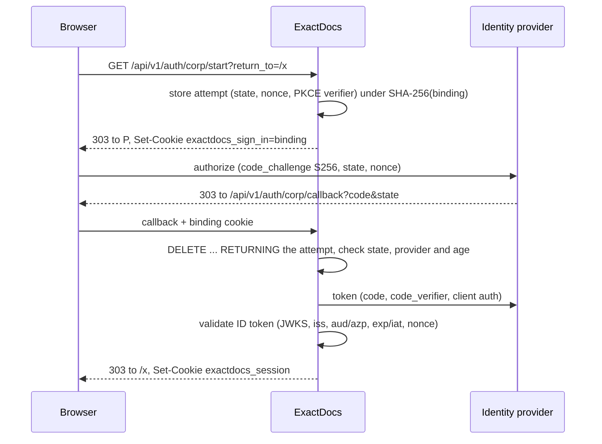

# External sign-in (OIDC)

!!! abstract "TL;DR"
    - Identity providers are configured in settings only (`[auth.providers.<name>]`); the redirect
      URI is built from `EXACTDOCS_PUBLIC_URL`.
    - A sign-in attempt lives 10 minutes, keyed by the SHA-256 of a browser binding cookie, and the
      callback takes it once with `DELETE ... RETURNING`.
    - An identity links to its account by (issuer, subject), never by email or username; the first
      allowed sign-in creates the account.
    - `admin_groups` decides the role at every sign-in and revalidation, and access ends at
      `access_until`, so it fails closed when no revalidation runs.
    - The setup still creates a local break-glass admin, and password sign-in never depends on a
      provider.

Identity providers are configured in settings only (`[auth.providers.<name>]`,
`bootstrap/settings.py:SignInProviderSettings`); nothing about them is stored.

`bootstrap/sign_in.py` turns each into:

- the domain's `SignInPolicy` (`models.py`: who is admitted, `admin_groups`, `group_prefix`, the
  revalidation times);
- a `SignInProvider` driven adapter (`identity/adapters/driven/oidc.py:OidcProvider`: discovery,
  PKCE through Authlib, the ID token through joserfc, HTTP through `httpx2`).

The redirect URI is built from `EXACTDOCS_PUBLIC_URL`.

## MCP over OAuth

`EXACTDOCS_MCP_OAUTH_PROVIDER`: `bootstrap/mcp_oauth.py` runs FastMCP's `OIDCProxy` for the chosen
provider and combines it with the API-token verifier through `MultiAuth`.

- The proxy's token verifier (`identity/adapters/driving/mcp.py:ExternalTokenVerifier`) calls the
  `IdentifyExternalToken` use case at every request: the provider adapter validates the ID token
  (`SignInProvider.verify_id_token`) and the provider's `SignInPolicy` admits the person. Nothing is
  stored by the domain.
- A disabled account is refused at the next call. The groups are those of the ID token the proxy
  holds, so a group change shows when it expires and the host renews it.
- The verifier carries a frozen `ExternalTokenIdentity` object in request-local access-token claims.
  `bootstrap/caller.py` accepts only that object type for the same authenticated account; JSON
  claims cannot assert it.
- Library role resolution uses its mapped groups and policy role, while still denying disabled or
  missing linked accounts. OAuth-only callers can use group grants without creating accounts or
  overwriting web memberships and refresh tokens.
- `MultiAuth` qualifies its `client_id` by trust source; the original typed `original_client_id`
  names the stored account.
- Resource-list snapshots also distinguish OAuth policy roles and mapped groups, so one credential
  cannot reuse a broader list built by another credential for the same account.

## The sign-in flow

## Attempts

- `identity_sign_in_attempts` holds `state`, `nonce`, the PKCE verifier, the provider and
  `return_to` for 10 minutes.
- Rows are keyed by the SHA-256 of a random browser binding whose value only the browser holds (an
  HttpOnly, SameSite=Lax cookie on `/api/v1/auth`).
- The callback takes the row with `DELETE ... RETURNING` before anything else, so it works once on
  any process. It needs the cookie, the row's provider and its `state` (compared in constant time).
- Login CSRF and replays are refused (`sign_in_failed`), and so is any ID token check.
- Expired rows are pruned when the next attempt is stored.
- SameSite=Lax suffices because the provider comes back with a top-level `GET`
  (`response_mode=query`).

## Links

- `identity_external_identities` (primary key (issuer, subject), one per account) connects an
  identity to its account. Email and username never do.
- A first allowed sign-in creates the account (`password_hash` NULL) with its link and groups in one
  transaction (`create_linked_account`):
    - the unique username refuses a taken name, and then `<name>@<provider>` is tried;
    - the primary key refuses a second link of the identity (two concurrent first sign-ins: the
      loser uses the winner's account).
- `identity_account_groups` holds each account's groups (with `group_prefix`), replaced at every
  sign-in and revalidation, for library roles (grants to a group).
- `identity_account_roles` holds the values of the provider's `role_claim` the same way, apart from
  the groups: only [role rules](role-rules.md) read them.
- An account without a password costs one dummy hash at password sign-in, like an unknown user.

## Role and access

- **Role.** `admin_groups` and the `instance_admin` [role rules](role-rules.md) decide an external
  account's role at every sign-in and revalidation.
  Demotion is not held back by the last-enabled-admin guard (that guards the operator's disable
  only), and a local account's role never changes through a provider.
- **Access** ends at the link's `access_until`. `IdentifyCaller` and `IdentifyToken` refuse an
  external account past it (the session row is deleted), so access fails closed even when no
  revalidation runs.
    - A sign-in or a successful check sets it to
      `now + revalidate_minutes + revalidate_grace_minutes`.
    - Without a refresh token, it is set to `now + revalidate_grace_minutes`.

## Revalidation

`RevalidateExternalAccounts` runs every `auth.revalidate_poll_seconds`, started by
`Container.running()` in the server only, never in the read-only stdio container.

1. Links whose `next_check_at` passed and that hold a refresh token are claimed in batches with a
   lease (`REVALIDATION_LEASE`; on PostgreSQL `FOR UPDATE SKIP LOCKED`, so processes share the work
   and never check one link twice).
2. They are refreshed with the provider.

What happens next depends on the answer:

- **Still allowed:** groups, role, `access_until` and the (possibly rotated) refresh token are
  stored, but only while the link is still as it was claimed[^claimed].
- **Refused:** a lost group, a refused refresh token, claims of another subject, a token that no
  longer opens, or a provider no longer configured. `access_until` becomes now, the sealed token and
  groups are dropped and the account's sessions deleted, until its next allowed sign-in.
- **Unreachable:** nothing changes. The link is tried again after the lease, and access ends with
  the grace.

[^claimed]: ../`record_revalidation` compares its token and its sign-in, check and access times, and
    that the account is not disabled, in the `UPDATE` itself. A disable, revocation or sign-in that
    happened while the provider answered wins, and the answer is dropped (`superseded`).

## Refresh tokens and the break-glass admin

- **Refresh tokens** are sealed by the bootstrap secret box under `SIGN_IN_TOKENS_PURPOSE` through
  identity's own `SecretBox` port. Disabling an account drops its sealed token.
- **The local break-glass admin:** the setup still creates the first admin locally, external sign-in
  sits behind `SetupGuard`, and password sign-in never depends on a provider.
