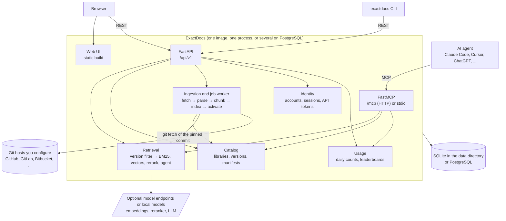

# Architecture

!!! abstract "TL;DR"

    - ExactDocs is a **modular monolith**: one Docker image or one `uvx exactdocs`, split into five
      domains (`catalog`, `identity`, `retrieval`, `ingestion`, `usage`) that never import each other.
    - Inside each domain the code is **hexagonal** (ports and adapters) with the dependency rule of
      clean architecture. The React client follows the same idea with **vertical slices**.
    - Tests enforce these rules ([What enforces it](conventions.md#what-enforces-it)).
    - A new version becomes visible in one step, and only once it is complete.

ExactDocs ships as one deployable (one Docker image, one `uvx exactdocs`) and is split into
**domains** with hard boundaries.

- Inside every domain the code follows **hexagonal architecture** (ports and adapters) with the
  dependency rule of clean architecture.
- The React client mirrors the same idea with **vertical slices**.
- Tests enforce all of it.

## The system at a glance

- An import fetches only the pinned commit and only the selected files.
- It splits every article at its headings and indexes it.
- A new version becomes visible in one step, once it is complete.
- A re-sync of a branch re-chunks only the files that changed.

[Flows](../flows/index.md) draws each path.

## Repository layout

| Path | What it is |
|---|---|
| `pyproject.toml` | uv workspace root: dev tools, ruff, ty, pytest and behave config, the `docs` group (Zensical) |
| `packages/exactdocs-kernel/` | shared kernel (`src/exactdocs_kernel/`), a separate, published package |
| `packages/exactdocs/` | the application, published as `exactdocs` (`src/exactdocs/`) |
| `.../exactdocs/bootstrap/` | composition root: settings, container, bridges, migrations, HTTP / MCP / CLI entry points |
| `.../exactdocs/catalog/` | domain: libraries, versions, manifests, article contents |
| `.../exactdocs/identity/` | domain: local and external accounts (admins and users), web sessions, API tokens and library roles |
| `.../exactdocs/retrieval/` | domain: chunks, the BM25 index, `search_docs`, `query-docs`, `resolve-library-id` |
| `.../exactdocs/ingestion/` | domain: jobs, the DBOS worker, git access, parsing, chunking and the import |
| `.../exactdocs/usage/` | domain: daily counts of reads, searches and answers, usage reports and leaderboards |
| `.../exactdocs/_web/` | the built web UI (gitignored, added by CI / Docker) |
| `packages/exactdocs/tests/` `packages/exactdocs/features/` | pytest (unit, integration, architecture) and behave (Gherkin acceptance scenarios) |
| `packages/exactdocs/evals/` | the retrieval eval suite (Pydantic Evals), not shipped; see [Retrieval evals](../evals/index.md) |
| `web/` | React client (Vite, TanStack Router and Query, shadcn); see [web/README.md](https://github.com/SirCypkowskyy/ExactDocs/blob/develop/web/README.md) |
| `deploy/` | Dockerfile, smoke test, size-budget check, Mermaid check, the test servers and helper scripts of CI and the release |
| `e2e/` | the Playwright test of the whole loop in a browser |
| `docs/` | this site (Zensical) |

`.../exactdocs/` stands for `packages/exactdocs/src/exactdocs/`.

## Pages in this section

| Page | What it covers |
|---|---|
| [Domains and boundaries](domains.md) | what may import what, bridges, the secret box, outbound connections, the fixed module set of a domain |
| [Persistence](persistence.md) | the data directory, SQLite, PostgreSQL, libSQL, migrations, backup, the search index format |
| [Version storage](versions.md) | manifests, logos, manual tags, renames between versions |
| [Vectors, embedding and budgets](embeddings.md) | the vector store, background embedding, AI spend and budgets |
| [Data model](data-model.md) | the tables of every domain and the states of manifests and jobs |
| [Identity](identity.md) | accounts, the setup guard, sessions, external sign-in, library roles |
| [Usage counts](usage.md) | daily counts, reports and leaderboards |
| [Background jobs](jobs.md) | the DBOS worker, durable steps, several processes, schedules, push webhooks |
| [The import](import.md) | how a version is imported, re-chunked, re-tagged, and what it keeps |
| [Telemetry](telemetry.md) | traces, metrics, scrubbing, Prometheus |
| [External index backends](index-backends.md) | moving the search or vector index to another engine |
| [AI retrieval](ai-retrieval.md) | provider profiles, mode selection, hybrid, HyDE, reranker, LLM judge, local models |
| [Agentic search](agentic.md) | the search agent, its answer cache, repo guidance |
| [Python conventions](conventions.md) | coding rules and the tests that enforce them |
| [Web client](web-client.md) | vertical slices in the React client |
