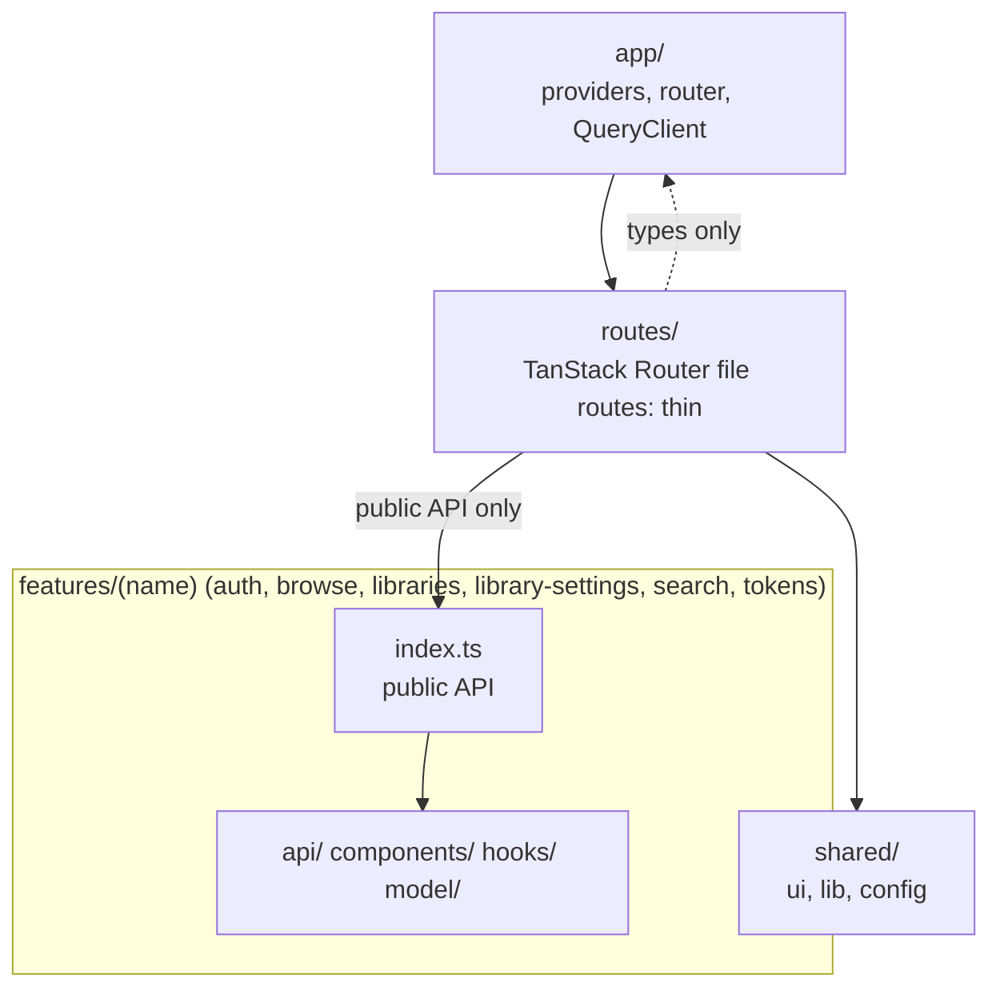

# Web client: vertical slices

!!! abstract "TL;DR"

    - The React client is split into features, each mirroring a backend use case or domain view.
    - Features never import each other. Routes are thin and use a feature's public API only.
    - Shared code moves to `shared` when it is generic; business logic that only looks the same
      stays duplicated.

- A feature mirrors a backend use case or domain view.
- Features never import each other. If two need the same thing, it:
    - moves to `shared` when it is generic;
    - stays duplicated when it is business logic that only looks the same.

Details: [web/README.md](https://github.com/SirCypkowskyy/ExactDocs/blob/develop/web/README.md).
