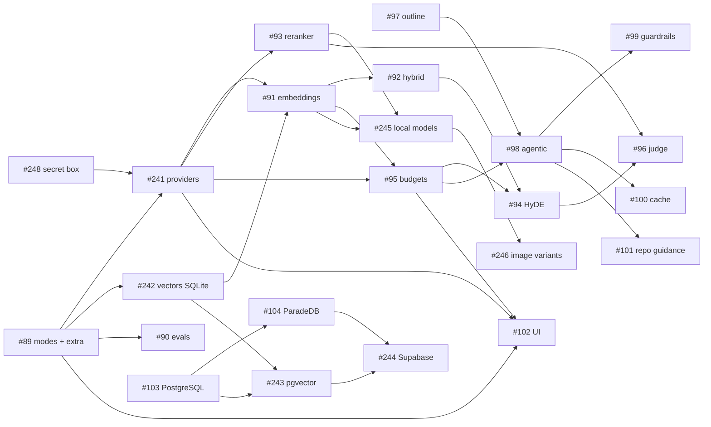

# AI retrieval decisions

| | |
|---|---|
| **Status** | Accepted, 2026-11-07 |
| **Scope** | Milestone *Next: AI retrieval* (#89 to #104, #241 to #246); sign-in for #105 and #106 (recorded here, built in *Next: Teams & integrations*) |
| **Issue** | #240 |
| **Decided by** | The owner decided the databases, the LLM providers and the sign-in providers; the rest was proposed in #240 and is open to change in review |

This record fixes how ExactDocs adds embeddings, rerankers and LLMs on top of BM25, where their
vectors live, how operators configure them, what they cost and what leaves the instance. Each
issue of the milestone points here instead of deciding these again. The short form is in the
[Decisions](../user-stories.md#decisions) table; the architecture of what is built today is in
[Architecture](../architecture.md).

## Context

- ExactDocs is a BM25 search server by default and must stay one: a 384 MB image within a 400 MB
  budget, a model-free wheel and image checked by CI (RUN-02, [Size and model-free
  budgets](../releasing.md#size-and-model-free-budgets)), and no outbound connection but git.
- The owner decided: **databases** are local SQLite with vector search inside SQLite, PostgreSQL
  with pgvector, and Supabase (managed PostgreSQL with pgvector); **LLM providers** are a custom
  OpenAI-compatible API (base URL plus an optional key), OpenAI, OpenRouter, Anthropic, Azure
  OpenAI, Google Vertex AI and other popular platforms; **sign-in** (Teams) is custom OIDC, OAuth,
  ADFS and GitHub with organization and team membership checks, GitHub Enterprise Server (GHE)
  included.
- The earlier plan named pydantic-ai and its harness, float32 BLOBs with numpy for SQLite vectors,
  `OpenAICompatibleProvider` for custom endpoints, FastMCP's rate-limit middleware, and "no
  in-process models". Checking the current releases changed several of these (below).

## Summary

| Topic | Decision |
|---|---|
| Chat and agents | **pydantic-ai-slim 2.60.0** models and providers, one profile per endpoint, always given explicit URLs and keys (never the SDKs' environment variables); harness 0.60.0 for Code Mode, spend limits and guardrails |
| Embeddings | Our own `Embeddings` port; adapters over `pydantic_ai.Embedder` (remote) and **fastembed** (local) |
| Rerankers | Our own `Reranker` port; Cohere-compatible and TEI HTTP adapters, fastembed cross-encoder, or an LLM judge |
| Vector store | One `VectorIndex` port; **sqlite-vec** on SQLite, **pgvector** on PostgreSQL and Supabase; one table per embedding space, exact search scoped to the manifest |
| Databases | SQLite (default), PostgreSQL on **psycopg 3** (#103), ParadeDB for BM25 (#104), Supabase as "PostgreSQL without pg_search" (#244) |
| Packaging | `exactdocs[ai]` and `exactdocs[local]` extras; images **base** (400 MB), **-ai** (560 MB), **-local** (950 MB, models included) |
| Configuration | Named provider profiles and roles in env or a TOML file; UI-managed profiles with keys sealed by the existing secret box; per-library overrides except the embedding model |
| Offline | Nothing configured: nothing imported, nothing sent. `-local`: no network needed at all |
| Cost | Token and USD budgets per instance, library and user, daily and monthly, in one database table: harness `SpendLimits` (over a `BatchSpendStore`) for LLM agents, retrieval's own check for embeddings and rerankers; rate limits inside retrieval; a limit degrades search, never fails it |
| Telemetry | pydantic-ai's OpenTelemetry instrumentation with `include_content=False`; `gen_ai.*` metrics without library, user or query labels |
| Evals | Pydantic Evals on the fixture libraries; wrong-version rate 0 is a hard gate; real local models in CI, LLMs only with test models or by hand |
| Sign-in (Teams) | Several named providers: `oidc` (ADFS included), `oauth2`, `github` (GHE base URL, org and team membership via the GitHub API) |

## Databases

- **SQLite** stays the default: one file in the data directory, vectors in it too (one backup).
- **PostgreSQL** (#103) moves into this milestone. Driver: **psycopg 3** async
  (`postgresql+psycopg://`), already in the image as a DBOS dependency, so it costs nothing;
  asyncpg would add about 32 MB and a second driver. DBOS keeps its system tables in the **same
  database**: bootstrap sets `DBOSConfig.system_database_url` to the app's PostgreSQL URL and
  `dbos_system_schema` (default `dbos`) to a schema of their own. That is what makes several server
  processes safe. (DBOS 3.3's default system database is a local SQLite file, today's
  `jobs.sqlite`; given a PostgreSQL system database that does not exist, it connects to the
  `postgres` database and runs `CREATE DATABASE`, which managed services such as Supabase usually
  forbid. Pointing it at the existing app database avoids that; DBOS still first connects to
  `postgres` to check that the database exists and only logs a warning when it may not, which
  #103 and #244 verify with a role that cannot create databases.)
- **BM25 on PostgreSQL** is ParadeDB `pg_search` (#104), as decided before. The CI image
  (`paradedb/paradedb`) also bundles pgvector.
- **Supabase** (#244) is supported as a PostgreSQL database, nothing more: no Supabase SDK, Auth or
  Storage. It has pgvector (in the `extensions` schema) but not `pg_search`, so a third adapter of
  the search port uses PostgreSQL full-text search (`tsvector` with the `simple` configuration on
  the same identifier-expanded column, ranked with `ts_rank_cd`) whenever `pg_search` is missing.
  It is not true BM25: the shared ranking suite runs on it and lists any expected-order
  difference. Connections need `sslmode=require` and a session: a direct connection (IPv6 only
  on most Supabase plans, unless the IPv4 add-on is bought) or the pooler in session mode on port
  5432. The transaction-mode pooler breaks prepared statements and DBOS's `LISTEN` connection, so
  it is refused at start. #244's CI runs DBOS on `supabase/postgres` with `dbos_system_schema`.

## Provider abstraction

### Chat and agents: pydantic-ai

Every LLM call (HyDE #94, judge #96, agentic #98) is a pydantic-ai `Agent` on a model built from a
**provider profile** (#241). pydantic-ai already speaks every API the owner listed, handles
retries, usage, cost (bundled `genai-prices` data) and OpenTelemetry, and the harness adds Code
Mode, `SpendLimits` and guardrails. A profile has a `kind`:

| Profile `kind` | pydantic-ai provider | Chat model class | Embeddings | SDK in `[ai]` |
|---|---|---|---|---|
| `openai-compatible` (custom: base URL, optional key) | `OpenAIProvider(base_url=…, api_key=…)` | `OpenAIChatModel` | `OpenAIEmbeddingModel` | `openai` |
| `openai` | `OpenAIProvider` | `OpenAIResponsesModel` | `OpenAIEmbeddingModel` | `openai` |
| `openrouter` | `OpenRouterProvider` | `OpenRouterModel` | `OpenAIEmbeddingModel` on the same provider | `openai` |
| `anthropic` | `AnthropicProvider`; `platform = "api"` (default, optional `base_url` for gateways), `"vertex"` (Claude on Vertex AI: `anthropic_client=AsyncAnthropicVertex(project_id=…, region=…, base_url=…, credentials=…)`), `"foundry"` (Claude on Azure AI Foundry: `AsyncAnthropicFoundry(base_url=… or resource=…, api_key=… or azure_ad_token_provider=…)`) or `"bedrock"` (`AsyncAnthropicBedrock`, needs boto3: not in the images) | `AnthropicModel` | none: Anthropic has no embedding API | `anthropic` (Vertex auth through `google-auth`, already there via google-genai) |
| `azure` (Azure OpenAI) | `AzureProvider(azure_endpoint, api_version, api_key)`; with `auth = "entra"` (no key): `AzureProvider(openai_client=AsyncAzureOpenAI(azure_endpoint=…, api_version=…, azure_ad_token_provider=…))` with the **sync** `azure.identity.get_bearer_token_provider(credential, "https://cognitiveservices.azure.com/.default")` (managed identity, workload identity or a client secret). The sync credential blocks only when the cached token is refreshed, about once an hour; `azure.identity.aio` would need `azure-core[aio]` and so aiohttp, which is not in the lock or the budget; the model name is the deployment | `OpenAIChatModel` | `OpenAIEmbeddingModel` | `openai`, `azure-identity` (about 5 MB) |
| `google-vertex` (Vertex AI) | `GoogleCloudProvider(project, location, credentials)`: a service-account file, workload identity / ADC, or an Express-mode key | `GoogleModel` | `GoogleEmbeddingModel` | `google-genai` |
| `google` (Gemini API) | `GoogleProvider(api_key)` | `GoogleModel` | `GoogleEmbeddingModel` | `google-genai` |
| `ollama`, `vllm` | `OllamaProvider(base_url)`, `VLLMProvider(base_url)` | `OllamaModel` (a subclass of `OpenAIChatModel`), `OpenAIChatModel` | `OpenAIEmbeddingModel` | `openai` |
| `litellm` (gateway) | `LiteLLMProvider` | `OpenAIChatModel` | `OpenAIEmbeddingModel` | `openai` |
| `deepseek`, `together`, `fireworks`, `cerebras`, `github` (Models), `vercel`, `moonshotai`, `heroku`, `nebius`, `ovhcloud`, `sambanova`, `alibaba` | pydantic-ai's provider of that name | `OpenAIChatModel` (`CerebrasModel` for `cerebras`, also a subclass) | where the platform has them | `openai` |
| `bedrock`, `groq`, `mistral`, `cohere`, `xai`, `huggingface` | pydantic-ai's provider of that name | its own model class | per platform | **not included**: each needs its own SDK |
| `local` | none | none (use `ollama` for a local LLM) | fastembed (#245) | `[local]` extra |

- **Explicit values only, never the SDKs' environment.** The provider factory always passes an
  explicit `base_url` and `api_key` (or a client built with them) to every provider, using the
  fixed placeholder `"unused"` for a keyless profile, explicit project, location and
  credentials to Vertex, explicit `base_url`, `region` and `project_id` to `AsyncAnthropicVertex`,
  explicit `base_url` (or `resource`) to `AsyncAnthropicFoundry`, and explicit `azure_endpoint`
  and `api_version` to `AsyncAzureOpenAI`. It never builds a model from a `"<provider>:<model>"`
  string (which infers the provider from the environment). Otherwise the SDKs fall back to
  `OPENAI_API_KEY`, `OPENAI_BASE_URL`, `OPENAI_API_VERSION`, `ANTHROPIC_API_KEY`,
  `ANTHROPIC_VERTEX_BASE_URL`, `ANTHROPIC_VERTEX_PROJECT_ID`, `CLOUD_ML_REGION`,
  `ANTHROPIC_FOUNDRY_BASE_URL`, `ANTHROPIC_FOUNDRY_RESOURCE`, `ANTHROPIC_FOUNDRY_API_KEY`,
  `AZURE_OPENAI_API_KEY`, `AZURE_OPENAI_ENDPOINT`, `OPENROUTER_API_KEY`, `OLLAMA_BASE_URL`,
  `GOOGLE_API_KEY`, `GEMINI_API_KEY`, `GOOGLE_APPLICATION_CREDENTIALS` and the like: a keyless
  custom gateway would receive the host's OpenAI key, and every `*_BASE_URL` / `*_ENDPOINT` would
  redirect traffic. ADC for Vertex is used only when the profile says `credentials = "adc"`. #241's
  socket-guard test runs with those variables set and proves none of them is used.
- **Custom endpoints** use `OpenAIProvider(base_url=…, api_key=…)` with `OpenAIChatModel` (Chat
  Completions, the most widely implemented API). pydantic-ai's `OpenAICompatibleProvider`,
  named in the first plan, is an internal base class in 2.60.0, not an entry point.
- **Platforms whose SDK is not included** (Bedrock, for Claude too, pulls boto3; the others their
  own clients)
  are reached through their OpenAI-compatible endpoint as `openai-compatible`, through a LiteLLM
  gateway, or, with `uvx`, by adding the SDK: `uvx --from 'exactdocs[ai]' --with
  'pydantic-ai-slim[bedrock]==2.60.0' exactdocs serve`. The images do not include them.
- **One HTTP client per profile** on `httpx2` (what pydantic-ai 2.60.0 uses): proxy on the
  transport (a retrying transport stops httpx reading `HTTPS_PROXY`), extra headers (values masked
  in logs), exactly one retry layer, and an overall `request_timeout`.

### Embeddings: a small port with two kinds of adapter

pydantic-ai 2.60.0 has `Embedder` with OpenAI (and every OpenAI-compatible provider), Cohere,
Bedrock, Google/Vertex, Voyage and sentence-transformers models. On Python 3.14 the Voyage and
sentence-transformers extras are not installable (their requirements stop at 3.13), and our code
never subclasses third-party bases (the only inheritance in the codebase is exceptions), so a
local model cannot be added as an `EmbeddingModel` subclass. Hence retrieval declares its own
**`Embeddings` driven port** (embed documents, embed a query, model identity, dimensions), with:

- an adapter over `pydantic_ai.Embedder` for every remote kind above that has embeddings; it
  batches inputs itself (`batch_size`) and sets `EmbeddingSettings(dimensions=…)` when the model
  supports shortening;
- a fastembed adapter for `local` (#245).

### Rerankers

pydantic-ai has no rerank API. Retrieval declares a **`Reranker` driven port** (query and
candidates in, scores out) with three adapters: HTTP in the Cohere-compatible `/v2/rerank`
dialect (Cohere, Jina, Voyage, vLLM, LiteLLM, Azure AI Foundry) or the TEI `/rerank` dialect
(#93), fastembed's `TextCrossEncoder` (#245), and an LLM **judge** on any chat profile (#96).

## Local and offline models

- **fastembed 0.9.1 on ONNX Runtime 1.31.0** (CPU) in an `exactdocs[local]` extra: embeddings
  (`TextEmbedding`) and a cross-encoder (`TextCrossEncoder`) without torch. sentence-transformers
  was rejected: it needs torch (hundreds of MB) and is not installable from pydantic-ai on 3.14.
- **Defaults:** `BAAI/bge-small-en-v1.5` (384 dimensions, 67 MB quantized ONNX) and
  `Xenova/ms-marco-MiniLM-L-6-v2` (91 MB). Other fastembed models can be configured; the eval
  suite decides whether the defaults change.
- **No download at run time.** `exactdocs models pull` is the only command that contacts the
  Hugging Face Hub; it stores models in **`EXACTDOCS_MODELS_DIR`** (default `<data dir>/models`;
  the `-local` image sets it to its read-only `/opt/exactdocs/models`). At run time models load
  from that directory only (`specific_model_path`, `local_files_only`: fastembed never reaches Hub code, so `HF_HUB_OFFLINE` is not needed, #278); a missing model disables the role at start with a message, it is
  never fetched.
- A local **LLM** is out of scope for in-process inference: use the `ollama` kind (or vLLM,
  llama.cpp's server, LM Studio as `openai-compatible`).

### Image variants

Measured on 2026-11-07 (Python 3.14, x86_64, site-packages with bytecode, which the image keeps):

| Variant | Contents | Estimated | Budget |
|---|---|---|---|
| `exactdocs:<v>` | as today: BM25, SQLite and PostgreSQL | 384 MB | **400 MB** (unchanged) |
| `exactdocs:<v>-ai` | `exactdocs[ai]`: +141 MB (`anthropic` 17, `openai` 16, `pydantic_monty` 12, `pydantic_ai` 10, google-genai about 11, harness 6, ...), plus about 5 MB for `azure-identity` | 531 MB | **560 MB** |
| `exactdocs:<v>-local` | `exactdocs[ai,local]`: +196 MB (`onnxruntime` 63, numpy 57, pillow 20, tokenizers 12, ...) and the two default models (158 MB) in `/opt/exactdocs/models` (`EXACTDOCS_MODELS_DIR`) | 887 MB | **950 MB** |

- The base image and the wheel stay **model-free** (RUN-02): the `ML_PACKAGES` checks keep
  ignoring `extra ==` requirements, and also apply to the `-ai` image; only `-local` may hold
  ONNX Runtime and model files.
- `uvx exactdocs` stays BM25-only; `uvx --from 'exactdocs[ai]' exactdocs serve` and
  `'exactdocs[ai,local]'` add the extras.
- `[ai]` lists `pydantic-ai-harness` and `pydantic-monty` instead of
  `pydantic-ai-harness[codemode]`: that extra also pulls a DuckDuckGo search client (`ddgs`,
  `primp`, `lxml`: about 27 MB) that Code Mode does not import.
- CI builds the three targets of one Dockerfile and checks each budget (#246). CI (arm64,
  PR #285) measured **387.1**, **520.4** and **866.5 MB** (amd64: 353.0, 492.0 and 847.9 MB), so
  the budgets stay as set: 7.1 % of headroom for `-ai`, and 8.8 % for `-local`, kept on purpose as
  room for a default-model update. `docs/releasing.md`, *Size and model-free budgets*, has the
  reasoning. The `-local` models are baked in at build time (pulled at their pinned revisions,
  their ONNX files checked against pinned sha256 digests), not pulled at first start: the image
  must work with `--network none`. Their licenses (MIT for bge-small, Apache-2.0 for the
  cross-encoder) ship with them in `/opt/exactdocs/models/NOTICE`.

## Vector store

- **One driven port, `VectorIndex`** (#242): create or retire a space, upsert and delete vectors by
  chunk key, find the nearest chunks within one manifest, report a manifest's coverage. In-memory,
  SQLite (#242) and pgvector (#243) adapters run one contract test.
- **Embedding space.** A space is one (profile kind, model, dimensions, input format version)
  and is recorded in `retrieval_embedding_spaces` with its state (`building`, `active`,
  `retired`). Its vectors live in **one table per space** (`retrieval_vec_<space>`), created and
  dropped by the adapter, like the search index tables of `exactdocs reindex`. A table per space
  gives a fixed `vector(<dimensions>)` type on PostgreSQL and makes mixing two models impossible.
- **Keys and dedup.** A vector belongs to a `retrieval_chunks` row, which is already shared by
  every version holding the same blob with the same chunking, so a blob is embedded once. Garbage
  collection removes vectors with their chunk sets.
- **Search is exact, scoped to the manifest.** Every query is pinned to one version, so it scans
  at most that version's chunks (thousands to tens of thousands): sqlite-vec's
  `vec_distance_cosine` over float32 BLOBs, pgvector's `<=>`. No ANN index: exact results keep
  evals reproducible and need no tuning. HNSW per space is a follow-up if #242's benchmark (50,000
  vectors of 1,024 dimensions, p95 under 150 ms) fails on a real instance. Exact search also
  avoids pgvector's 2,000-dimension index limit.
- **sqlite-vec 0.1.9** (2026-03-31, the latest stable; 0.1.10 is still alpha) is loaded per
  connection, by the first search on that connection or by the availability check, which runs
  only once an embedding model is configured (so that hybrid can be reported unavailable before
  any space exists); with no embedding model it is never imported. A connection that searches
  also gets `PRAGMA mmap_size` (1 GiB of address space), which cut the p95 of #242's benchmark by
  about a fifth. It replaces the earlier "numpy brute force" decision:
  the distance runs in SQL, next to the manifest join, and numpy is not needed. Verified on uv's
  Python 3.14 build (`enable_load_extension`, `vec_distance_cosine`, `vec0`); the image runs
  `python:3.14-slim-trixie`, so #242 repeats the check in the built image. A Python built
  without loadable extensions reports hybrid as unavailable instead of failing.
- **Model change.** Changing the embedding model, its dimensions or the input format creates a
  new space and queues `embed` jobs. Until a version is covered by the new space it answers BM25
  with `fallback_reason: embedding_in_progress` (the old space cannot be queried without the old
  model). The old space is retired and dropped once the new one covers every version. Changing
  only a base URL keeps the space; `exactdocs ai reembed` forces a new one.
- **What is embedded:** the chunk's article title and heading path, then its text (input format
  1). Queries are embedded as queries where the model distinguishes them.

## Configuration

**Instance level, in the environment or a TOML file.** Settings gain an `ai` section read from
`EXACTDOCS_AI__...` variables (pydantic-settings, `__` as the nesting delimiter) and an optional
TOML file named by `EXACTDOCS_CONFIG_FILE`; the environment wins. The file holds no secrets: a
key in it is refused, keys come from the environment, from `api_key_file` (Docker and Kubernetes
secrets), or from the UI.

```toml
# exactdocs.toml (EXACTDOCS_CONFIG_FILE=/etc/exactdocs/exactdocs.toml)
[ai.providers.corp]                     # a company gateway
kind = "openai-compatible"
base_url = "https://llm.example.com/v1"
api_key_file = "/run/secrets/corp_llm_key"
headers = { "X-Team" = "docs" }
proxy = "http://proxy.example.com:3128"
request_timeout = 30

[ai.providers.vertex]
kind = "google-vertex"
project = "acme-ml"
location = "europe-west4"
credentials_file = "/run/secrets/vertex.json"

[ai.providers.offline]
kind = "local"                          # needs the [local] extra and `exactdocs models pull`

[ai.embedding]
model = "corp:text-embedding-3-small"   # <profile>:<model>, instance-wide only
dimensions = 1024                       # optional
batch_size = 64

[ai.reranker]
model = "offline:Xenova/ms-marco-MiniLM-L-6-v2"
top_n = 32

[ai.llm]
model = "vertex:gemini-2.5-flash"

[ai.judge]                              # optional, defaults to [ai.llm]
model = "corp:gpt-4.1-mini"

[ai.budgets]
daily_usd = 10
monthly_embedding_usd = 50
per_library_daily_usd = 2
per_user_daily_usd = 1
llm_searches_per_minute = 30

[ai.prices."corp:gpt-4.1-mini"]         # only for models genai-prices does not know
input_usd_per_mtok = 0.40
output_usd_per_mtok = 1.60
```

The same in the environment: `EXACTDOCS_AI__PROVIDERS__CORP__KIND=openai-compatible`,
`EXACTDOCS_AI__PROVIDERS__CORP__API_KEY=…`, `EXACTDOCS_AI__LLM__MODEL=corp:gpt-4.1-mini`.

- **Roles:** `embedding`, `reranker`, `llm`, `judge`; a role is `<profile>:<model>`. What is set
  decides which modes are available (#89), as in [Lightweight by
  default](../user-stories.md#lightweight-by-default).
- **Profiles managed in the UI or REST** (`/api/v1/ai/providers`, admin only, #241) are stored by
  retrieval, with their keys **sealed by the existing Fernet secret box** (`EXACTDOCS_SECRET_KEY`,
  the one that seals repository credentials). A key is never returned; without a secret key the
  UI refuses to store one. Profiles from the environment or the file are shown read-only.
  Retrieval declares its own small `SecretBox` port. The Fernet adapter itself **moves from
  ingestion to `bootstrap`** first (#248): retrieval (#241) and identity (#105) would otherwise
  depend on another domain's adapter module. The kernel cannot hold it (it needs `cryptography`).
- **The server's cloud identity is configuration only** (#241 review): a profile signed with
  ADC, a service-account file, Entra ID or the AWS identity (Claude on Bedrock) is configured in
  the environment or the file, never over REST, and takes no `base_url` (its endpoint is derived
  from `location` or `resource`, each a single DNS label), so a token of the machine's identity
  reaches only Google's, Azure's or AWS's endpoints. Extra headers may
  not carry credentials (`Authorization`, `*-key`, `*-token`, ...): keys go in the key field.
- **Per-library overrides** (stored by retrieval, #102; edited by admins until library roles
  exist, E12-05/06, then by the library's owner and admins): AI on or
  off (off: nothing of the library is ever sent to a provider), retrieval mode, the `llm`, `judge`
  and `reranker` profile and model, rerank `top_n`, agentic limits, and budgets no higher than the
  instance's. **Not** the embedding model: one space per instance keeps cross-library search
  (E5-06) comparable and the storage simple.
- **Precedence** for the mode stays call, then library, then instance, then the best available.

## Offline and no-outbound guarantees

| Situation | Guarantee | Proved by |
|---|---|---|
| Nothing configured (any install) | No module of `[ai]` or `[local]` is imported, sqlite-vec is not loaded, no connection is opened except to git remotes | the model-free test, extended with a socket guard (#241) |
| `[ai]` installed, nothing configured | Same as above | same test with the extra installed |
| A provider configured | Connections only to that profile's base URL, plus its identity endpoints: for Vertex with a service-account file `oauth2.googleapis.com`, with ADC or workload identity the GCE metadata server (`metadata.google.internal` / `169.254.169.254`); for Azure with Entra ID `login.microsoftonline.com` (or the managed-identity endpoint, `169.254.169.254` / `IDENTITY_ENDPOINT`). No telemetry to any vendor (no Logfire); `genai-prices` data is the bundled copy, never updated over the network; tiktoken is never used (below) | socket-guard test allowing only the mock endpoint, with the SDKs' `*_API_KEY` / `*_BASE_URL` variables set (#241) |
| `local` roles | No connection at all; models load from their folder on disk (`specific_model_path`, `local_files_only`); only `exactdocs models pull` contacts the Hub | test with sockets blocked (#245); `-local` smoke test with `--network none` (#246) |
| A library with AI off | No chunk, query or instruction file of it reaches any provider; its searches answer BM25 | scenario in #241 and #91 |

**No tiktoken.** The `openai` extra installs tiktoken, which downloads its encoding files from
`openaipublic.blob.core.windows.net` on first use (pydantic-ai's
`OpenAIEmbeddingModel.count_tokens` calls it). ExactDocs never calls `count_tokens`: accounting
uses the `usage` the provider returns, and `exactdocs ai estimate` estimates from characters
(4 per token) and says it is an estimate. A test asserts that tiktoken is never used: a chat role
does not import it, and no encoding is ever loaded. (pydantic-ai 2.60.0's
`pydantic_ai.embeddings.openai` imports tiktoken when it loads, so an OpenAI-API embedding role
imports the module, but never calls it; found in #241.)

What stays on the instance: HyDE's hypothetical answers (#94), written from user queries, are
cached in `retrieval_hyde_answers` per manifest, model and an HMAC of the normalized query (keyed
from the instance's secret key, never the query text), and deleted after `[ai.hyde] cache_ttl`
(30 days), with their manifest, or once their model is no longer configured.
The agentic answer cache (#100, `retrieval_agentic_answers`) keeps agentic answers (chunk IDs,
justifications, explored paths) per manifest, `llm` model and a fingerprint of the tag filter and
agentic limits; the question is kept as HMACs of it and of each term (HKDF purpose `exactdocs
agentic cache v1`) and, with an embedding model, as its embedding. Deleted after `[ai.agentic_cache]
ttl` (7 days), with their manifest, with the library's settings, or once their model or embedding
model is no longer configured.

What leaves the instance when a role is set: **embedding** receives chunk text (in background
jobs) and query text; **reranker** and **judge** receive query text and candidate chunk text;
**llm** (HyDE, agentic) receives query text and the docs the agent opens. Library names, user
identities and tokens are never sent.

## Cost and budgets

- **Accounting.** Every model call records input and output tokens and its price in USD:
  pydantic-ai's bundled `genai-prices` data, or the operator's per-model price
  (`[ai.prices]`). A USD budget on a model with no known price is refused at start; tokens are
  always counted. Local models cost nothing but their tokens are counted.
- **Budgets** (#95): token and USD limits per instance, per library and per user (the token's
  account; stdio MCP counts to instance and library), per UTC day and month, in one
  `retrieval_ai_spend` table (an atomic upsert per scope key and window) that works on SQLite and
  PostgreSQL, across processes.
    - **LLM agents** (HyDE, judge, agentic) are limited by the harness `SpendLimits` capability.
      Our store implements the harness **`BatchSpendStore`** protocol (`get_many` / `add_many`
      over `SpendEntry`) structurally. Its older `SpendStore` protocol is deprecated in 0.60.0:
      `SpendLimits` wraps it, warns, and loses the token-based deduplication of replays.
    - **Embedding and rerank calls** (`Embedder`, the HTTP rerankers, fastembed) never run
      through an agent, so `SpendLimits` cannot see them. Retrieval records and checks them
      itself, against the same table and the same rows, before each batch (the embed job) or
      call (rerank).
    - **We own the key format.** A ledger row is keyed by (scope kind, scope id, window, window
      start), in our own format. The harness builds its `SpendEntry.key` with private helpers
      (`store_key`, `bucket` in `pydantic_ai_harness/spend/_budget.py`, not exported), so our
      `BatchSpendStore` adapter parses each key the harness hands it into our row key, and never
      imports the private module. A contract test pins the harness 0.60.0 key format: a harness
      bump that changes it fails the test instead of splitting the spend over two sets of rows.
    - A check runs before each call or batch, so a burst can overshoot by at most the calls
      already in flight.
- **Per-call limits:** pydantic-ai `UsageLimits` on every call; for the agent also
  `max_tool_calls` and Monty's resource limits.
- **Rate limit:** LLM searches per minute per caller, enforced inside retrieval so it covers
  REST, HTTP MCP and stdio alike. It replaces FastMCP's `SlidingWindowRateLimitingMiddleware`,
  which only sees MCP and limits every tool, not just the expensive ones.
- **Degrade, never fail.** A budget or rate limit skips the LLM step and answers with the next
  cheaper mode, saying why (`fallback_reason`: `llm_budget_reached`, `llm_rate_limited`). An
  exhausted embedding budget stops the `embed` job (`ai_budget_reached`), retried when the window
  resets, while BM25 keeps answering.
- **Visibility:** `GET /api/v1/ai/usage` and the UI (#102) show spend and budget left per scope;
  `exactdocs ai estimate` prints the tokens and USD of embedding every version before it starts.

## Telemetry

- pydantic-ai's own OpenTelemetry instrumentation, `InstrumentationSettings(include_content=False)`,
  on the global providers that `bootstrap/otel_sdk.py` sets up (never Logfire, see
  [Telemetry](../architecture.md#telemetry)). Spans for model and embedding calls nest under the
  existing `retrieval.<search>` spans, with new stages `embed_query`, `hyde`, `rerank`, `judge` and
  `agent`; agent tool calls nest inside `run_code`.
- **No prompt text, ever.** `include_content=False` is the first guard; `ScrubbingExporter` also
  drops `gen_ai.input.messages`, `gen_ai.output.messages`, `gen_ai.system_instructions` and
  tool-call arguments as a second one. `EXACTDOCS_TELEMETRY_QUERY_TEXT` keeps covering the query
  text of request spans only; it never turns prompts on.
- **Metrics** (OTLP and `/metrics`): pydantic-ai's `gen_ai.client.token.usage`,
  `gen_ai.client.operation.duration` and `operation.cost`; ours: `exactdocs.ai.fallbacks` (by mode
  and reason), `exactdocs.ai.cache_hits` (by cache and mode), `exactdocs.embedding.backlog` (chunks waiting). Labels
  are bounded: provider kind, model (from configuration), operation, role, token type. Never the
  library, version, user or query, as for the existing metrics.

## Evaluation

- **Pydantic Evals 2.60.0** (dev dependency group, not an extra), datasets in the repository: the
  fixture library's expected queries plus natural-language questions, each with the expected
  version, article path and heading (#90).
- **Metrics per mode:** recall@1/5/10, MRR, **wrong-version rate**, p50 and p95 latency, tokens and
  USD per question, as a JSON report and a CI job summary.
- **Tiers.** Every PR runs BM25 (gating). A CI job with `[local]` and cached ONNX models runs
  `hybrid` and rerank for real, without any secret (report-only on PRs, compared with the
  baseline stored on `develop`). LLM modes run in tests with `TestModel` / `FunctionModel`; with a
  real provider only by a manual `workflow_dispatch` that has the key. No live endpoint is ever
  needed for CI to pass.
- **Gates.** Wrong-version rate must be 0 for every mode; recall@5 may not drop more than 2 points
  below the baseline. A mode becomes a default only when it beats BM25 recall@5 by at least
  5 points with wrong-version rate 0. Agentic runs are also checked from their traces (#99).
- How to run it, the dataset and the tiers as built: [Retrieval evals](../evals.md).

## Where the code lives

- Everything stays in the **retrieval** domain: ports `Embeddings`, `Reranker`, `VectorIndex`,
  the spend ledger (whose adapter also implements the harness `BatchSpendStore`), HyDE writer,
  judge and agent explorer; pydantic-ai, fastembed,
  sqlite-vec and pgvector only in `retrieval/adapters/driven/`. The architecture test adds them
  to the list of frameworks the core may not import.
- **Profiles and models.** Retrieval owns the profiles (`ProviderProfiles`, a repository port:
  UI-managed ones from its table, environment and file ones injected read-only by bootstrap) and
  resolves which profile and model a role uses for a library. Turning a resolved profile into
  something that can be called is the **`ModelFactory`** driven port, declared by retrieval
  (`chat_model(profile, model)`, `embedder(profile, model)`, `reranker(profile, model)`) and
  implemented in `bootstrap` with pydantic-ai, httpx2 and fastembed (it unseals the key through
  the `SecretBox` port, passes explicit values only, and imports the SDKs only when called). The
  core sees opaque handles; the AI adapters that receive them (HyDE writer, judge, explorer,
  embeddings, reranker) narrow them to the pydantic-ai types. So a profile edited in the UI takes
  effect at the next call without a restart, through an allowed call path.
- Embedding runs are an `embed` ingestion job kind (resumable steps per batch), reaching
  retrieval through a bridge, like indexing does today. No new domain: a separate package
  (`packages/exactdocs-retrieval-ai`) is the fallback if the extras ever need their own release
  cadence.

## Order of work

Each wave can be built in parallel; an issue starts when everything it depends on is merged. The
issues hold the authoritative `Depends on` lines.

| Wave | Issues | Depends on |
|---|---|---|
| 0 | #240 this record | - |
| 1 | #89 modes and the `[ai]` extra; #97 `article_outline`; #103 PostgreSQL; #248 secret box to bootstrap | merged MVP issues |
| 2 | #241 AI providers; #242 vector store on SQLite; #90 eval suite; #104 ParadeDB BM25 | #89 + #248; #89; #89; #103 |
| 3 | #91 embeddings; #93 reranker; #243 pgvector | #241 + #242; #241; #242 + #103 |
| 4 | #92 hybrid; #95 budgets; #245 local models; #244 Supabase | #91; #241 + #91; #91 + #93; #104 + #243 |
| 5 | #94 HyDE; #98 agentic; #102 UI; #246 image variants | #92 + #95; #97 + #95; #89 + #95 + #241; #241 + #245 |
| 6 | #96 judge; #99 guardrails; #100 cache; #101 repo guidance | #93 + #94 + #95; #98; #98 (+ #92); #98 |
| Teams | #105 sign-in after #103 and #248; #106 MCP OAuth after #105 | |

The longest chain is #89 → #241 → #91 → #95 → #94 → #96 (and #89 → #242 → #91). Budgets (#95)
now come **before** HyDE, so no LLM call ships unmetered.



## Sign-in for the Teams milestone

Recorded now so the PostgreSQL and provider work does not paint it into a corner; built in #105
and #106.

- **Several named providers** at once, next to local accounts (the local admin stays as
  break-glass). Each has a `kind`:
    - **`oidc`**: discovery from `<issuer>/.well-known/openid-configuration`, authorization code
      with PKCE, the ID token checked against the JWKS, configurable claims for username, email and
      groups. Works for Keycloak, Entra ID, Okta, Google, Auth0 and the like.
    - **ADFS is `oidc`** (ADFS 2016 and later; issuer `https://<host>/adfs`). Its quirks are
      configuration: the username from `upn` or `unique_name`, groups from the `group` claim that an
      issuance transform rule must emit (documented).
    - **`oauth2`**: for providers without OIDC; authorize, token and userinfo URLs and claim paths
      for subject, username, email and groups.
    - **`github`**: an OAuth App at a configurable `base_url`: `https://github.com`, a **GitHub
      Enterprise Server** host (API derived as `<base>/api/v3`) or GitHub Enterprise Cloud with data
      residency (`https://<subdomain>.ghe.com`, whose API is `https://api.<subdomain>.ghe.com`); an
      optional `api_url` overrides the derived one. Scopes `read:user read:org`. Access requires an
      `active` membership in an allowed organization (`GET /user/memberships/orgs/{org}`, checked
      **first**, per organization) and, when teams are listed, in an allowed team. Teams are then
      read with one paginated `GET /user/teams` and matched against the allowed list (it silently
      omits teams of organizations that restrict the app or need SSO, so only the per-org check
      can produce the 403 messages below). The per-team
      `GET /orgs/{org}/teams/{team_slug}/memberships/{username}` is the fallback for one team.
      Each allowed team becomes the ExactDocs group `github:<org>/<team>`.
    - **GitHub 403s are not "not a member".** An organization with OAuth App access restrictions
      must approve the OAuth App, and a SAML-enforced organization needs the token authorized for
      SSO; otherwise the membership call answers 403. Those answers are refused as "organization
      *acme* has not approved this app" or "authorize SSO for *acme*", with the setup documented,
      never as "not a member".
- **Membership follows the provider.** Groups and memberships are refreshed at every sign-in and
  every `revalidate_minutes` (default 60) with the user's provider token, sealed by the secret
  box (#248). A revoked token or a lost membership ends the session. When the provider cannot be
  reached, the session lasts at most `revalidate_grace_minutes` (default 1,440), then access is
  refused (fail closed).
    - `github`: OAuth App tokens do not expire, so the stored access token is enough.
    - `oidc`, `oauth2` and ADFS need a **refresh token** to fetch fresh groups: ExactDocs asks for
      `offline_access` (ADFS: refresh tokens enabled on the application group) and refreshes,
      then re-reads the ID token or userinfo claims. A provider that issues **no refresh token**
      cannot be revalidated: such a session is limited to `revalidate_grace_minutes` after sign-in,
      then the user signs in again (and groups are refreshed then). The UI and the docs say so.
- **Libraries:** Authlib for the web sign-in (already in the lock through FastMCP, at 1.9.3 from
  2026-11-03; the floor `authlib>=1.9.1` is the version released 2026-10-14). For MCP (#106), one provider is chosen
  (`EXACTDOCS_MCP_OAUTH_PROVIDER`): FastMCP `OIDCProxy` for `oidc` (ADFS included), `OAuthProxy`
  with the provider's endpoints for `oauth2` and `github` (FastMCP's `GitHubProvider` hard-codes
  github.com), each with our token verifier applying the same membership checks, combined with
  API tokens through `MultiAuth`.
- **Out of scope:** SAML, GitHub Apps (instead of OAuth Apps), SCIM provisioning.

## Pinned dependencies

Every version below was released at least two weeks before 2026-11-07 and checked on PyPI
(release date of its first file; a wheel for CPython 3.14 or a pure-Python wheel exists). They
install together with the current lock (`httpx2` 2.16, `fastmcp` 4.1.6, `opentelemetry` 1.45).

| Package | Version | Released | Where |
|---|---|---|---|
| `pydantic-ai-slim[openai,anthropic,google]` | 2.60.0 | 2026-10-23 | `[ai]` |
| `pydantic-ai-harness` | 0.60.0 (requires `pydantic-ai-slim==2.60.0`) | 2026-10-23 | `[ai]` |
| `pydantic-monty` | 1.3.0 | 2026-10-22 | `[ai]` (Code Mode sandbox) |
| `sqlite-vec` | 0.1.9 | 2026-03-31 | `[ai]` |
| `pgvector` (Python) | 0.5.1 | 2026-10-09 | `[ai]` |
| `fastembed` | 0.9.1 (0.9.0 until #246: 0.9.1 allows Pillow 13, which fixes CRITICAL CVEs of Pillow 12.3) | 2026-10-24 | `[local]` |
| `onnxruntime` | 1.31.0 | 2026-10-09 | `[local]` |
| `pydantic-evals` | 2.60.0 | 2026-10-23 | dev group |
| `psycopg[binary]` | 3.3.6 (already locked through DBOS) | 2026-09-18 | default |
| `azure-identity` | 1.26.0 | 2026-10-01 | `[ai]` (Azure OpenAI with Entra ID) |
| `authlib` | >= 1.9.1 (locked 1.9.3 through FastMCP, released 2026-11-03) | 2026-10-14 (the floor's date) | default (Teams) |

Transitive pins of note: `genai-prices` 0.1.13 (pydantic-ai's floor, 2026-10-15), `numpy` 2.5.4
(2026-10-10), `huggingface-hub` 1.33.0 (2026-09-24, fastembed requires < 2.0) and `pillow` 13.0.0
(2026-10-16; 12.3.0 until #246, which has CRITICAL and HIGH CVEs fixed in 13.0) under `[local]`;
`pyasn1` 0.6.5 (2026-10-27; 0.6.4 until #246, 4 HIGH CVEs) under `[ai]` (google-auth). All three
were more than two weeks old when bumped (2026-11-11), so no exception to the rule was needed.
Newer releases exist (pydantic-ai-slim 2.6x, harness 0.66, onnxruntime 1.31.1); they are taken by
Dependabot-style bumps once two weeks old, with the eval suite as the check.

## Consequences

- Operators choose an image: base for BM25, `-ai` for hosted models, `-local` for air-gapped
  semantic search. The base image and `uvx exactdocs` do not grow.
- PostgreSQL and Supabase arrive before teams and roles, so a shared database exists before
  sign-in (#105) needs one.
- Three search adapters (FTS5, pg_search, PostgreSQL full-text) and two vector adapters must keep
  passing one ranking suite and one contract test.
- A model change makes hybrid answer BM25 per version until re-embedding finishes; this is
  visible (`fallback_reason`) and never mixes vectors.

## Rejected options

| Option | Why not |
|---|---|
| numpy brute force over BLOBs on SQLite (earlier decision) | sqlite-vec does the same exact search in SQL, next to the manifest join, in a 214 KB wheel; numpy is 57 MB |
| `vec0` virtual tables or an ANN index | Every query is scoped to one manifest, which a join expresses and a partition key does not; exact search is fast enough there and reproducible |
| sentence-transformers / torch for local models | Hundreds of MB, and not installable through pydantic-ai on Python 3.14 |
| Putting `[ai]` in the base image | +141 MB over a 400 MB budget that is already 96 % used, for installs that only use BM25 |
| asyncpg | About 32 MB more and a second PostgreSQL driver next to psycopg, which DBOS already needs |
| A separate `ai` domain | Every consumer is retrieval; a domain would need bridges for each call without isolating anything |
| FastMCP rate-limit middleware for LLM limits | Covers MCP only and every tool, and answers with an error instead of degrading |
| A Supabase SDK or Supabase Auth | Only the database is needed; sign-in follows the Teams decisions |
