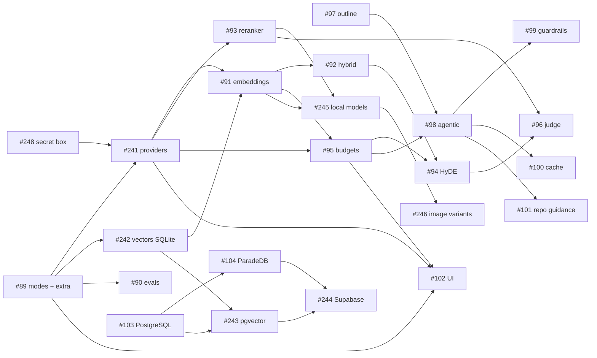

# Code layout, order of work and dependencies

!!! abstract "TL;DR"
    - All AI code stays in the retrieval domain. pydantic-ai, fastembed, sqlite-vec and pgvector
      appear only in `retrieval/adapters/driven/`, and `bootstrap` implements `ModelFactory`.
    - Embedding runs are an `embed` ingestion job kind. No new domain is added.
    - Work runs in waves 0 to 6. The longest chain is #89 → #241 → #91 → #95 → #94 → #96, and
      budgets (#95) come before HyDE so no LLM call ships unmetered.
    - Pinned versions include pydantic-ai-slim 2.60.0, pydantic-ai-harness 0.60.0, sqlite-vec
      0.1.9, fastembed 0.9.1 and onnxruntime 1.31.0, each released at least two weeks earlier.

## Where the code lives

- Everything stays in the **retrieval** domain: ports `Embeddings`, `Reranker`, `VectorIndex`,
  the spend ledger (whose adapter also implements the harness `BatchSpendStore`), HyDE writer,
  judge and agent explorer; pydantic-ai, fastembed,
  sqlite-vec and pgvector only in `retrieval/adapters/driven/`. The architecture test adds them
  to the list of frameworks the core may not import.
- **Profiles and models.**
    - Retrieval owns the profiles (`ProviderProfiles`, a repository port: UI-managed ones from its
      table, environment and file ones injected read-only by bootstrap). It resolves which profile
      and model a role uses for a library.
    - Turning a resolved profile into something that can be called is the **`ModelFactory`**
      driven port:
        - declared by retrieval: `chat_model(profile, model)`, `embedder(profile, model)`,
          `reranker(profile, model)`
        - implemented in `bootstrap` with pydantic-ai, httpx2 and fastembed. It unseals the key
          through the `SecretBox` port, passes explicit values only, and imports the SDKs only
          when called.
    - The core sees opaque handles. The AI adapters that receive them (HyDE writer, judge,
      explorer, embeddings, reranker) narrow them to the pydantic-ai types.
    - So a profile edited in the UI takes effect at the next call without a restart, through an
      allowed call path.
- Embedding runs are an `embed` ingestion job kind (resumable steps per batch), reaching
  retrieval through a bridge, like indexing does today.
- No new domain. A separate package (`packages/exactdocs-retrieval-ai`) is the fallback if the
  extras ever need their own release cadence.

## Order of work

Each wave can be built in parallel; an issue starts when everything it depends on is merged. The
issues hold the authoritative `Depends on` lines.

| Wave | Issues | Depends on |
|---|---|---|
| 0 | #240 this record | - |
| 1 | #89 modes and the `[ai]` extra; #97 `article_outline`; #103 PostgreSQL; #248 secret box to bootstrap | merged MVP issues |
| 2 | #241 AI providers; #242 vector store on SQLite; #90 eval suite; #104 ParadeDB BM25 | #89 + #248; #89; #89; #103 |
| 3 | #91 embeddings; #93 reranker; #243 pgvector | #241 + #242; #241; #242 + #103 |
| 4 | #92 hybrid; #95 budgets; #245 local models; #244 Supabase | #91; #241 + #91; #91 + #93; #104 + #243 |
| 5 | #94 HyDE; #98 agentic; #102 UI; #246 image variants | #92 + #95; #97 + #95; #89 + #95 + #241; #241 + #245 |
| 6 | #96 judge; #99 guardrails; #100 cache; #101 repo guidance | #93 + #94 + #95; #98; #98 (+ #92); #98 |
| Teams | #105 sign-in after #103 and #248; #106 MCP OAuth after #105 | |

The longest chain is #89 → #241 → #91 → #95 → #94 → #96 (and #89 → #242 → #91). Budgets (#95)
now come **before** HyDE, so no LLM call ships unmetered.

## Pinned dependencies

Every version below was released at least two weeks before 2026-11-07 and checked on PyPI
(release date of its first file; a wheel for CPython 3.14 or a pure-Python wheel exists). They
install together with the current lock (`httpx2` 2.16, `fastmcp` 4.1.6, `opentelemetry` 1.45).

| Package | Version | Released | Where |
|---|---|---|---|
| `pydantic-ai-slim[openai,anthropic,google]` | 2.60.0 | 2026-10-23 | `[ai]` |
| `pydantic-ai-harness` | 0.60.0 (requires `pydantic-ai-slim==2.60.0`) | 2026-10-23 | `[ai]` |
| `pydantic-monty` | 1.3.0 | 2026-10-22 | `[ai]` (Code Mode sandbox) |
| `sqlite-vec` | 0.1.9 | 2026-03-31 | `[ai]` |
| `pgvector` (Python) | 0.5.1 | 2026-10-09 | `[ai]` |
| `fastembed` | 0.9.1 (0.9.0 until #246: 0.9.1 allows Pillow 13, which fixes CRITICAL CVEs of Pillow 12.3) | 2026-10-24 | `[local]` |
| `onnxruntime` | 1.31.0 | 2026-10-09 | `[local]` |
| `pydantic-evals` | 2.60.0 | 2026-10-23 | dev group |
| `psycopg[binary]` | 3.3.6 (already locked through DBOS) | 2026-09-18 | default |
| `azure-identity` | 1.26.0 | 2026-10-01 | `[ai]` (Azure OpenAI with Entra ID) |
| `authlib` | >= 1.9.1 (locked 1.9.3 through FastMCP, released 2026-11-03) | 2026-10-14 (the floor's date) | default (Teams) |

Transitive pins of note:

| Package | Version | Released | Where | Note |
|---|---|---|---|---|
| `genai-prices` | 0.1.13 | 2026-10-15 | `[ai]` | pydantic-ai's floor |
| `numpy` | 2.5.4 | 2026-10-10 | `[local]` | |
| `huggingface-hub` | 1.33.0 | 2026-09-24 | `[local]` | fastembed requires < 2.0 |
| `pillow` | 13.0.0 | 2026-10-16 | `[local]` | 12.3.0 until #246, which has CRITICAL and HIGH CVEs fixed in 13.0 |
| `pyasn1` | 0.6.5 | 2026-10-27 | `[ai]` (google-auth) | 0.6.4 until #246, 4 HIGH CVEs |

- All three were more than two weeks old when bumped (2026-11-11), so no exception to the rule was
  needed.
- Newer releases exist (pydantic-ai-slim 2.6x, harness 0.66, onnxruntime 1.31.1). They are taken
  by Dependabot-style bumps once two weeks old, with the eval suite as the check.
