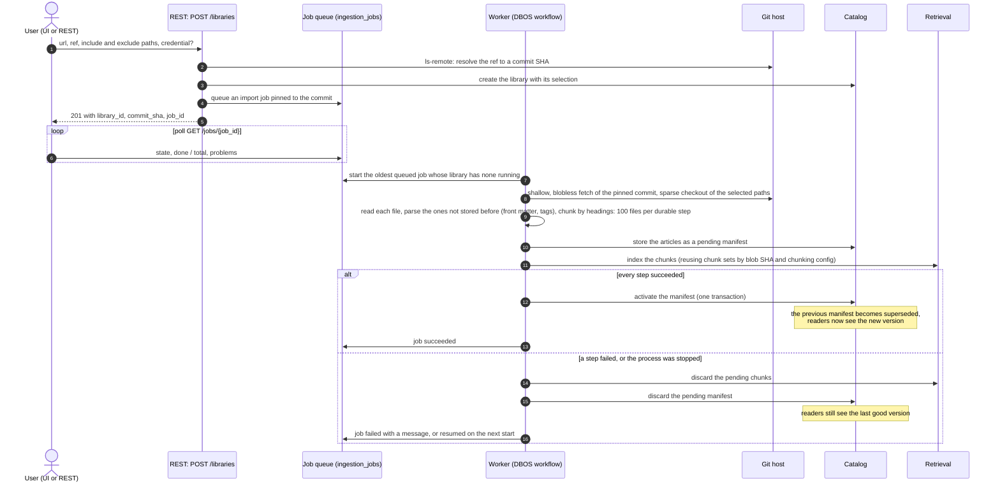
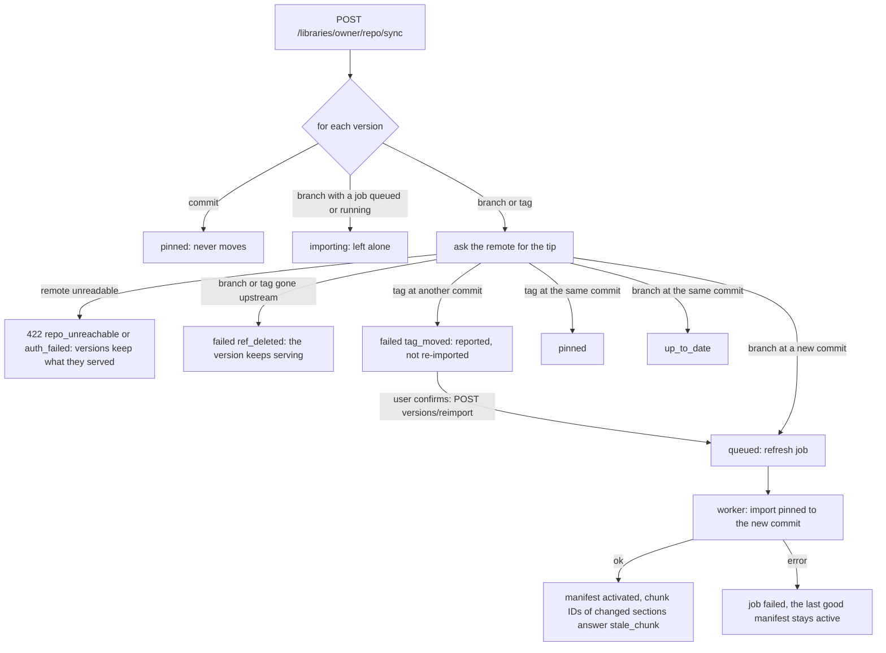
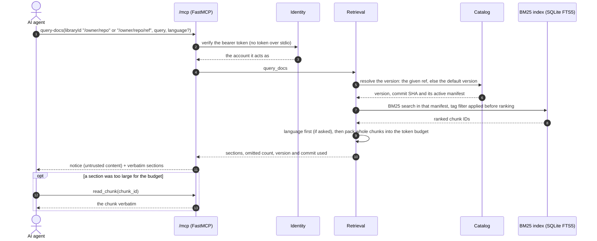
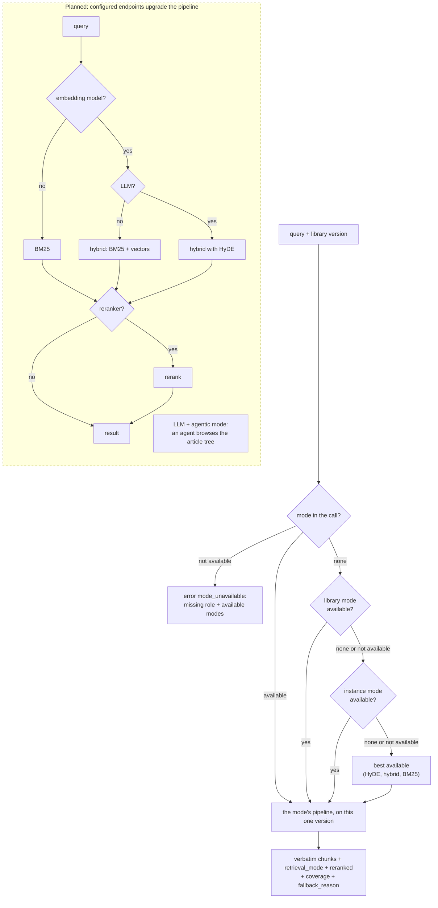
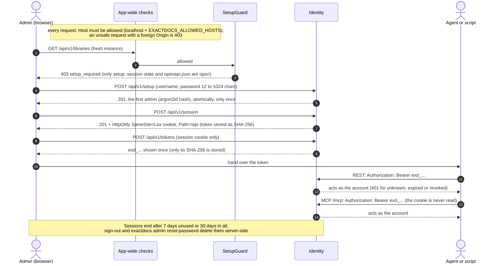

# Flows

How the main paths through ExactDocs work as built in MVP-1 (v0.2.0). The structure behind them
is in [Architecture](architecture.md); the endpoints are in the [REST API](rest-api.md). Planned
stages are drawn dashed and labelled *planned*.

## Importing a version

Adding a library, adding another version and re-syncing a branch all end in the same worker. The
HTTP call only validates and queues; the work happens in a job ([Background jobs](architecture.md#background-jobs)).

A process that stops or is killed mid-import resumes the job on the next start: the steps it
completed (files listed, batches parsed and chunked) are taken from DBOS's stored results, and
the import goes on from the first unfinished one.

Skipped files (binary, too large, undecodable...) do not fail the import: they are recorded as
job problems with a code, and the version is published without them.

### Editing a library's settings

`PUT /libraries/{owner}/{repo}/settings` stores new paths, tag rules and chunking, then queues
one job for the whole library. Changed paths: a `reprocess` job runs the `refresh` pipeline for
each version at the commit it serves, so each version's new manifest replaces the old one at
once. Changed chunking: a `rechunk` job copies each version's active manifest into a pending one,
re-derives its imported tags, cuts the stored text with the new chunking (reusing chunk sets
already cut with it), indexes the copy and activates it, without fetching (a version stored by an
older parser, or with an article only its file can rebuild exactly, is re-imported at its commit
instead). Only tag rules changed: a `retag` job
re-derives each stored article's imported tags (front matter plus rules) and writes them per
version in one transaction, then copies them onto the chunks, without fetching. Until a version
is done it serves its previous state; one that fails keeps it.
In the web UI, paths and tag rules are edited in *Files and tags* on the library's settings page
(it leaves the chunking as stored): saving a change first warns that every version is
re-processed (naming them), then follows the job's progress; a Preview shows which files the
typed paths take in the default version (not for a private library yet: a preview cannot use its
stored credential). When the newest re-processing failed, the section shows it with *Run again*,
which sends the stored settings back.

### Re-sync

`POST /libraries/{owner}/{repo}/sync` compares each *branch* and *tag* version with the remote.
A branch that moved gets a `refresh` job, which is the same pipeline pinned to the new commit;
unchanged files reuse their stored chunks, and the new manifest replaces the old one in place.
A tag that moved is reported (`tag_moved`), never re-imported by a sync: the user confirms its
re-import (`POST .../versions/reimport`, the button on the error in the library list and in Re-sync, `exactdocs sync --confirm`),
which queues a `refresh` job of the tag pinned to its new commit. Every upstream problem leaves the
last good version served and is recorded on a failed job with a stable `error_code`.

## Answering a query

Both paths resolve the version first and then search only inside it. A missing version is an
error, never a fallback to another one.

`search_docs` is the same path with a `limit` instead of a budget: it returns chunks with their
location, `prev_chunk_id` / `next_chunk_id`, the commit SHA and source link, a `coverage` block
that says whether the search was complete, and the retrieval mode used. Following a neighbor is
`read_chunk`; a chunk ID from before a re-sync answers `stale_chunk`.

The default version is the highest imported stable semver tag, else the default branch, else the
most recently imported version.

## Retrieval modes

Only BM25 is built; the other modes are the design for the *Next: AI retrieval* milestone. Which
mode answers is decided per call (RET-06): the call's `mode`, else the library's mode, else the
instance's (`EXACTDOCS_AI__MODE`), else the best mode the configured model roles allow. A
mode is available when it has a pipeline and its roles are configured (`hybrid`: embedding;
`hybrid_hyde`: embedding and LLM; `agentic`: LLM) and, for the hybrid modes, the vector store can
load (sqlite-vec); reranking is a flag on top. A mode the call asks for that is not available is an
error naming the missing role; a library or instance mode that is not available is skipped, and the
result says so (`fallback_reason: mode_unavailable`, or `vector_store_unavailable` when only the
vector store is missing).

## Authentication

`exactdocs serve --stdio` skips all of this: it opens the database read-only and exposes the
read-only tools only.
