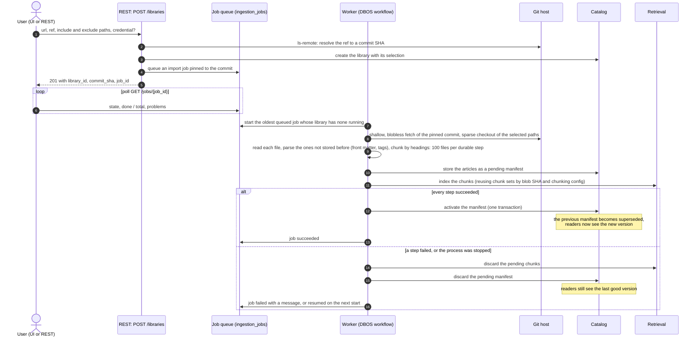
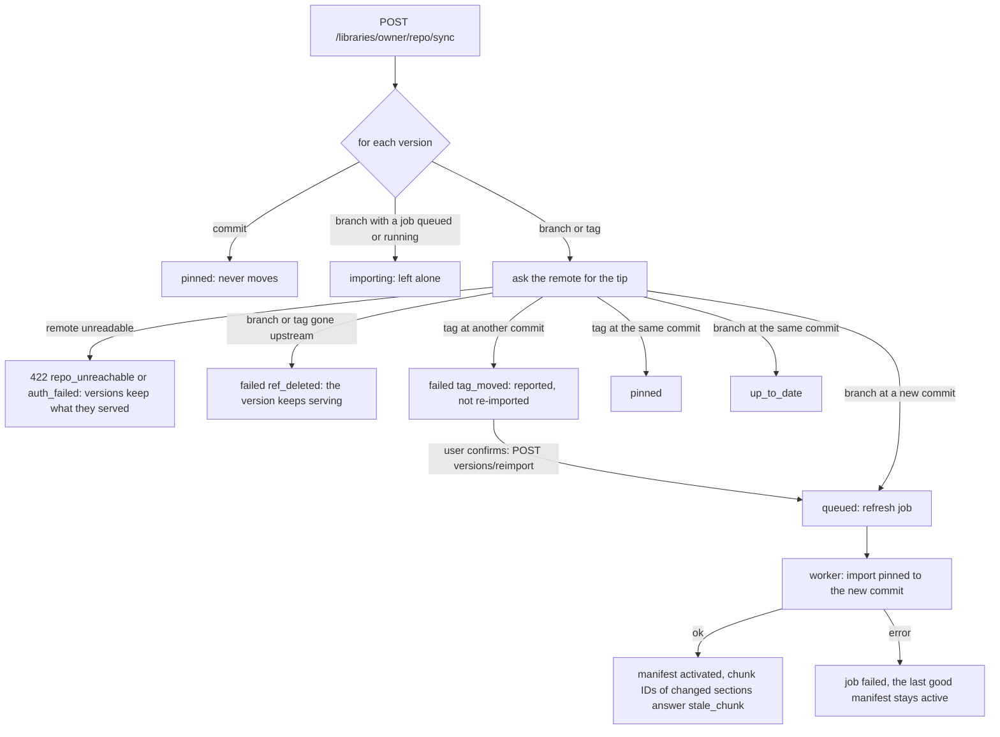
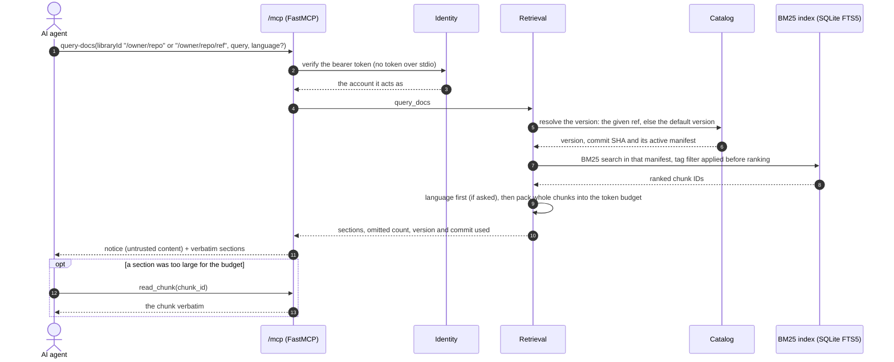
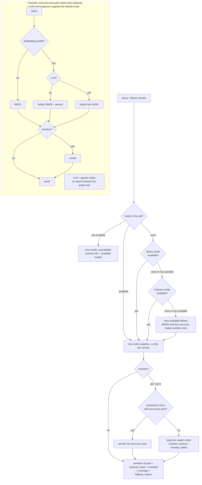
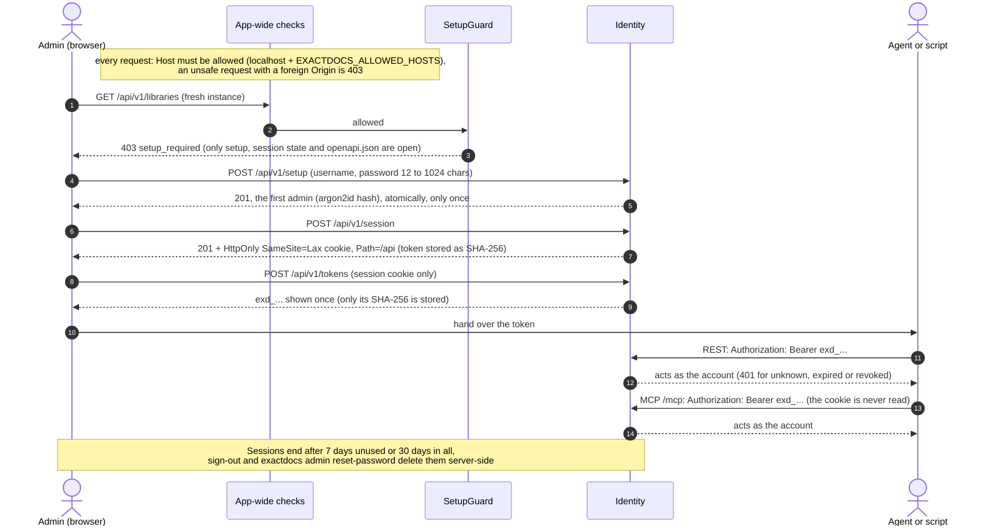

# Flows

How the main paths through ExactDocs work. The structure behind them is in
[Architecture](architecture.md); the endpoints are in the [REST API](rest-api.md). Planned stages
are drawn dashed and labelled *planned*.

## Importing a version

Adding a library, adding another version and re-syncing a branch all end in the same worker. The
HTTP call only validates and queues; the work happens in a job ([Background jobs](architecture.md#background-jobs)).

A process that stops or is killed mid-import resumes the job on the next start: the steps it
completed (files listed, batches parsed and chunked) are taken from DBOS's stored results, and
the import goes on from the first unfinished one.

Skipped files (binary, too large, undecodable...) do not fail the import: they are recorded as
job problems with a code, and the version is published without them. So is a file the parser or
the chunker fails on (`unparsable`, naming the file and the error's type, #430); a failure that is
not about one file (the store, the repository, running out of memory) still fails the import.
A re-chunk that meets such a file re-imports the version instead, which lists it.

### Editing a library's settings

`PUT /libraries/{owner}/{repo}/settings` stores new paths, tag rules and chunking, then queues
one job for the whole library. Changed paths: a `reprocess` job runs the `refresh` pipeline for
each version at the commit it serves, so each version's new manifest replaces the old one at
once. Changed chunking: a `rechunk` job copies each version's active manifest into a pending one,
re-derives its imported tags, cuts the stored text with the new chunking (reusing chunk sets
already cut with it), indexes the copy and activates it, without fetching (a version stored by an
older parser, or with an article only its file can rebuild exactly, is re-imported at its commit
instead). Only tag rules changed: a `retag` job
re-derives each stored article's imported tags (front matter plus rules) and writes them per
version in one transaction, then copies them onto the chunks, without fetching. Until a version
is done it serves its previous state; one that fails keeps it.
In the web UI, paths and tag rules are edited in *Files and tags* on the library's settings page
(it leaves the chunking as stored): saving a change first warns that every version is
re-processed (naming them), then follows the job's progress; a Preview shows which files the
typed paths take in the default version (not for a private library yet: a preview cannot use its
stored credential). When the newest re-processing failed, the section shows it with *Run again*,
which sends the stored settings back.

### Re-sync

`POST /libraries/{owner}/{repo}/sync` compares each *branch* and *tag* version with the remote.
A branch that moved gets a `refresh` job, which is the same pipeline pinned to the new commit;
unchanged files reuse their stored chunks, and the new manifest replaces the old one in place.
A tag that moved is reported (`tag_moved`), never re-imported by a sync: the user confirms its
re-import (`POST .../versions/reimport`, the button on the error in the library list and in Re-sync, `exactdocs sync --confirm`),
which queues a `refresh` job of the tag pinned to its new commit. Every upstream problem leaves the
last good version served and is recorded on a failed job with a stable `error_code`.

## Answering a query

Both paths resolve the version first and then search only inside it. A missing version is an
error, never a fallback to another one.

`search_docs` is the same path with a `limit` instead of a budget: it returns chunks with their
location, `prev_chunk_id` / `next_chunk_id`, the commit SHA and source link, a `coverage` block
that says whether the search was complete, and the retrieval mode used. Following a neighbor is
`read_chunk`; a chunk ID from before a re-sync answers `stale_chunk`.

The default version is the highest imported stable semver tag, else the default branch, else the
most recently imported version.

## Retrieval modes

Every mode is built: BM25, `vector`, `hybrid` (BM25 and vectors fused with reciprocal rank
fusion, #92), `hybrid_hyde` (#94) and `agentic` (#98), and so is reranking (#93);
[Search and AI models](search.md) describes each. Which mode answers is decided per
call (RET-06): the call's `mode`, else the library's mode, else the instance's
(`EXACTDOCS_AI__MODE`), else the best default the configured model roles allow. A mode becomes a
default only once the eval suite shows it beats BM25 ([Retrieval evals](evals/gates.md#gates)): `hybrid`
is not one yet, so it runs when an operator, a library or a call chooses it. A
mode is available when it has a pipeline and its roles are configured (`hybrid`: embedding;
`hybrid_hyde`: embedding and LLM; `agentic`: LLM) and, for the hybrid modes, the vector store can
load (sqlite-vec on SQLite, pgvector on PostgreSQL); reranking is a flag on top. A mode the call asks for that is not available is an
error naming the missing role; a library or instance mode that is not available is skipped, and the
result says so (`fallback_reason: mode_unavailable`, or `vector_store_unavailable` when only the
vector store is missing). A hybrid search never fails for its model either: a version its model has
not embedded yet answers BM25 with `embedding_in_progress`, and a query the model fails or times
out on answers BM25 with `embedding_unavailable`. A `hybrid_hyde` search first has the LLM write a
short hypothetical answer (cached per query, version and model) and embeds that instead of the
query; without it (a budget, the rate limit, an LLM error or timeout) it answers `hybrid`, saying
why (`llm_budget_reached`, `llm_rate_limited`, `llm_unavailable`).

With a reranker configured, the mode's pipeline is asked for the reranker's top N candidates (32,
or the library's own number) when that is more than the call's `limit`; the reranker receives the
query and those candidates' chunk text, never a library name or version, and they are reordered by
its scores before the `limit` is applied. A reranker that does not answer within its timeout (2 s),
fails, or answers something unusable never fails the search: the candidates keep the mode's order
with `reranked: false` and `fallback_reason` `reranker_timeout` or `reranker_failed`.

## Authentication

`exactdocs serve --stdio` skips all of this: it opens the database read-only and exposes the
read-only tools only. Its one write is AI spend, added to the shared ledger over a second
connection that may write that table alone (#274).
