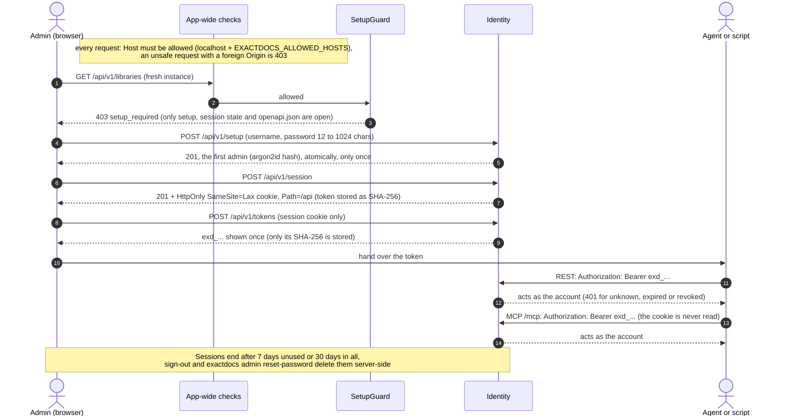

# Authentication

!!! abstract "TL;DR"

    - A fresh instance answers `403 setup_required` until the first admin is created, once and
      atomically.
    - The browser signs in with a server-side session in an HttpOnly cookie; agents and scripts use
      `exd_...` API tokens. Only SHA-256 hashes of either are stored.
    - `/mcp` accepts only the bearer token and never reads the cookie.
    - `exactdocs serve --stdio` skips all of this and is read-only.

## stdio

`exactdocs serve --stdio` skips all of this:

- it opens the database read-only and exposes the read-only tools only;
- its one write is AI spend, added to the shared ledger over a second connection that may write that
  table alone (#274).

Sessions, tokens and external sign-in are described in [Identity](../architecture/identity.md).
