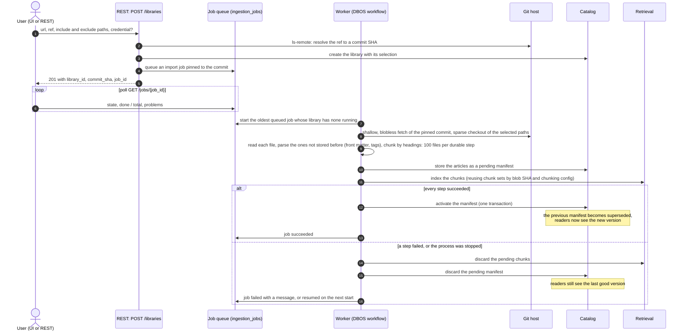
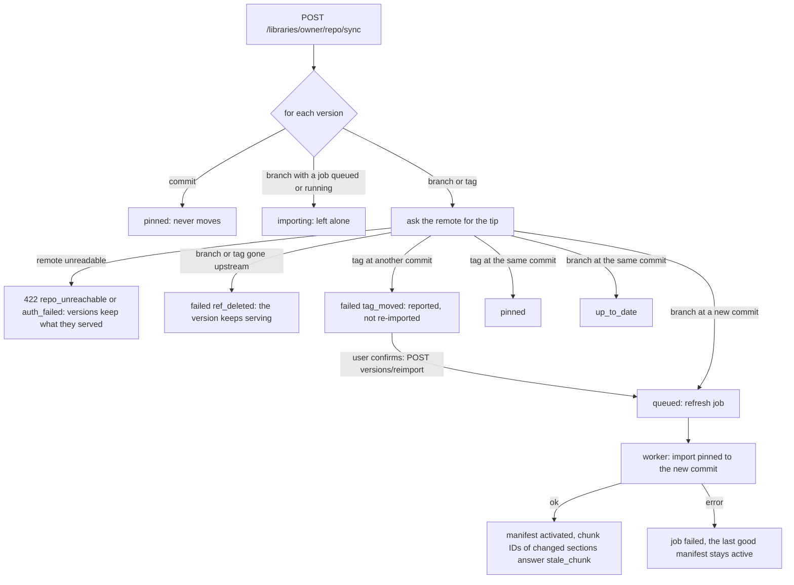

# Importing a version

!!! abstract "TL;DR"

    - Adding a library, adding another version and re-syncing a branch all end in the same worker.
    - Readers see the new version only once every step succeeded; on failure they keep the last good
      version.
    - A killed import resumes at its first unfinished step.
    - Skipped or unparsable files are job problems, not failures. A moved tag is reported, never
      re-imported without the user's confirmation.

Adding a library, adding another version and re-syncing a branch all end in the same worker. The
HTTP call only validates and queues; the work happens in a job
([Background jobs](../architecture/jobs/index.md)).

## Resuming

A process that stops or is killed mid-import resumes the job on the next start. The steps it
completed (files listed, batches parsed and chunked) are taken from DBOS's stored results, and the
import goes on from the first unfinished one.

## Skipped files

- Skipped files (binary, too large, undecodable...) do not fail the import. They are recorded as job
  problems with a code, and the version is published without them.
- So is a file the parser or the chunker fails on (`unparsable`, naming the file and the error's
  type, #430).
- A failure that is not about one file (the store, the repository, running out of memory) still
  fails the import.
- A re-chunk that meets such a file re-imports the version instead, which lists it.

## Editing a library's settings

`PUT /libraries/{owner}/{repo}/settings` stores new paths, tag rules and chunking, then queues one
job for the whole library:

| What changed | Job | Fetches |
|---|---|---|
| paths | `reprocess` | yes |
| chunking | `rechunk` | no[^reimport] |
| only tag rules | `retag` | no |

[^reimport]: A version stored by an older parser, or with an article only its file can rebuild
    exactly, is re-imported at its commit instead.

- **`reprocess`** runs the `refresh` pipeline for each version at the commit it serves, so each
  version's new manifest replaces the old one at once.
- **`rechunk`** copies each version's active manifest into a pending one, re-derives its imported
  tags, cuts the stored text with the new chunking (reusing chunk sets already cut with it), indexes
  the copy and activates it.
- **`retag`** re-derives each stored article's imported tags (front matter plus rules) and writes
  them per version in one transaction, then copies them onto the chunks.

Until a version is done it serves its previous state; one that fails keeps it.

### In the web UI

Paths and tag rules are edited in *Files and tags* on the library's settings page (it leaves the
chunking as stored).

- Saving a change first warns that every version is re-processed (naming them), then follows the
  job's progress.
- A Preview shows which files the typed paths take in the default version. Not for a private library
  yet: a preview cannot use its stored credential.
- When the newest re-processing failed, the section shows it with *Run again*, which sends the
  stored settings back.

## Re-sync

`POST /libraries/{owner}/{repo}/sync` compares each *branch* and *tag* version with the remote.

- **A branch that moved** gets a `refresh` job, which is the same pipeline pinned to the new commit.
  Unchanged files reuse their stored chunks, and the new manifest replaces the old one in place.
- **A tag that moved** is reported (`tag_moved`), never re-imported by a sync. The user confirms its
  re-import, which queues a `refresh` job of the tag pinned to its new commit. Ways to confirm:
    - `POST .../versions/reimport`;
    - the button on the error in the library list and in Re-sync;
    - `exactdocs sync --confirm`.
- **Every upstream problem** leaves the last good version served and is recorded on a failed job
  with a stable `error_code`.

