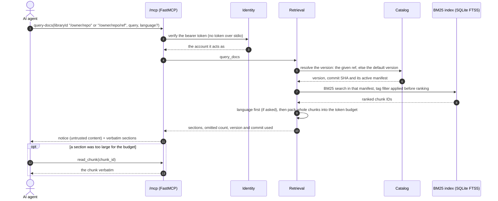

# Answering a query

!!! abstract "TL;DR"

    - Both `query-docs` and `search_docs` resolve the version first and then search only inside it.
    - A missing version is an error, never a fallback to another one.
    - `query-docs` packs whole chunks into a token budget; `search_docs` returns a `limit` of chunks
      with their neighbours and a `coverage` block.
    - The default version is the highest imported stable semver tag, else the default branch, else
      the most recently imported version.

Both paths resolve the version first and then search only inside it. A missing version is an error,
never a fallback to another one.

## `search_docs`

`search_docs` is the same path with a `limit` instead of a budget. It returns:

- chunks with their location;
- `prev_chunk_id` / `next_chunk_id`;
- the commit SHA and source link;
- a `coverage` block that says whether the search was complete;
- the retrieval mode used.

Following a neighbor is `read_chunk`. A chunk ID from before a re-sync answers `stale_chunk`.

## The default version

The default version is the highest imported stable semver tag, else the default branch, else the
most recently imported version.
