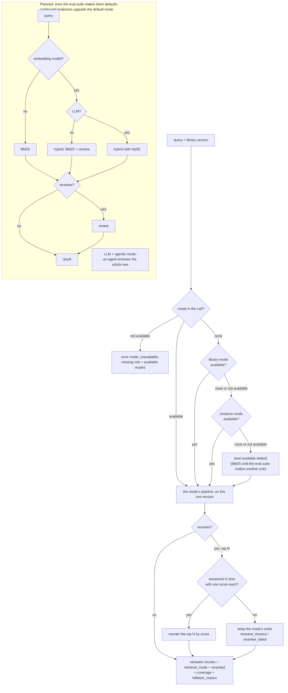

# Retrieval modes

!!! abstract "TL;DR"

    - Every mode is built: BM25, `vector`, `hybrid`, `hybrid_hyde` and `agentic`, plus reranking.
    - The mode is the call's, else the library's, else the instance's, else the best default the
      configured roles allow. Only BM25 is a default until the eval suite shows another one beats it.
    - A mode the call asks for that is not available is an error. Anything else that cannot run
      falls back to a cheaper mode and says why in `fallback_reason`.
    - A reranker that times out or fails never fails the search: the mode's order is kept.

Every mode is built: BM25, `vector`, `hybrid` (BM25 and vectors fused with reciprocal rank fusion,
\#92), `hybrid_hyde` (#94) and `agentic` (#98), and so is reranking (#93).
[Search and AI models](../search/index.md) describes each.

## Which mode answers

Which mode answers is decided per call (RET-06):

1. the call's `mode`;
2. else the library's mode;
3. else the instance's (`EXACTDOCS_AI__MODE`);
4. else the best default the configured model roles allow.

A mode becomes a default only once the eval suite shows it beats BM25
([Retrieval evals](../evals/gates.md#gates)). `hybrid` is not one yet, so it runs when an operator, a
library or a call chooses it.

## When a mode is available

A mode is available when it has a pipeline and its roles are configured:

| Mode | Roles |
|---|---|
| `hybrid` | embedding |
| `hybrid_hyde` | embedding and LLM |
| `agentic` | LLM |

The hybrid modes also need the vector store to load (sqlite-vec on SQLite, pgvector on PostgreSQL).
Reranking is a flag on top.

## Fallbacks

| Situation | Result |
|---|---|
| a mode the call asks for is not available | an error naming the missing role |
| a library or instance mode is not available | skipped; `fallback_reason: mode_unavailable`, or `vector_store_unavailable` when only the vector store is missing |
| hybrid: a version its model has not embedded yet | BM25 with `embedding_in_progress` |
| hybrid: a query the model fails or times out on | BM25 with `embedding_unavailable` |
| `hybrid_hyde`: no hypothetical answer (a budget, the rate limit, an LLM error or timeout) | `hybrid`, with `llm_budget_reached`, `llm_rate_limited` or `llm_unavailable` |

A hybrid search never fails for its model. A `hybrid_hyde` search first has the LLM write a short
hypothetical answer (cached per query, version and model) and embeds that instead of the query.

## Reranking

- With a reranker configured, the mode's pipeline is asked for the reranker's top N candidates (32,
  or the library's own number) when that is more than the call's `limit`.
- The reranker receives the query and those candidates' chunk text, never a library name or version.
- The candidates are reordered by its scores before the `limit` is applied.
- A reranker that does not answer within its timeout (2 s), fails, or answers something unusable
  never fails the search: the candidates keep the mode's order with `reranked: false` and
  `fallback_reason` `reranker_timeout` or `reranker_failed`.

The internals of each mode are in [AI retrieval](../architecture/ai-retrieval.md).
