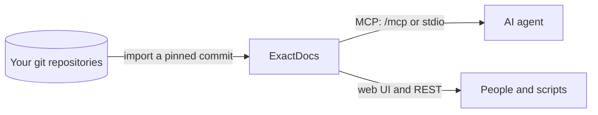

# ExactDocs

ExactDocs is a self-hosted documentation server for AI coding agents. Point it at a git
repository, choose the Markdown files you care about, and it serves them to your agent over MCP,
and to people in a web UI, pinned to the exact tag, branch or commit you imported.

Ask about `v1.3` and you get text from `v1.3`, verbatim, with its file path, heading, commit SHA
and a link to the source. If `v1.3` has no answer, you get an explicit "no result", never a
plausible paragraph from `v1.4`. Its MCP tools and library IDs match context7's, so a client set
up for context7 switches with a URL change.

```bash
docker run -d -p 3000:3000 -v exactdocs-data:/data ghcr.io/sircypkowskyy/exactdocs:latest
# or, without Docker
uvx exactdocs serve
```

Open <http://localhost:3000>, create the admin account, add a library, then point your agent at
`http://localhost:3000/mcp` (Streamable HTTP) or run `uvx exactdocs serve --stdio`.



## Use it

| Page | What is in it |
|---|---|
| [Getting started](getting-started.md) | Start the server, create the admin, import a library, use the CLI, private repositories, webhooks, accounts |
| [MCP](mcp.md) | Connecting Claude, Cursor, VS Code and Codex; tokens; stdio; every tool and resource; context7 over REST |
| [Configuration](configuration.md) | Every environment variable, the TOML file and the secret key |
| [Search and AI models](search.md) | Retrieval modes, chunking and tags, AI providers, reranking, agentic search, local models, budgets |
| [Deployment](deployment.md) | Image variants, hardened Docker, reverse proxies, health checks, upgrades, backups, PostgreSQL, Supabase, observability |

## How it is built

| Page | What is in it |
|---|---|
| [Architecture](architecture.md) | The modular monolith: domains, ports and adapters, the data model, background jobs, vertical slices, and the tests that enforce them |
| [Flows](flows.md) | Import, re-sync, query, retrieval modes and authentication as diagrams |
| [REST API](rest-api.md) | Conventions, authentication, errors, and the library, version, sync and job endpoints |
| [Retrieval evals](evals.md) | The eval suite that compares retrieval modes |
| [Benchmark](benchmark/index.md) | The golden set, method, results and recommended defaults |
| [Branching and releases](releasing.md) | `main` and `develop`, SemVer and PEP 440 versions, tag-driven releases to PyPI and ghcr.io, CI runners, size budgets |

## Where the project is going

| Page | What is in it |
|---|---|
| [User stories](user-stories.md) | The main use case (git repository to Markdown to browsing) as user stories, plus what comes next and later |
| [Delivery plan](plan.md) | The issues behind the user stories, by epic and milestone |
| [AI retrieval decisions](decisions/ai-retrieval.md) | Why the AI retrieval modes are built the way they are |

!!! note "Which version this site describes"
    The site is published from the `main` branch, so it describes the latest release. Anything not
    built yet is marked *planned*.

The diagrams are [Mermaid](https://mermaid.js.org), and CI parses every one of them. This site
loads Mermaid from unpkg, pinned to 12.3.0 (the version CI checks with). That request is made by
the documentation site only, never by the running app.

The README, the contributing guide and the agent skills live in the
[repository](https://github.com/SirCypkowskyy/ExactDocs).
