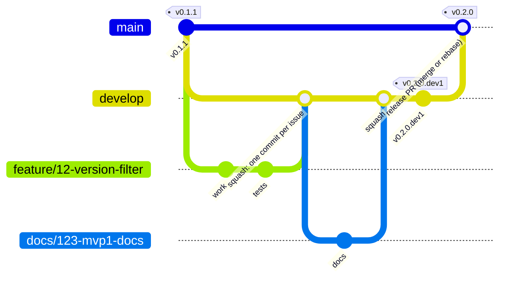
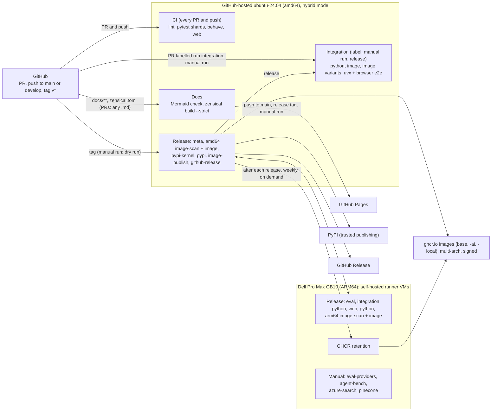

# Branching, versioning and releases

## Branches

| Branch | Purpose | Protection |
|---|---|---|
| `main` | released code; every commit is releasable | no deletion, no force-push; changes only through a PR, merged with **merge commit** or **rebase** |
| `develop` | integration branch; feature branches merge here | no deletion, no force-push; changes only through a PR, merged with **squash** |
| `feature/<issue>-<slug>`, `bugfix/<issue>-<slug>`, `docs/<issue>-<slug>`, `chore/<issue>-<slug>` | one issue each, from `develop` | none |

Flow: `feature/12-version-filter` → PR into `develop` (squash: one commit per issue) → PR
`develop` → `main` (merge commit or rebase, keeping the squashed history) → tag on `main`.



The branch names in the graph are examples. `feature/*`, `bugfix/*`, `docs/*` and `chore/*` branches are squashed into `develop`; `develop` is
merged (or rebased) into `main`; a tag on `develop` publishes a dev pre-release, a tag on `main`
a stable release. The registry then keeps only the newest images ([Image retention](#image-retention)).

The merge methods are enforced by repository rulesets on the target branch, so they apply to every
PR into it, whatever the source branch (a rare `main` → `develop` back-merge is squashed too).

## Versions (SemVer + PEP 440)

`MAJOR.MINOR.PATCH`, the same number on PyPI, ghcr.io and the git tag (`v` prefix on the tag only).

- **MAJOR**: only for breaking changes (MCP tool contracts, config variables, REST API, data
  format). Stays `0` until we decide the project is stable; bumping it is a deliberate decision,
  not part of a regular release.
- **MINOR**: new use cases / features.
- **PATCH**: fixes to the current minor, or small logic changes with no new use case.

Package versions come from the git tag (`uv-dynamic-versioning`); nothing in the repo is edited
to release. `exactdocs` pins `exactdocs-kernel==<same version>`.

## Tags and what they publish

| Tag | Must be on | PyPI | ghcr.io/sircypkowskyy/exactdocs | GitHub Release |
|---|---|---|---|---|
| `v0.1.3` | `main` | `exactdocs 0.1.3`, `exactdocs-kernel 0.1.3` | `0.1.3`, `0.1`, `latest` | release, marked latest |
| `v0.1.3.dev2` | `develop` | `0.1.3.dev2` (pre-release) | `0.1.3.dev2`, `0.1.3.dev2-<sha7>`, `dev` | pre-release |

Every image tag is published three times, once per variant of `deploy/Dockerfile` (#246): the
base image under the tags above, `exactdocs[ai]` with the suffix `-ai` and `exactdocs[ai,local]`
with the default local models with `-local` (`0.1.3-ai`, `0.1-local`, `latest-ai`,
`0.1.3.dev2-<sha7>-local`, `dev-ai`, ...). See [Size and model-free budgets](#size-and-model-free-budgets).

Dev tags use the PEP 440 developmental-release form `X.Y.Z.devN`, meaning "work towards X.Y.Z",
so `0.1.3.dev2 < 0.1.3`. pip and `uvx exactdocs` ignore them unless asked
(`uvx --prerelease allow exactdocs@0.1.3.dev2`). PyPI forbids local versions (`+sha`), so the
commit is visible on the image tag and in the release instead.

Any other tag shape, or a tag on the wrong branch, fails the workflow before anything is published.

Before a stable release, run `just screenshots` on `develop` and merge the retaken pictures in
`docs/assets/screenshots/` if they changed (with their alt texts in the README and the docs, if
what they show changed), so the README and the docs show the UI being released.

```bash
# stable
git switch main && git pull && git tag v0.1.3 && git push origin v0.1.3
# dev (rare)
git switch develop && git pull && git tag v0.1.3.dev1 && git push origin v0.1.3.dev1
```

Creating a release in the GitHub UI with a new tag works too: it pushes the tag, the workflow
runs, and it attaches the distributions to that release.

## Upgrades, migrations and "requires reindex"

Updating must never mean importing everything again (RUN-04). Two mechanisms keep it so:

- **Schema migrations run on start.** Every schema change is an Alembic revision
  (`bootstrap/migrations/versions`); `exactdocs serve` brings the database to the head before it
  answers. A revision must keep the data: a new column gets a default or is filled from what is
  stored, never "re-import to get it".
- **The search index records its format** (`retrieval_search_format`, `FORMAT` in
  `retrieval/adapters/driven/sqlite_fts.py`). A change to how index entries are made from chunks
  (tokenizer, `identifier_tokens`, what goes in which column) bumps `FORMAT`. The old index keeps
  answering as it was built; the server logs a warning, `/api/health` says
  `"reindex_required": true`, and the release notes have a **Requires reindex** section.
  `exactdocs reindex` (local: run it where the server runs, e.g. `docker exec exactdocs exactdocs
  reindex`) rebuilds the index from the stored chunks into a second table while the old one keeps
  answering, then swaps them in one transaction. Nothing is fetched or imported again. A change of
  the index's *columns* is an Alembic revision that rebuilds the table on start instead, because
  the search queries name them.

**CI upgrade test** (integration job *uvx*, `deploy/upgrade_check.py`; a PR labelled
`run integration` and every release run it, see [Fast and integration tests](#fast-and-integration-tests)):
the newest stable release from PyPI
starts on an empty data directory and imports the fixture docs repository at two tags; then this
build starts on the same directory and must migrate it to its head revision and serve the same
libraries, articles and search results to the same API token. Last, `exactdocs reindex` runs while
that server keeps answering searches. Run it locally with `python3 deploy/upgrade_check.py`
(`--previous X.Y.Z` to pick the release). The behave scenario *Upgrading keeps the libraries*
(`features/upgrade.feature`) is its in-process half: it takes the schema back to the previous
release's head revision. After tagging a stable release, move `PREVIOUS_RELEASE` and
`PREVIOUS_REVISION` in `features/steps/upgrade_steps.py` to it (the head is
`uv run python -c "from alembic.script import ScriptDirectory; from exactdocs.bootstrap.database import alembic_config; print(ScriptDirectory.from_config(alembic_config()).get_current_head())"`).

### Release notes template

The release workflow creates the GitHub Release with generated notes, grouped by
`.github/release.yml`: PRs labelled `requires reindex` get their own section. Edit the release
afterwards so it reads like this (leave out a section that would be empty, except *Upgrading*):

```markdown
## Highlights
- <what a user can do now that they could not before>

## Upgrading
Start the new version on the same data directory: the database is migrated on start.

### Requires reindex
<!-- Only when FORMAT changed (a PR labelled `requires reindex`); otherwise write "No reindex needed." -->
Search keeps answering as before until you run, where the server runs:
`exactdocs reindex` (Docker: `docker exec exactdocs exactdocs reindex`). It rebuilds the index
while the server keeps serving; until then `/api/health` reports `"reindex_required": true`.
Why: <what search finds better after it>.

### Breaking changes
- <configuration, REST, MCP tool contract or data-format changes; MAJOR only after 1.0>

## Fixes
- ...
```

## Image retention

`.github/workflows/ghcr-retention.yml` keeps the registry small: the **5 newest dev images**
(`X.Y.Z.devN`) and the **10 newest stable images** (`X.Y.Z`) of each variant (base, `-ai`,
`-local`, counted separately, so a release's three images do not push out another variant's
older ones); a multi-arch image is removed with
its platform images, cosign signature and attestations, and untagged leftovers are deleted. It
runs after every release, weekly, and on demand (`gh workflow run ghcr-retention.yml -f
dry-run=true` shows what would be deleted). Change `KEEP_DEV` / `KEEP_STABLE` in the workflow to
adjust. PyPI releases are never deleted.

## Size and model-free budgets

RUN-02: many installs only ever use BM25, so the wheel and the base image hold no models and no ML
libraries. Operators who want AI retrieval should not have to build their own image, so the image
comes in three variants, the build targets of one `deploy/Dockerfile` (#246; decision record
[*Image variants*](decisions/ai-retrieval.md#image-variants)). CI enforces each budget
(`deploy/check_artifacts.py`, the integration jobs *Docker image* and *Docker image variants*,
which run on a PR labelled `run integration` and in every release, and the release's *Scan image*
jobs; the sizes land in the job summary). Since #468 the CI jobs run on GitHub-hosted
`ubuntu-24.04` (amd64), where the images come out smaller than on arm64 (353.0 MB against 387.1 MB
for `base` before MCP Apps), so the arm64 figures below come from the release's builds and earlier
CI runs. Since #478 the release checks both architectures (natively, except the amd64 legs in
[`self-hosted` mode](#cicd-and-runners)); arm64 is the one that gets close to a budget, and a pull
request that adds a dependency only finds out in the release (or a [dry run](#dry-run)):

| Artifact | Budget | Now | Also checked |
|---|---|---|---|
| wheel (with the UI) | 5 MB | 0.9 MB (CI, PR #237) | no `*.safetensors`, `*.bin`, `*.onnx`, `*.gguf`, `*.pt`; no ML package in `Requires-Dist` |
| image `base` (`<v>`; unpacked file bytes, `du -sxb /` in the container; independent of the image store) | 410 MB | 404.1 MB (CI, arm64, PR #464); 387.1 MB before MCP Apps (PR #285); 353.0 MB on amd64 | no such model file anywhere in the filesystem; no `ML_PACKAGES` distribution installed; no aiohttp |
| image `ai` (`<v>-ai`: `exactdocs[ai]`) | 560 MB | 520.4 MB (CI, arm64, PR #285: +133 MB); 492.0 MB on amd64 | as `base`, except that pydantic-ai(-slim) is allowed: it calls models over HTTP and runs none |
| image `local` (`<v>-local`: `exactdocs[ai,local]` + default models) | 950 MB | 866.5 MB (CI, arm64, PR #285: +479 MB, of which 159 MB are the models); 847.9 MB on amd64 | of `ML_PACKAGES` only fastembed, onnxruntime, tokenizers, huggingface-hub and pydantic-ai(-slim) (no torch, transformers, onnx, ...); both default models at their pinned revisions in `/opt/exactdocs/models` (the server's own marker check) with the pinned sha256 of their ONNX files (`MODEL_SHA256`), their license `NOTICE`, a directory UID 10001 cannot write, and `EXACTDOCS_MODELS_DIR` set to it; model files nowhere else (but ONNX Runtime's own few-KB examples); no aiohttp |

**Why these budgets.** The decision record estimated 531 MB for `-ai` and 887 MB for `-local` from
the extras' site-packages (measured 2026-11-07 on x86_64) and set 560 MB and 950 MB. CI (arm64,
PR #285, with Pillow 13) measured 387.1, 520.4 and 866.5 MB (387.0, 520.2 and 867.6 MB with Pillow 12.3): 7.1 % of headroom for `-ai`, the same margin as the
base image's. `-local` keeps 950 MB, 8.8 % of headroom (930 MB would be about 7 %), on purpose: it
is the decision record's figure, and the extra 20 MB is room for a default-model update (a newer
revision or a slightly larger cross-encoder replaces 159 MB of weights, which no dependency
trimming can offset). amd64 images are 20 to 34 MB smaller than arm64 ones (353.0, 492.0 and
847.9 MB), so CI's arm64 numbers are the ones that count.
Raising a budget needs a reason in the PR; dropping a dependency to stay inside it is the first
choice.

- **Only `-local` may hold ONNX Runtime and model files.** The `-ai` image is checked against
  `ML_PACKAGES` like the base one, minus `pydantic-ai` and `pydantic-ai-slim`
  (`LLM_CLIENT_PACKAGES`); `-local` also allows what `[local]` brings (`LOCAL_PACKAGES`:
  fastembed, onnxruntime, tokenizers, huggingface-hub) and nothing else of the list. No variant holds **aiohttp**: Entra ID uses `azure.identity`'s sync
  token provider (#241), never `azure.identity.aio`.
- **The `-local` models are baked in, not pulled at first start.** The image must work with
  `--network none`, so the build runs `exactdocs models pull`, which fetches each default model at
  its pinned Hub revision (`PINNED_MODEL_REVISIONS`), into a BuildKit cache mount (a rebuild
  contacts no Hub) natively on the build platform (the files are the same for amd64 and arm64, and
  a cross-build pulls them natively too), and copies
  the two folders into the image, owned by root and read-only. The check then compares their ONNX
  files with the sha256 the Hub records for them at the pinned revisions (`MODEL_SHA256` in
  `deploy/check_artifacts.py`; update it with `PINNED_MODEL_REVISIONS`), so a build is verified
  byte for byte and not only by the Hub commit and TLS.
  `EXACTDOCS_MODELS_DIR=/opt/exactdocs/models` is set in the image. A model of your own goes into
  another directory (a volume) with `exactdocs models pull` and its own `EXACTDOCS_MODELS_DIR`.
- **Model licenses.** The weights are third-party: `BAAI/bge-small-en-v1.5` (Qdrant's quantized
  ONNX port, MIT) and `Xenova/ms-marco-MiniLM-L-6-v2` (an ONNX conversion of
  `cross-encoder/ms-marco-MiniLM-L-6-v2`, Apache-2.0), as their model cards at the pinned
  revisions say. Neither repository has a LICENSE or NOTICE file, and `models pull` fetches only
  the model and tokenizer files, so `deploy/model-notices/NOTICE` (the attribution, and the MIT
  and Apache-2.0 texts) is copied to `/opt/exactdocs/models/NOTICE`, and the `-local` image's
  `org.opencontainers.image.licenses` is `Apache-2.0 AND MIT`. A new default model needs its
  entry there.
- **Smoke tests.** Every variant runs `deploy/smoke.sh` (read-only root filesystem, no
  capabilities) with no model configured: the `-ai` and `-local` images stay BM25 servers until
  a role is set. The `-ai` image also runs `deploy/check_sqlite_vec.py` (the vector store in the
  image's own Python), and the `-local` one `deploy/smoke_local.py` inside a container started
  with **`--network none`** and the default models on the embedding and reranker roles: it
  imports the fixture, waits for the version to be embedded, and the search must answer with
  `retrieval_mode` `hybrid` and `reranked: true`.
- **CI time.** The variants are built, checked, scanned and smoke-tested in their own job, in
  parallel with the base image's; `local` builds on the `ai` stages in the same BuildKit. On
  GitHub-hosted runners nothing is cached between runs, so every run builds from scratch and
  pulls the models (on the persistent self-hosted runner, in `self-hosted` mode, the BuildKit
  cache survives). The job removes its two images at the end (`if: always()`).
- **Locally:** `just docker-build 0.0.0.dev0 ai` (or `local`) builds `exactdocs:build-ai` (`exactdocs:build-local`), and
  `just docker-check ai` runs the same check.

The unit tests add that the default dependency graph in `uv.lock` (from `exactdocs`, optional
extras excluded) holds no torch, transformers, sentence-transformers, huggingface-hub, onnx,
onnxruntime, model2vec, tensorflow or pydantic-ai, and that a started app imports none of them
(`packages/exactdocs/tests/bootstrap/test_model_free.py`). The list is `ML_PACKAGES` in
`deploy/check_artifacts.py`, shared by the script and the test. Optional AI extras (`[ai]`) are
allowed to carry them: both checks skip `extra ==` requirements.

They also check what `check_artifacts.py image` decides for each variant from what it reads out
of a built image: its installed distributions, its model files and its default models.

**Chonkie is not banned** (the chunker is markdown-it-py, issue #27; Chonkie's Markdown recipe needs the
HF Hub and network, which breaks RUN-02). If it is ever added, these extras must stay off: anything
pulling torch, transformers, sentence-transformers, onnx/onnxruntime, huggingface-hub or model2vec
(for Chonkie: the `semantic`, `neural`, `embeddings`, `code` and `all` extras).

### How the base image got to its budget

**Why 375 MB and not the 300 MB first planned** (before DBOS; see below for 400 MB). The floor is the `python:3.14-slim` base (~120 MB),
git and ssh (~25 MB git-core plus libraries; Perl is already purged) and the virtualenv (167 MB). 57 MB
of that is precompiled `.pyc`: dropping it would reach ~297 MB but make every start of a read-only
container recompile the whole dependency tree. Keeping it is the better trade, so the budget is the
measured 339 MB (`du -sxb /`; `docker image inspect` reports 353 MB with overlay2 and only the compressed ~115 MB with the containerd store, so it is not used) plus about 10 % headroom for dependency and Debian security updates. Raising it needs a
reason in the PR; lowering it is the goal if a dependency is dropped.

**Why 400 MB since E3-11 (#65).** Resumable imports run on DBOS 3.3, which imports psycopg at
module level (`dbos._utils`, `dbos._queue`), so it needs a working psycopg at import time even
though ExactDocs only uses its SQLite backend. Plain `psycopg` fails to import without a system
libpq, and without psycopg DBOS does not import at all; making the import lazy would mean patching
DBOS. So the image carries `psycopg[binary]` (about 19 MB, with its bundled libpq and OpenSSL), plus
croniter, python-dateutil and tzdata: about 28 MB in all. That took the image from the 339 MB
measured above to 374.5 MB in CI (Docker image job of #218), 0.5 MB under the old 375 MB budget, so
the budget was raised to 400 MB: the same headroom (about 7 %) as before, for dependency and Debian
updates. A smaller footprint stays possible behind the same `Checkpoints` port (an ingestion-owned
checkpoint table instead of DBOS). psycopg is LGPL-3.0: list it if the image ever gets a
third-party notices file (the `-local` image has one for its model weights only,
`/opt/exactdocs/models/NOTICE`; see *Model licenses* above).

**Telemetry since E10-07 (#87): 384.4 MB.** The OpenTelemetry SDK and its OTLP/HTTP exporter (with
protobuf, googleapis-common-protos and requests) are imported only when `EXACTDOCS_TELEMETRY=otlp`,
but ship in the image so operators can turn them on (#218 measured 374.5 MB before them).
With Logfire as the SDK, as the Telemetry decision first named, the image was 393.3 MB (6.7 MB
of headroom); Logfire (a second copy of its package for its migration, plus executing, wrapt and
opentelemetry-instrumentation) was about 9 MB of that, which is part of why the plain SDK is used.
The 15.6 MB left is about 4 %: the next dependency that needs room should first look for something
to drop.

**Prometheus since E10-08 (#88): about +0.6 MB.** `opentelemetry-exporter-prometheus` and
`prometheus-client` (pure Python, no dependencies of their own) add about 0.57 MB with their
compiled bytecode, measured in a clean virtualenv; imported only when `EXACTDOCS_METRICS` is on.
CI's *Docker image* job reports the exact size.

**410 MB since MCP Apps (#115): 404.1 MB.** `view_article` and `view_search` render through
Prefab UI (`prefab-ui`, pinned), whose renderer is a single self-contained page (`app.html`,
6.8 MB, every script and style inlined). ExactDocs serves it itself so that a host never loads the
UI from a CDN, which keeps the offline guarantee; that page is nearly all of the 8 MB the extra
adds. The maintainer chose to raise the budget by 10 MB rather than move MCP Apps into an optional
extra, so every install gets them. The headroom is now about 1.5 %: the next dependency that needs
room must first look for something to drop.

## Image scan

Every integration run (jobs *Docker image* and *Docker image variants* of `integration.yml`: a PR
labelled `run integration`, a manual CI run with `integration`, every release) and every release's
*Scan image* jobs scan each built image variant with
[Trivy](https://trivy.dev). Every PR lints `deploy/Dockerfile` with hadolint (CI's *Lint* job; its
one accepted rule, with the reason, is in `.hadolint.yaml`). The scan **fails on a CRITICAL or HIGH
vulnerability that has a fix** (`--ignore-unfixed`); the table is in the job log and in the
`trivy-report` artifact (`trivy-report-ai`, `trivy-report-local`, and in a release
`trivy-report-<variant>-<arch>`).
No image of a release is pushed while the scan of any variant fails.

When it fails:

1. Rebuild with fresh base layers: bump the base images (Dependabot's `docker` PRs for `/deploy`
   move tag and digest together; merging one is usually the fix). Debian packages are not
   pinned: the Dockerfile's `DEBIAN_REFRESH` build argument (the date in a release, the ISO week
   in CI) makes a new build fetch fresh package indexes, so it also picks up a fixed `git` or
   `openssh-client`. It does not upgrade the packages that come with the base image (`apt`,
   `libc6`, `dpkg`, ...): `apt-get install` leaves installed packages alone, so a finding in one
   of those is fixed by a newer base digest or, until one ships the fix, by an explicit
   `apt-get install --only-upgrade <package>` in the `runtime-tools` stage (as for `zlib1g`,
   #275; remove it once the base digest catches up). A GitHub-hosted job downloads a fresh Trivy
   DB every run, while the persistent self-hosted runner keeps its own in `~/.cache/trivy` and
   refreshes it when it is out of date, so a scan that passed yesterday can fail today on an
   advisory published since, and the amd64 and arm64 legs of one release can briefly disagree;
   the failing run is the real result.
   Because the week is part of the cache key, the first Docker build of each ISO week (Monday)
   re-runs the apt steps and is about a minute slower; that is expected, not a cache bug.
2. If the fix is a Python dependency, update it in `uv.lock`; for a web dependency, `pnpm-lock.yaml`.
3. Only if the finding does not apply to ExactDocs and cannot be fixed yet, accept it: add the ID
   to `.trivyignore` with a comment above it saying why, the date and who accepted it, in the PR
   that needs it. The reviewer decides; remove the entry once a fixed version ships.

Unfixed findings are not listed by the gate; check them occasionally with
`docker run --rm -v /var/run/docker.sock:/var/run/docker.sock ghcr.io/aquasecurity/trivy image <image>`.

The scanner and the linter are pinned by digest in `run:`/`env:` text, which Dependabot does not
read: bump `hadolint/hadolint` (`.github/workflows/ci.yml`, job *image*) and
`ghcr.io/aquasecurity/trivy` (`.github/actions/trivy-gate/action.yml`) by hand at every release, or
a stale scanner stops finding new vulnerabilities.

The CI Docker jobs use the runner's own BuildKit (`driver: docker`): on a fresh GitHub-hosted VM
nothing is cached between runs. The release uses the GitHub Actions cache (one scope per variant
and architecture, `scope=exactdocs-<variant>-<arch>`), which hands the scanned layers to the build
that pushes them.

## Fast and integration tests

Pull requests and pushes to `develop` and `main` run the **fast checks** only (#507), as parallel
jobs of `ci.yml` with no service container and no image build:

| Job | What it runs |
|---|---|
| *Lint (ruff, ty, hadolint)* | `ruff format --check`, `ruff check`, `ty check`, hadolint on `deploy/Dockerfile` |
| *pytest (1/6)* … *(6/6)* | `uv run pytest` split by [pytest-split](https://github.com/jerry-git/pytest-split) into six groups of about the same time (two in `self-hosted` mode), from the durations in `.test_durations`; each writes its coverage data |
| *behave (1/3)* … *(3/3)* | `uv run behave`, every scenario but the `@integration` ones, the feature files in three groups of about the same time (one in `self-hosted` mode; `deploy/behave_shards.py`, from the times in `.behave_durations`) |
| *Python (ruff, ty, pytest, behave)* | waits for the jobs above and fails unless all passed (the check branch protection requires); combines the shards' coverage into one report (the total in the job summary, the data in the `python-reports` artifact) |
| *Web (biome, fallow, react-doctor, vitest, build)* | the web client |

**Integration tests** are the ones that need a container, a service, the network or a download:
PostgreSQL (with pg_search, pgvector, PgBouncer, Supabase), libSQL servers, every search or vector
server (Elasticsearch, OpenSearch, Qdrant, Chroma, Redis, MongoDB, Milvus, Pinecone, Azure AI
Search) and the default local models. pytest marks them `integration` and behave tags them
`@integration`; both leave them out by default, and the run ends saying how many it left out and
how to run them. Most are marked from what they take, so none is missed by hand
(`packages/exactdocs/tests/fixtures/integration.py`): a test on `on_postgres` or a PostgreSQL case
of `SQL_BACKENDS` / `SEARCH_BACKENDS`, and every server case of `index_backends.BackendCase`. A
behave scenario with a service tag (`@postgres`, `@qdrant` …) must also carry `@integration`, or
the run stops. A test proves the default (`tests/ci/test_integration_tests.py`): with every service
variable set, a default run collects no test that is marked, takes a service fixture or runs on a
server case. And the fast CI jobs set every `EXACTDOCS_TEST_<NAME>_URL` to a port where nothing
listens, so a test that reached a service without the marker would fail there, not skip.

One switch turns them on, `--integration` (pytest) or `EXACTDOCS_INTEGRATION=1` (pytest and
behave); `just test-integration` and `just bdd-integration` set it. Then each runs when its
service's variable is set, and is skipped, naming the variable, when it is not
(`EXACTDOCS_REQUIRE_<NAME>=1` turns that into an error, as CI does). `-m integration` and
`--tags=@integration` narrow a run to them:

```bash
export EXACTDOCS_TEST_POSTGRES_URL=postgresql://postgres@127.0.0.1/postgres  # may create databases
export EXACTDOCS_TEST_MILVUS_URL=$(deploy/milvus-test-server.sh exactdocs-milvus)
just test-integration -m integration           # pytest: only the integration tests
just bdd-integration --tags=@integration       # behave: only the @integration scenarios
```

| Variable | Service (CI's pinned image: `.github/workflows/integration.yml`) |
|---|---|
| `EXACTDOCS_TEST_POSTGRES_URL`, `EXACTDOCS_TEST_PG_SEARCH=1` | a PostgreSQL role that may create databases and roles; `pg_search` when the server has it (ParadeDB) |
| `EXACTDOCS_TEST_PGBOUNCER_URL` | PgBouncer in transaction mode in front of that server |
| `EXACTDOCS_TEST_SUPABASE_URL` | `deploy/supabase-test-db.sh` |
| `EXACTDOCS_TEST_LIBSQL_URL`, `_AUTH_TOKEN` | `deploy/libsql-test-server.sh` (the index backend) |
| `EXACTDOCS_TEST_LIBSQL_DATABASE_URL`, `_AUTH_TOKEN` | another, empty libSQL server (ExactDocs' own database; the SQLite cases move there) |
| `EXACTDOCS_TEST_MILVUS_URL` | `deploy/milvus-test-server.sh` |
| `EXACTDOCS_TEST_QDRANT_URL` (`_API_KEY`), `_ELASTICSEARCH_URL`, `_OPENSEARCH_URL`, `_CHROMA_URL`, `_REDIS_URL`, `_MONGODB_URL`, `_PINECONE_URL` | the server of that name ([Configuration](configuration.md)) |
| `EXACTDOCS_TEST_AZURE_SEARCH_URL` | a real Azure AI Search service (the manual `azure-search.yml`) |
| `EXACTDOCS_TEST_MODELS_DIR` | the default local models, pulled by `exactdocs models pull` (the release's eval job) |

**When CI runs them.** The jobs are in `integration.yml`: the integration pytest and behave suites
with every service above as a container (and the ranking suite on Supabase, the persistence suite
on libSQL), the Docker image build, scan and smoke tests, the `-ai` and `-local` variants, and uvx
with the upgrade check and the browser end-to-end test. They run

- on a pull request with the label **`run integration`**: adding it starts them, and each push
  runs them again while it is on (adding any other label starts nothing). The label is defined in
  `.github/labels.yml`; create it once with `.agents/skills/working-on-issues/scripts/sync-labels.sh`;
- on a manual run of CI with the input `integration` (*Actions → CI → Run workflow*, or
  `gh workflow run ci.yml --ref <branch> -f integration=true`);
- in every release and release dry run, before anything is published ([below](#what-the-release-workflow-does)).

Pushes to `develop` and `main` do not run them; a release does, so nothing is published untested.

**`.test_durations`** holds the time of every fast test, from a default run with
`--store-durations`, and **`.behave_durations`** the time of every feature file; the shards are
balanced by them, and a test or feature they do not know counts as the average. Refresh them with
`just test-durations` and `just bdd-durations` (and commit them) when many tests were added or a
shard runs much longer than the others.

## CI/CD and runners

Two kinds of runner: GitHub-hosted `ubuntu-24.04` (amd64; it uses the plan's free Actions
minutes), and the self-hosted runner on the maintainer's Dell Pro Max GB10 (ARM64, LXD VMs, labels
`self-hosted, linux, ARM64, exactdocs`; see `deploy/runners/README.md`), which uses no minutes.
Which job runs where is set by one **repository variable, `RUNNER_MODE`**, that every `runs-on:`
reads (`vars` is one of the few contexts `runs-on` may use; a comment block at the top of each
workflow says what it does there):

| Workflow | `hybrid` (default; also when `RUNNER_MODE` is unset) | `self-hosted` (fallback) |
|---|---|---|
| CI (`ci.yml`): lint, pytest shards, behave, web | every job on `ubuntu-24.04` (six pytest shards) | every job on the self-hosted runner (two pytest shards) |
| Integration (`integration.yml`) from a PR label or a manual CI run | every job on `ubuntu-24.04` | every job on the self-hosted runner |
| Integration from a release: **python** (pytest, behave) | self-hosted | self-hosted |
| Integration from a release: **image**, **image-variants**, **uvx** | `ubuntu-24.04` | self-hosted |
| Docs (`docs.yml`) | `ubuntu-24.04` | self-hosted |
| Release (`release.yml`): **eval**, **web**, **python** | self-hosted | self-hosted |
| Release: **image-scan**, **image**, arm64 legs | self-hosted, native | self-hosted, native |
| Release: **image-scan**, **image**, amd64 legs | `ubuntu-24.04`, native | self-hosted, cross-built (below) |
| Release: **meta**, **pypi-kernel**, **pypi**, **image-publish** (index, tags, cosign), **github-release** | `ubuntu-24.04` | self-hosted |
| GHCR retention, `eval-providers.yml`, `agent-bench.yml`, `azure-search.yml`, `pinecone.yml` | self-hosted | self-hosted |

Why the release is split that way in `hybrid`: the eval is the heaviest job (up to 75 minutes) and
needs nothing of x86, so it and the web and Python builds stay off the minutes; the amd64 image
legs need x86 to build and check natively; the jobs that validate the tag, publish to PyPI, sign
and create the release are short (a minute or two each) and run on a fresh VM, which keeps the
publishing credentials (OIDC tokens, `packages: write`) off a persistent machine.

**`self-hosted` mode, what changes.**

- **CI and the integration jobs on ARM64.** Pinecone Local (`ghcr.io/pinecone-io/pinecone-index`) has only an amd64 image:
  its service's `image:` becomes an empty string, and a service with an empty image is not started
  ([workflow syntax](https://docs.github.com/en/actions/reference/workflows-and-actions/workflow-syntax),
  `jobs.<job_id>.services.<service_id>.image`); `EXACTDOCS_TEST_PINECONE_URL` is empty, so the
  Pinecone contract cases and scenario skip. The libSQL local-file cases skip because the
  `libsql` wheel is x86-only (the libSQL server cases still run). Every other service and helper
  image (ParadeDB, PgBouncer, Qdrant, Elasticsearch, OpenSearch, Chroma, Redis, MongoDB Atlas
  Local, Supabase Postgres, Milvus, libSQL server) is published for `linux/arm64` (checked with
  `docker buildx imagetools inspect` on the pinned digests, 2026-11-23). The images are built and
  smoke-tested for arm64; the amd64 *runtime-tools* step runs under QEMU (`docker/setup-qemu-action`),
  which only runs apt-get, git, ssh and tini. *Free disk space* runs on hosted runners only.
- **The release's amd64 legs are cross-built** on the ARM64 runner, as the release did before
  #478: the Python stages of `deploy/Dockerfile` run natively and cross-install the venv for
  amd64 (`--python-platform`), the default models are pulled natively, and only the runtime stage's
  apt-get runs under QEMU. Python 3.14 crashes under QEMU (#257), so nothing runs Python in the
  amd64 image: its check is `check_artifacts.py image <ref> <variant> --no-python`, which measures
  the size with `du`, finds model files with `find` and reads the installed distributions from
  their `.dist-info` directories (the same names as `importlib.metadata`), and **skips the `-local`
  default-models check** (it runs ExactDocs' own code), which the arm64 leg does on the same model
  files. Trivy only reads the saved image, so the scan is unchanged.
- Jobs queue on the self-hosted VMs (two of them, 4 vCPU and 8 GiB each), so a CI run or a release
  takes longer, and the job limit is the self-hosted one (5 days) instead of 6 hours.

**When to switch.** When the account's free minutes for the month are used up (and no budget allows
more), GitHub-hosted jobs do not start; they fail at once with an annotation like *"The job was not
started because recent account payments have failed or your spending limit needs to be
increased. Please check the 'Billing & plans' section in your settings"*. Then, in the repository's
*Settings → Secrets and variables → Actions → Variables*, create (or edit) the repository variable
`RUNNER_MODE` with the value `self-hosted`, and re-run the failed workflows. When the minutes reset
(the start of the billing cycle), set it back to `hybrid` or delete it. Any value other than
`self-hosted` means `hybrid`. Re-runs use the variable's value at the time of the re-run.

The switch is manual. An automatic one would need a scheduled workflow to read the account's
Actions usage (`GET /users/{username}/settings/billing/usage`, which needs a personal access token
with the *Plan* permission, not `GITHUB_TOKEN`) and then write the variable (a token with
*Variables: write*; `GITHUB_TOKEN` cannot write variables), so a long-lived personal token stored
as a secret; or a job that notices the billing failure and re-dispatches the workflow, which
loses the pull request's check context and still cannot flip the variable. Neither is set up.



In `self-hosted` mode every box above runs in the GB10 group.

## What the release workflow does

`.github/workflows/release.yml` (runners: [CI/CD and runners](#cicd-and-runners)):

1. **meta**: validates tag shape and branch, derives version/channel.
2. **eval**: the retrieval eval ([Retrieval evals](evals.md#when-it-runs)), which pull requests
   do not run: the model-free gates on SQLite and on ParadeDB's pg_search against the
   `baseline.json` of the tagged tree, the suite's end-to-end tests (`pytest -m eval`), the
   ingestion and retrieval benchmarks against their recorded runs, then hybrid and rerank on the
   default local models, report-only. `pypi-kernel` and `image` need it, so a failing gate
   publishes nothing.
   **integration** (`integration.yml`, [Fast and integration tests](#fast-and-integration-tests)):
   the integration pytest and behave suites on PostgreSQL, PgBouncer, Supabase, libSQL and every
   search and vector server (on the self-hosted runner, so Pinecone Local's cases skip there),
   the Docker images' build, scan and smoke tests, uvx, the upgrade from the previous release
   and the browser end-to-end test. Pull requests run them only when labelled, so here they are
   a gate: `pypi-kernel` and `image` need them too.
3. **web**: `pnpm build`.
4. **python**: bundles the UI into the wheel, `uv build --all-packages`, `twine check`, runs the
   wheel the way `uvx` would.
5. **pypi-kernel**, then **pypi**: `uv publish` with **trusted publishing** (OIDC, no stored token).
6. **image-scan** (six jobs: `base`, `ai`, `local` × `amd64`, `arm64`): each variant is built
   natively on a runner of its architecture (`ubuntu-24.04`, the self-hosted ARM64 runner; in
   `self-hosted` mode amd64 is cross-built there and checked with `--no-python`), checked against
   its size budget (`deploy/check_artifacts.py`) and scanned (see *Image scan*), so both
   architectures are checked and scanned, not only the build host's.
7. **image** (the same six), only when all six scans and the eval pass: each is built again from
   the scan's cache (the same build arguments: `DEBIAN_REFRESH`, the date, and `CREATED` are set
   once in **meta**, so these are the layers that were scanned), with SBOM + provenance
   attestations, and pushed **by digest only**, without a tag.
8. **image-publish**, once per variant: `docker buildx imagetools create` joins the amd64 and
   arm64 images (with their attestations) into one multi-arch index, tags it (suffix `-ai` /
   `-local`), puts the title, description and licenses on it as annotations, checks it holds
   exactly `linux/amd64` and `linux/arm64`, and signs it with a keyless **cosign** signature.
   In `hybrid` mode nothing runs under QEMU; in `self-hosted` mode the amd64 legs use it for the
   runtime stage's `apt-get` only.
9. **github-release**: creates or updates the release with the distributions.

Pushing a tag runs the workflow file **of the tagged commit**, and so does *Re-run jobs* on an
old run: a tag made before a workflow fix keeps failing the old way. Release from a new tag on a
commit that has the fix.

### Dry run

A manual run is a dry run, from any branch, and publishes nothing:

```bash
gh workflow run release.yml --ref develop     # or a feature branch with workflow changes
```

It builds version `0.0.0.dev<run number>` and runs **meta** (without the tag checks), **eval**,
**integration**, **web**, **python** and all twelve image jobs (the six **image** builds with `push=false`, no
registry login). **pypi-kernel**, **pypi**, **image-publish** and **github-release** are skipped
(`if: github.event_name == 'push'`). GHCR retention still starts after it (a `workflow_run`
trigger fires on every completed Release run, from the file on the default branch) but skips its
jobs when the run was not a tag push. Run one before
tagging when the release workflow, the Dockerfile, the eval or a size budget changed: the gates
that pull requests do not run (the eval, arm64 budgets and scans) fail here instead of on the tag.
The one thing it cannot check is the publishing itself (PyPI trusted publishing, the index, the
signature). It runs on the runners of the current `RUNNER_MODE`, so a dry run in `hybrid` mode does
not exercise the cross-built amd64 legs of `self-hosted` mode.

## One-time setup

1. PyPI trusted publishers (done 2026-11-03), owner `SirCypkowskyy`, repository `ExactDocs`,
   workflow `release.yml`: `exactdocs-kernel` with environment `pypi`, `exactdocs` with
   environment `pypi-exactdocs`. PyPI allows only one pending publisher per
   repository + workflow + environment, hence two environments and two publish jobs.
2. GitHub environments `pypi` and `pypi-exactdocs` exist and accept deployments from tags `v*`
   only. Optionally add yourself as a required reviewer on both.
3. After the first image push, set the ghcr.io package visibility (private by default) and link it
   to the repository.
