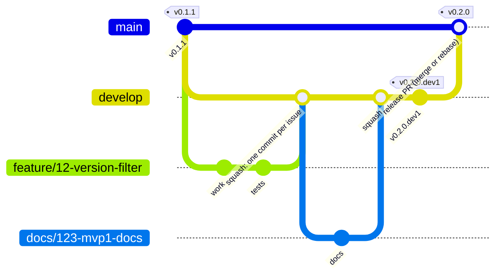

# Branches

!!! abstract "TL;DR"
    - `main` holds released code, `develop` is the integration branch, and every issue gets its
      own branch from `develop`.
    - Issue branches are squashed into `develop`: one commit per issue.
    - `develop` goes into `main` by merge commit or rebase, keeping the squashed history.
    - Repository rulesets enforce the merge methods on every PR into a branch.

| Branch | Purpose | Protection |
|---|---|---|
| `main` | released code; every commit is releasable | no deletion, no force-push changes only through a PR, merged with **merge commit** or **rebase** |
| `develop` | integration branch; feature branches merge here | no deletion, no force-push changes only through a PR, merged with **squash** |
| `feature/<issue>-<slug>` `bugfix/<issue>-<slug>` `docs/<issue>-<slug>` `chore/<issue>-<slug>` | one issue each, from `develop` | none |

## The flow

1. `feature/12-version-filter` → PR into `develop` (squash: one commit per issue).
2. PR `develop` → `main` (merge commit or rebase, keeping the squashed history).
3. Tag on `main`.

The branch names in the graph are examples.

- `feature/*`, `bugfix/*`, `docs/*` and `chore/*` branches are squashed into `develop`.
- `develop` is merged (or rebased) into `main`.
- A tag on `develop` publishes a dev pre-release, a tag on `main` a stable release
  ([Versions and tags](versions.md)).
- The registry then keeps only the newest images ([Image retention](images.md#image-retention)).

## Merge methods

The merge methods are enforced by repository rulesets on the target branch, so they apply to every
PR into it, whatever the source branch. A rare `main` → `develop` back-merge is squashed too.
