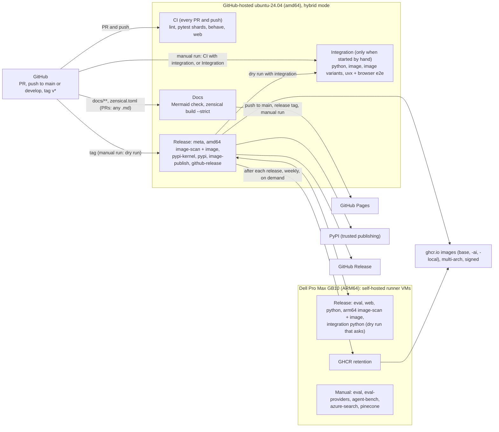

# CI/CD and runners

!!! abstract "TL;DR"
    - Two kinds of runner: GitHub-hosted `ubuntu-24.04` (amd64, uses the plan's free minutes) and
      the self-hosted runner on the maintainer's Dell Pro Max GB10 (ARM64, no minutes).
    - One repository variable, `RUNNER_MODE`, decides which job runs where. `hybrid` is the
      default; `self-hosted` is the fallback.
    - In `hybrid` the release's eval, web and Python jobs stay on the self-hosted runner, and the
      short publishing jobs run on fresh GitHub-hosted VMs.
    - When the free minutes run out, set `RUNNER_MODE` to `self-hosted` by hand and re-run the
      failed workflows; set it back when the minutes reset.

## The runners

| Runner | Architecture | Cost |
|---|---|---|
| GitHub-hosted `ubuntu-24.04` | amd64 | uses the plan's free Actions minutes |
| the self-hosted runner on the maintainer's Dell Pro Max GB10 | ARM64, LXD VMs | uses no minutes |

The self-hosted runner's labels are `self-hosted, linux, ARM64, exactdocs`; see
`deploy/runners/README.md`.

Which job runs where is set by one **repository variable, `RUNNER_MODE`**, that every `runs-on:`
reads. `vars` is one of the few contexts `runs-on` may use. A comment block at the top of each
workflow says what it does there.

## Which job runs where

`hybrid` is the default, and also applies when `RUNNER_MODE` is unset. `self-hosted` is the
fallback.

| Workflow | `hybrid` | `self-hosted` |
|---|---|---|
| CI (`ci.yml`): lint, pytest shards, behave, web | every job on `ubuntu-24.04` (six pytest shards) | every job on the self-hosted runner (two pytest shards) |
| Integration (`integration.yml`) from its own manual run or a manual CI run | every job on `ubuntu-24.04` | every job on the self-hosted runner |
| Integration from a release dry run: **python** (pytest, behave) | self-hosted | self-hosted |
| Integration from a release dry run: **image**, **image-variants**, **uvx** | `ubuntu-24.04` | self-hosted |
| Docs (`docs.yml`) | `ubuntu-24.04` | self-hosted |
| Release (`release.yml`): **eval**, **web**, **python** | self-hosted | self-hosted |
| Release: **image-scan**, **image**, arm64 legs | self-hosted, native | self-hosted, native |
| Release: **image-scan**, **image**, amd64 legs | `ubuntu-24.04`, native | self-hosted, cross-built ([below](#self-hosted-mode-what-changes)) |
| Release: **meta**, **pypi-kernel**, **pypi**, **image-publish** (index, tags, cosign), **github-release** | `ubuntu-24.04` | self-hosted |
| GHCR retention `eval.yml`, `eval-providers.yml`, `agent-bench.yml` `azure-search.yml`, `pinecone.yml` | self-hosted | self-hosted |

### Why the release is split that way in `hybrid`

- The eval (a few minutes, timeout 30) and the web and Python builds need nothing of x86, so they
  stay off the minutes. The full eval in `eval.yml` runs on the self-hosted runner too (up to 75
  minutes).
- The amd64 image legs need x86 to build and check natively.
- The jobs that validate the tag, publish to PyPI, sign and create the release are short (a minute
  or two each) and run on a fresh VM. That keeps the publishing credentials (OIDC tokens,
  `packages: write`) off a persistent machine.

In `self-hosted` mode every box above runs in the GB10 group.

## `self-hosted` mode, what changes

### CI and the integration jobs on ARM64

- **Pinecone Local** (`ghcr.io/pinecone-io/pinecone-index`) has only an amd64 image.
    - Its service's `image:` becomes an empty string, and a service with an empty image is not
      started ([workflow syntax](https://docs.github.com/en/actions/reference/workflows-and-actions/workflow-syntax),
      `jobs.<job_id>.services.<service_id>.image`).
    - `EXACTDOCS_TEST_PINECONE_URL` is empty, so the Pinecone contract cases and scenario skip.
- **libSQL local-file cases** skip, because the `libsql` wheel is x86-only. The libSQL server cases
  still run.
- **Every other service and helper image** is published for `linux/arm64`: ParadeDB, PgBouncer,
  Qdrant, Elasticsearch, OpenSearch, Chroma, Redis, MongoDB Atlas Local, Supabase Postgres, Milvus,
  libSQL server. This was checked with `docker buildx imagetools inspect` on the pinned digests,
  2026-11-23.
- **The images** are built and smoke-tested for arm64. The amd64 *runtime-tools* step runs under
  QEMU (`docker/setup-qemu-action`), which only runs apt-get, git, ssh and tini.
- *Free disk space* runs on hosted runners only.

### The release's amd64 legs are cross-built

They are cross-built on the ARM64 runner, as the release did before #478:

- the Python stages of `deploy/Dockerfile` run natively and cross-install the venv for amd64
  (`--python-platform`);
- the default models are pulled natively;
- only the runtime stage's apt-get runs under QEMU.

Python 3.14 crashes under QEMU (#257), so nothing runs Python in the amd64 image. Its check is
`check_artifacts.py image <ref> <variant> --no-python`, which:

- measures the size with `du`;
- finds model files with `find`;
- reads the installed distributions from their `.dist-info` directories (the same names as
  `importlib.metadata`);
- **skips the `-local` default-models check** (it runs ExactDocs' own code), which the arm64 leg
  does on the same model files.

Trivy only reads the saved image, so the scan is unchanged.

### Queues and limits

Jobs queue on the self-hosted VMs (two of them, 4 vCPU and 8 GiB each), so a CI run or a release
takes longer. The job limit is the self-hosted one (5 days) instead of 6 hours.

## When to switch

When the account's free minutes for the month are used up (and no budget allows more),
GitHub-hosted jobs do not start. They fail at once with an annotation like:

> The job was not started because recent account payments have failed or your spending limit
> needs to be increased. Please check the 'Billing & plans' section in your settings

Then:

1. In the repository's *Settings → Secrets and variables → Actions → Variables*, create (or edit)
   the repository variable `RUNNER_MODE` with the value `self-hosted`.
2. Re-run the failed workflows.
3. When the minutes reset (the start of the billing cycle), set it back to `hybrid` or delete it.

- Any value other than `self-hosted` means `hybrid`.
- Re-runs use the variable's value at the time of the re-run.

??? note "Why the switch is manual"
    An automatic one would need either of these, and neither is set up:

    - A scheduled workflow that reads the account's Actions usage
      (`GET /users/{username}/settings/billing/usage`, which needs a personal access token with the
      *Plan* permission, not `GITHUB_TOKEN`) and then writes the variable (a token with
      *Variables: write*; `GITHUB_TOKEN` cannot write variables). So a long-lived personal token
      stored as a secret.
    - A job that notices the billing failure and re-dispatches the workflow. That loses the pull
      request's check context and still cannot flip the variable.
