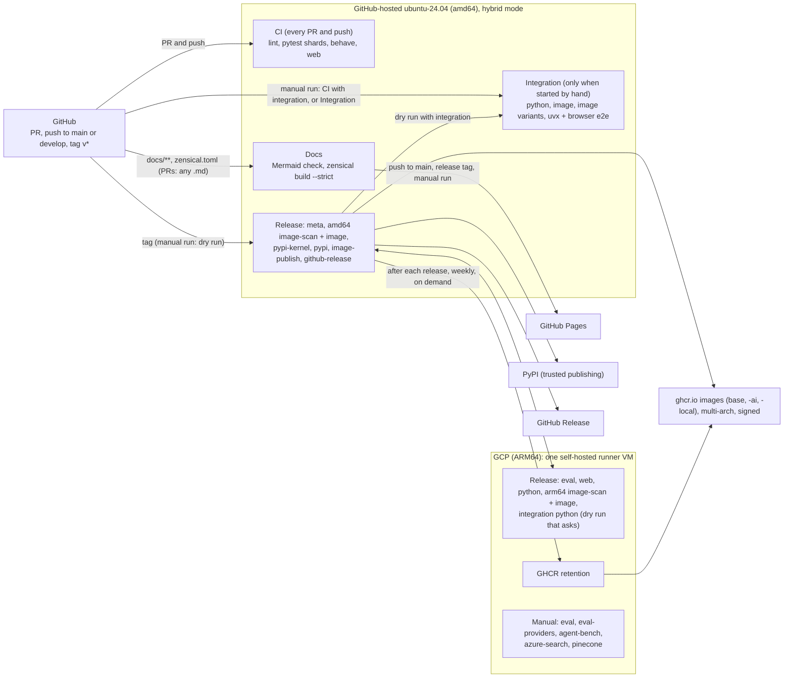

# CI/CD and runners

!!! abstract "TL;DR"
    - CI runs on our one GCP self-hosted runner (ARM64, 2 vCPU and 8 GiB), labelled
      `[self-hosted, linux, ARM64, exactdocs, gcp]`. The decision is in
      [CI runs on our GCP self-hosted runners](../decisions/ci-runners.md).
    - The repository variable `RUNNER_MODE` is `self-hosted`, so every job of a trusted run goes
      to them. `hybrid` (any other value, or unset) moves CI, the docs and the release's amd64
      and publishing jobs back to GitHub-hosted `ubuntu-24.04`.
    - A pull request from a fork always runs on GitHub-hosted `ubuntu-24.04`, whatever
      `RUNNER_MODE` says, and only after the maintainer approves the run.

## The runners

| Runner | Architecture | Cost |
|---|---|---|
| GitHub-hosted `ubuntu-24.04` | amd64 | free for a public repository (standard runners do not use the plan's included minutes) |
| `exactdocs-gcp-runner-1` to `-5`, GCP `t2a-standard-2` VMs | ARM64, 2 vCPU, 8 GiB | the GCP bill; no Actions minutes |

Every self-hosted job asks for `[self-hosted, linux, ARM64, exactdocs, gcp]`. The `gcp` label
keeps jobs off any other runner registered with the older label set, and
`packages/exactdocs/tests/ci/test_runners.py` checks that every `runs-on` uses exactly this set.
The VMs are described in `deploy/runners/README.md`.

Which job runs where is set by one **repository variable, `RUNNER_MODE`**, that every `runs-on:`
reads. `vars` is one of the few contexts `runs-on` may use. A comment block at the top of each
workflow says what it does there.

## Which job runs where

`hybrid` applies when `RUNNER_MODE` is unset or has any other value. `self-hosted` is the
current setting. "self-hosted" in the table means the GCP runners, and the release, GHCR
retention, the evals and the benchmarks use them in both modes.

| Workflow | `hybrid` | `self-hosted` (current) |
|---|---|---|
| CI (`ci.yml`): lint, pytest shards, behave, web | every job on `ubuntu-24.04` (six pytest shards) | every job on the GCP runners (three pytest shards, two behave shards) |
| Integration (`integration.yml`) from its own manual run or a manual CI run | every job on `ubuntu-24.04` | every job on the self-hosted runner |
| Integration from a release dry run: **python** (pytest, behave) | self-hosted | self-hosted |
| Integration from a release dry run: **image**, **image-variants**, **uvx** | `ubuntu-24.04` | self-hosted |
| Docs (`docs.yml`) | `ubuntu-24.04` | self-hosted |
| Release (`release.yml`): **eval**, **web**, **python** | self-hosted | self-hosted |
| Release: **image-scan**, **image**, arm64 legs | self-hosted, native | self-hosted, native |
| Release: **image-scan**, **image**, amd64 legs | `ubuntu-24.04`, native | self-hosted, cross-built ([below](#self-hosted-mode-what-changes)) |
| Release: **meta**, **pypi-kernel**, **pypi**, **image-publish** (index, tags, cosign), **github-release** | `ubuntu-24.04` | self-hosted |
| GHCR retention `eval.yml`, `eval-providers.yml`, `agent-bench.yml` `azure-search.yml`, `pinecone.yml` | self-hosted | self-hosted |

### Why the release is split that way in `hybrid`

- The eval (a few minutes, timeout 30) and the web and Python builds need nothing of x86, so they
  stay on the self-hosted runners (they predate the repository going public, when hosted jobs used
  the plan's minutes). The full eval in `eval.yml` runs on the self-hosted runner too (up to 75
  minutes).
- The amd64 image legs need x86 to build and check natively.
- The jobs that validate the tag, publish to PyPI, sign and create the release are short (a minute
  or two each) and run on a fresh VM. That keeps the publishing credentials (OIDC tokens,
  `packages: write`) off a persistent machine.

In `self-hosted` mode, the current one, every box above runs in the GCP group.

## `self-hosted` mode, what changes

### CI and the integration jobs on ARM64

- **Pinecone Local** (`ghcr.io/pinecone-io/pinecone-index`) has only an amd64 image.
    - Its service's `image:` becomes an empty string, and a service with an empty image is not
      started ([workflow syntax](https://docs.github.com/en/actions/reference/workflows-and-actions/workflow-syntax),
      `jobs.<job_id>.services.<service_id>.image`).
    - `EXACTDOCS_TEST_PINECONE_URL` is empty, so the Pinecone contract cases and scenario skip.
- **libSQL local-file cases** skip, because the `libsql` wheel is x86-only. The libSQL server cases
  still run.
- **Every other service and helper image** is published for `linux/arm64`: ParadeDB, PgBouncer,
  Qdrant, Elasticsearch, OpenSearch, Chroma, Redis, MongoDB Atlas Local, Supabase Postgres, Milvus,
  libSQL server. This was checked with `docker buildx imagetools inspect` on the pinned digests,
  2026-11-23; Weaviate's (the Docker Hub index behind `cr.weaviate.io`) on 2026-11-27.
- **The images** are built and smoke-tested for arm64. The amd64 *runtime-tools* step runs under
  QEMU (`docker/setup-qemu-action`), which only runs apt-get, git, ssh and tini.
- *Free disk space* runs on hosted runners only.

### The release's amd64 legs are cross-built

They are cross-built on the ARM64 runner, as the release did before #478:

- the Python stages of `deploy/Dockerfile` run natively and cross-install the venv for amd64
  (`--python-platform`);
- the default models are pulled natively;
- only the runtime stage's apt-get runs under QEMU.

Python 3.14 crashes under QEMU (#257), so nothing runs Python in the amd64 image. Its check is
`check_artifacts.py image <ref> <variant> --no-python`, which:

- measures the size with `du`;
- finds model files with `find`;
- reads the installed distributions from their `.dist-info` directories (the same names as
  `importlib.metadata`);
- **skips the `-local` default-models check** (it runs ExactDocs' own code), which the arm64 leg
  does on the same model files.

Trivy only reads the saved image, so the scan is unchanged.

### Queues and limits

- Eight runners with 2 vCPU each take one job at a time. A CI run of a pull request is nine jobs
  (lint, three pytest shards, two behave shards, coding tasks, web and the summary job) plus
  two docs jobs, so two pull requests at once already queue.
- The summary job, the required check `Python (ruff, ty, pytest, behave)`, always runs on
  GitHub-hosted `ubuntu-24.04` (free for a public repository): it runs no repository code, so it
  never waits for a runner after the shards have passed.
- A pytest shard takes about 20 minutes and a behave shard about 18 (timeouts 40 and 45). The
  real-providers benchmark has a 720-minute timeout, since its recorded local subset took
  3 h 22 min on 4 CPUs.
- The job limit is the self-hosted one (5 days) instead of 6 hours.
- The VMs are persistent: `_work`, the Docker cache and the BuildKit cache survive between jobs.

## Fork pull requests

- CI and Docs, the only workflows a pull request starts, choose the runner with
  `!github.event.pull_request.head.repo.fork`, so a fork's own run lands on `ubuntu-24.04`.
- A fork can edit `runs-on` in its copy of the workflow, so the expression alone is not enough.
  *Settings → Actions → General* requires approval for every external contributor's run, and
  the maintainer reads the workflow diff before approving one.
- No workflow uses `pull_request_target`. GHCR retention's `workflow_run` trigger listens only to
  the release, whose runs come from a tag or a manual run, and it checks out no code.
- The default `GITHUB_TOKEN` is read-only, and the VMs have no GCP service account.

## Switching back to GitHub-hosted runners

In *Settings → Secrets and variables → Actions → Variables*, set `RUNNER_MODE` to `hybrid` (or
delete it) and re-run the workflows. Re-runs use the variable's value at the time of the re-run.
The hard-coded self-hosted jobs (GHCR retention, the evals and benchmarks) stay on the GCP
runners.
