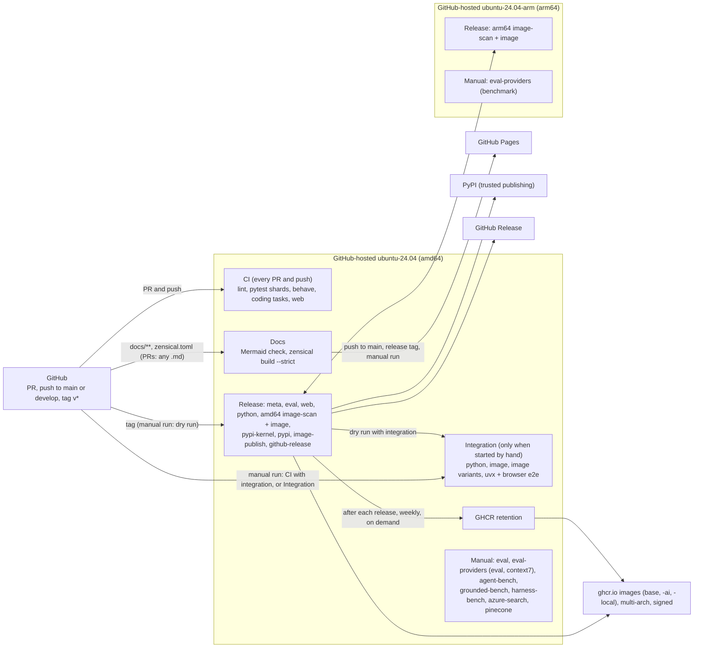

# CI/CD and runners

!!! abstract "TL;DR"
    - Every job runs on a GitHub-hosted runner, a fresh VM for each job: `ubuntu-24.04` (amd64),
      and `ubuntu-24.04-arm` (arm64) where the architecture matters.
    - No self-hosted runner is registered and no repository variable chooses the runner.
    - Each image architecture is built natively; nothing is cross-built or emulated.
    - A hosted job stops after 6 hours: split a long benchmark run.

## Which job runs where

A public repository gets the standard hosted runners for free.

| Workflow | Runner |
|---|---|
| CI (`ci.yml`): lint, six pytest shards, three behave shards, coding tasks, web | `ubuntu-24.04` |
| Integration (`integration.yml`): **python**, **image**, **image-variants**, **uvx**, from its own manual run, a manual CI run or a release dry run | `ubuntu-24.04` |
| Docs (`docs.yml`) | `ubuntu-24.04` |
| Release (`release.yml`): **meta**, **eval**, **web**, **python**, **pypi-kernel**, **pypi**, **image-publish** (index, tags, cosign), **github-release** | `ubuntu-24.04` |
| Release: **image-scan**, **image**, amd64 legs | `ubuntu-24.04`, native |
| Release: **image-scan**, **image**, arm64 legs | `ubuntu-24.04-arm`, native |
| GHCR retention `eval.yml`, `agent-bench.yml`, `grounded-bench.yml`, `harness-bench.yml` `azure-search.yml`, `pinecone.yml`, `eval-providers.yml` (jobs *eval*, *context7*) | `ubuntu-24.04` |
| `eval-providers.yml` (job *benchmark*) | `ubuntu-24.04-arm` |

## Why this layout

- **Each image architecture is built natively** on a runner of its own, so nothing runs under
  QEMU (where Python 3.14 crashes, #257) and both legs run the full image check
  (`check_artifacts.py image`, the `-local` default models included). `deploy/Dockerfile` can
  still cross-build another platform's image on one machine; `check_artifacts.py image <ref>
  <variant> --no-python` checks such an image without running its Python.
- **A fresh VM for every job.** The publishing credentials (OIDC tokens, `packages: write`) and
  the providers' keys never reach a machine that outlives the job, and a pull request's code
  never runs on one. Only the Actions cache is shared between runs (uv, the default models,
  BuildKit's `type=gha` layers).
- **Pinecone Local and the libSQL local-file cases run everywhere.** The Pinecone emulator's
  image and the `libsql` wheel are amd64-only, and every integration run, a release dry run's
  included, is on `ubuntu-24.04`.
- **The real-providers retrieval benchmark runs on `ubuntu-24.04-arm`**, the platform of the
  recorded runs in `packages/exactdocs/evals/results/` (Linux aarch64, 4 CPUs), so its latencies
  compare with theirs. The Grounded Docs benchmark runs on `ubuntu-24.04`, the platform of its
  recorded run (Linux x86_64, 4 CPUs).
- **Fork pull requests.** A `pull_request` run takes the workflow file from the pull request, so
  a fork can change what runs, but only on a hosted VM, with a read-only token and no secrets.
  The integration jobs never run on a pull request ([Fast and integration tests](tests.md)).

## Limits

- Standard hosted runners for a public repository have 4 vCPUs, 16 GB of RAM and about 14 GB of
  free disk at the start (hence the *Free disk space* steps before the image builds and the
  integration services).
- **A hosted job stops after 6 hours**, and a job stopped that way uploads no artifact.
- The longest timeouts are the real-providers retrieval benchmark and the harness benchmark (360
  minutes, the maximum), the agent and Grounded Docs benchmarks (180), the integration *python*
  job (120), the image jobs (90) and the full eval in `eval.yml` (75).
- The recorded local benchmark subset took 3 h 22 min on 4 CPUs
  ([The recorded run](../evals/retrieval-runs.md#the-recorded-run)). A full local matrix takes
  longer than 6 hours, so run it in parts (`benchmark_configs`, or `benchmark_args` such as
  `--chunkings default`).

