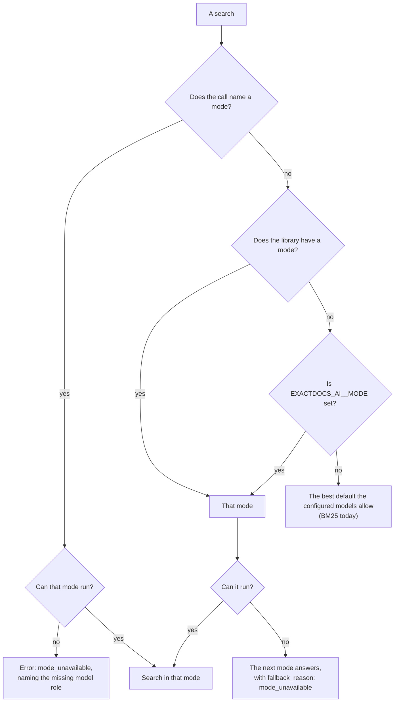
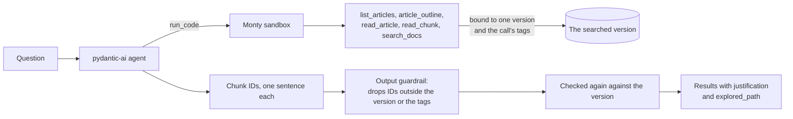

# Search and AI models

By default every search is BM25, pinned to one version, with no model and no network. If you
configure model endpoints, or run the bundled local models, a search can also use vectors, a
reranker, an LLM that writes a hypothetical answer, or an agent that browses the docs. Each of
these is opt-in, and each one falls back to a cheaper mode rather than failing the search.

Which configuration to pick (no models, local models or hosted models), with the benchmark numbers
behind it, is on [Recommended defaults](benchmark/defaults.md).

## Retrieval modes

| Mode | Needs | What it does |
|---|---|---|
| `bm25` | nothing | Full-text search: SQLite FTS5, or on PostgreSQL `pg_search` or full-text search. Identifiers are indexed whole and by their parts (`camelCase`, `snake_case`, `pkg.mod.fn`) |
| `vector` | an embedding model | Vector search alone: the version's chunks nearest to the query's embedding, with no BM25 half. Never a default; for comparing what the embedding model finds on its own |
| `hybrid` | an embedding model | BM25 and vector search fused with reciprocal rank fusion (`k` = 60, the top 50 of each), within the version |
| `hybrid_hyde` | an embedding model and an LLM | HyDE: the LLM writes a short hypothetical answer, whose embedding searches the vector half while BM25 keeps the query. Cached per query, version and model |
| `agentic` | an LLM | A pydantic-ai agent browses the version's tree and returns the chunks that answer the question, each with a reason. Never a default; see [Agentic search](#agentic-search) |

On top of any mode, a search can be reranked by a cross-encoder ([Reranker](#reranker)) or by an
LLM judge ([LLM judge](#llm-judge)).

Every mode stays pinned to the version asked for. When a mode cannot answer, the search answers with
a cheaper one and says why in `fallback_reason`:

| Mode | Falls back when | `fallback_reason` |
|---|---|---|
| `vector`, `hybrid` | the version is not embedded yet | `embedding_in_progress` |
| `vector`, `hybrid` | the embedding model fails on the query | `embedding_unavailable` |
| `vector`, `hybrid`, `hybrid_hyde` | the vector store's extension cannot be loaded | `vector_store_unavailable` |
| `hybrid_hyde` | a budget is used up, the caller hit the LLM rate limit, or the LLM failed or timed out | `llm_budget_reached`, `llm_rate_limited`, `llm_unavailable` |
| `agentic` | a limit, a budget, a loop or a failure ended the run | `agent_limit_reached`, `llm_budget_reached`, `agent_loop_detected`, `agent_failed` |
| any | the library's or instance's mode cannot run (its model was removed) | `mode_unavailable` |

### Which mode answers



A mode becomes a default only once the [eval suite](evals.md) shows that it beats BM25. None has
yet, so BM25 is the default: set `EXACTDOCS_AI__MODE=hybrid`, or a library's mode, to use hybrid
search. A library's mode is set with `PUT /api/v1/libraries/{owner}/{repo}/retrieval`, and setting
one whose model is not configured is refused.

A call that asks for a mode that cannot run fails, but a library or instance mode that cannot run
never fails a search. `vector_store_unavailable` means the hybrid modes cannot load the vector
store's extension (sqlite-vec on SQLite, pgvector's `vector` on PostgreSQL); `/healthz` names it in
`vector_store_missing`, and BM25 keeps answering.

Searching across libraries (`search_all_docs`, `GET /api/v1/search`) and `resolve-library-id`
ignore the library and instance modes: their scores must compare across libraries. They are BM25
unless `GET /api/v1/search` names `mode=vector` or `mode=hybrid` (the search playground does). Then
the query is embedded once, and every chosen library's default version that the configured model
has embedded is ranked by distance in that one space, so the distances compare across libraries;
`hybrid` fuses that ranking with the BM25 one, as within a version. Each result carries its
`bm25_rank` and `vector_rank`. A library with AI off, or not embedded yet, is left out of the
vector ranking and named in `libraries_without_vectors`; when none can be, BM25 answers with the
`fallback_reason`. [Flows](flows.md) has more diagrams of the retrieval paths.

## Chunks and tags

Articles are chunked at their Markdown headings with
[markdown-it-py](https://github.com/executablebooks/markdown-it-py), never inside a code block or
a table.[^chonkie]

Each library chooses its split level (`h1` to `h6`) and its chunk sizes with
`PUT /api/v1/libraries/{owner}/{repo}/settings`. `max_chars` cuts long sections again at deeper
headings, and `min_chars` merges tiny ones; settings left out keep the stored chunking. Every
version is then chunked again from the stored text, without fetching anything, and keeps serving
its old chunks until the new ones are in place.

A library added without chunking settings gets split level `h3` and `max_chars` 4,000, the
chunking the [retrieval benchmark](benchmark/defaults.md) recommends (#381). The library stores
it, so a later change of the default changes no existing library: one added with ExactDocs 0.4 or
earlier keeps split level `h6` and no bound until its settings say otherwise.

Whatever the settings, a section longer than 8,000 characters (about 2,000 tokens) is split between
its top-level blocks, never inside a code block, table or MDX component, into parts that keep its
heading path. A `max_chars` or `min_chars` above 8,000 is refused (422).

Articles are tagged from front matter, from path rules and by hand. Articles, over REST and MCP,
say where each tag comes from in `tag_origins`, with several origins when a tag comes from several
places. The article page of the web UI shows each tag under each of its origins and adds or removes
manual tags, which hold for every version (`PUT`/`DELETE /api/v1/libraries/{owner}/{repo}/tags?path=`).
Listings and searches filter by tag.

[^chonkie]: An earlier design used Chonkie. Its Markdown recipe needs the Hugging Face Hub and the
    network, which a model-free, offline-capable image cannot have.

## AI providers and model roles

Model endpoints are provider profiles. Each is named once, and every role uses it as
`<profile>:<model>`. Configure them in the environment or in the TOML file that
`EXACTDOCS_CONFIG_FILE` names; the environment wins, field by field. They need the `exactdocs[ai]`
extra (`uvx --from 'exactdocs[ai]' exactdocs serve`, or an `-ai` image). While no profile is
configured, none of this is imported and nothing is sent anywhere.

```toml
# EXACTDOCS_CONFIG_FILE=/etc/exactdocs/exactdocs.toml
[ai.providers.corp]                     # a company gateway speaking the OpenAI API
kind = "openai-compatible"
base_url = "https://llm.example.com/v1"
api_key_file = "/run/secrets/corp_llm_key"   # never api_key in the file
headers = { "X-Team" = "docs" }     # no credentials here: Authorization, *-key, *-token are refused
proxy = "http://proxy.example.com:3128"
request_timeout = 30

[ai.llm]
model = "corp:gpt-4.1-mini"

[ai.embedding]
model = "corp:text-embedding-3-small"   # instance-wide only
dimensions = 1024                       # optional: ask the model for shorter vectors
batch_size = 64                         # chunks per call and per durable step
```

The same in the environment: `EXACTDOCS_AI__PROVIDERS__CORP__KIND=openai-compatible`,
`EXACTDOCS_AI__PROVIDERS__CORP__API_KEY=...`, `EXACTDOCS_AI__LLM__MODEL=corp:gpt-4.1-mini`.

There are four roles: `embedding`, `reranker`, `llm` and `judge`. The `judge` defaults to the `llm`.

### Thinking level

Current chat models think before they answer, and their thinking tokens are billed as output.
Several providers default to a high level (Gemini 4 Hydrogen and Neon default to `high`), while
the `llm` and `judge` roles do short, bounded work: a hypothetical answer, a list of ratings, a
few tool calls. `thinking` lowers (or raises) how much they think:

```toml
[ai.llm]
model = "gcp:gemini-4-hydrogen"
thinking = "low"          # EXACTDOCS_AI__LLM__THINKING: minimal, low, medium, high or xhigh

[ai.judge]
thinking = "minimal"      # EXACTDOCS_AI__JUDGE__THINKING; the judge is the LLM here
```

Unset, calls are made as before, at the provider's default. A judge that is the `llm` role thinks
as the `llm` does unless it has a level of its own. The level is sent as each provider's own
control, through pydantic-ai's model settings:

| Provider kind | What is sent |
|---|---|
| `google-vertex`, `google` (Gemini 3 and later) | `thinking_config.thinking_level` (`MINIMAL`, `LOW`, `MEDIUM`, `HIGH`; a level the model lacks snaps to the nearest, e.g. `minimal` to `LOW` on Gemini 3.1 Pro) |
| `google-vertex`, `google` (Gemini 2.5) | `thinking_config.thinking_budget`: 128, 2,048, 8,192 or 24,576 tokens |
| `anthropic` (adaptive thinking: Claude Opus and Sonnet 4.6 and later, Haiku 5.5) | `thinking: {type: adaptive}` with `output_config.effort` |
| `anthropic` (older Claude models) | `thinking.budget_tokens`: 1,024, 2,048, 10,000, 16,384 or 32,768; the budget is added to the answer's own token cap, which it counts toward |
| `openai` (Responses API), `azure` | `reasoning.effort` / `reasoning_effort` |
| `openrouter` | `reasoning.effort` |
| `openai-compatible`, `ollama`, `vllm`, `litellm` and the other OpenAI-API kinds | `reasoning_effort` |

Behind an OpenAI-compatible endpoint (a gateway's alias, an Azure deployment) a model is sent
`reasoning_effort` even when pydantic-ai does not know it: the endpoint takes the field, and only a
call tells whether the model does. Anthropic, Google and OpenAI's own API serve models
pydantic-ai knows; one that takes no thinking setting (`gemini-2.0-flash`, `gpt-4.1`) is refused a
level when it is saved over the REST API or in the UI (422 `thinking_unsupported`, naming the role
and the model). A level from the environment or the file that the model cannot take is logged as a
warning at start, shown on the *AI* page, and left out of every call.

Where it is set:

- the environment or the TOML file (above), read-only elsewhere;
- otherwise `PUT /api/v1/ai/roles/{llm|judge}` with `{"thinking": "low"}` (`null` clears it), or
  the *AI* page; `GET /api/v1/ai/roles` shows each role's `thinking`, its `own_thinking`, whether it
  is `thinking_configured`, and `thinking_unsupported` when its model cannot take it;
- for one library, `llm_thinking` and `judge_thinking` in its retrieval settings (below), which win
  over the instance's level, for its own model or the instance's.

Every call of the role uses the level: HyDE, the judge, the agentic mode and `exactdocs ai check`,
so the check's latency reflects it. Spend is counted as before, from the usage each provider
reports: thinking tokens are part of the output tokens.

### Provider kinds

| Kind | Notes |
|---|---|
| `openai-compatible` | any gateway: a base URL and an optional key |
| `openai`, `openrouter` | |
| `anthropic` | `platform = "api"`, `"vertex"`, `"foundry"`, or `"bedrock"` (needs boto3, which the images do not include) |
| `azure` | Azure OpenAI: `base_url` or `resource`, `api_version`, and a key or `auth = "entra"` |
| `google-vertex` | `project`, `location` and `credentials_file`, or `credentials = "adc"`, or an Express-mode key |
| `google` | the Gemini API |
| `ollama`, `vllm`, `litellm` | self-hosted servers |
| `deepseek`, `together`, `fireworks`, `cerebras`, `github`, `vercel`, `moonshotai`, `heroku`, `nebius`, `ovhcloud`, `sambanova`, `alibaba` | pydantic-ai's OpenAI-API providers |
| `tei` | Text Embeddings Inference serving a reranker; the `reranker` role only |
| `local` | models in this process; see [Local models](#local-models) |

Groq, Mistral, Cohere, xAI and Bedrock are reached through their OpenAI-compatible endpoint or
through LiteLLM.

### How profiles handle credentials

Every SDK client gets its endpoint, key (`unused` for a profile without one), project, region and
API version from the profile, and nothing else. `OPENAI_API_KEY`, `OPENAI_BASE_URL`,
`ANTHROPIC_API_KEY`, `AZURE_OPENAI_*`, `GOOGLE_*` and similar variables are never read, and each
profile's HTTP client refuses any scheme, host or port but its own endpoint's.
`OPENAI_CUSTOM_HEADERS` and `ANTHROPIC_CUSTOM_HEADERS` are removed from the process before any SDK
client is built, because the SDKs would let them replace a profile's key.

Extra headers carry no credentials. `Authorization`, `Cookie`, `x-api-key`, `api-key` and names
ending in `-key`, `-token`, `-secret` or `-password` are refused with "use the key field", so no
credential sits unsealed in the database or the file.

The server's own cloud identity (`credentials = "adc"`, `credentials_file`, `auth = "entra"`, and
Claude on Bedrock, which signs with the AWS identity) is only used by profiles from the environment
or the TOML file, never by ones created over REST. Such a profile takes no `base_url`. Its endpoint
is derived from `location` or `resource` (Google's, Azure's or AWS's own), so the token never
reaches another host:

- `resource`, `location` and `project` must each be a single DNS label (letters, digits, inner
  hyphens). GCP's legacy domain-scoped project IDs (`example.com:project`) are therefore refused.
- A derived endpoint is built with a URL constructor and checked against the provider's exact host
  form: `<resource>.openai.azure.com`, `<resource>.services.ai.azure.com`,
  `bedrock-runtime.<region>.amazonaws.com`, or Vertex AI's `aiplatform` hosts.
- An Entra ID credential chain (client secret or certificate, workload identity, managed identity,
  user-assigned through `AZURE_CLIENT_ID`) is built once per profile. The profile's `proxy` carries
  the calls to `login.microsoftonline.com`, but never those to managed identity's local endpoint.
  Entra ID never uses the Azure CLI, PowerShell, VS Code or any developer sign-in; for local
  development, use a client secret (`AZURE_TENANT_ID`, `AZURE_CLIENT_ID`, `AZURE_CLIENT_SECRET`).
- Google's token refresh uses the environment's proxy variables, because google-auth reads them
  itself.

### Managing profiles

Over REST (`/api/v1/ai/providers`, admins only), profiles can be created, changed, deleted and
checked. Their keys are sealed with the secret key (`EXACTDOCS_SECRET_KEY` or `secret.key`, under a
key derivation of their own) and never returned. Profiles from the environment or the file are
read-only there. A stored key is dropped, not reused, when the profile's endpoint changes.

`exactdocs ai check`, run where the server runs, makes one minimal call per role and prints the
latency, the model that answered and an embedding's dimensions, never a key.
`POST /api/v1/ai/providers/{name}/check` does the same for one profile.

The *AI* page of the web UI (admins only) lists the providers and roles (never a key) with a check
per profile, the embedding progress of each space (`GET /api/v1/ai/embedding`), and the usage and
budgets described below.

### Per-library settings

`PUT /api/v1/libraries/{owner}/{repo}/retrieval` sets, for one library:

- whether AI is on. When it is off, nothing of the library is ever sent to a provider and its
  searches are BM25;
- its own `llm`, `judge` and `reranker`, and its own `rerank_top_n`;
- its own thinking levels, `llm_thinking` and `judge_thinking` (see [Thinking level](#thinking-level));
- what reranks it: `rerank_with`, `cross_encoder` or `judge`;
- its own spend limits per day and month (`budgets`), no higher than the instance's;
- its `repo_guidance` (see [Repo guidance](#repo-guidance)).

The embedding model is instance-wide only. The library's settings page (*Retrieval and AI*) shows
the pipeline its searches run now and edits all of these.

### Background embedding

With an embedding model set, every version is embedded in the background: one `embed` job per
version, with a durable step per `batch_size` chunks that resumes after a restart. Jobs are queued
on start, after each import and whenever the model changes.

Each chunk is sent once, as its article title, heading path and text, even when many versions hold
it, and a library with AI off is never sent. Changing the model, its `dimensions` or the input
format starts a new embedding space, and every version is embedded again. Until a version is
covered by the new model, its searches answer BM25 with `fallback_reason: embedding_in_progress`;
two models' vectors are never mixed. The old space is dropped once the new one covers every
version.

Saving the embedding role's profile over REST re-queues what it changes. A batch the provider does
not answer for now (a timeout, a 429) is tried again a few times. On PostgreSQL the vectors go to
pgvector (see [PostgreSQL](deployment.md#postgresql)); without its `vector` extension each embed
job is skipped with `vector_store_unavailable`.

To see what embedding will cost before you start, `exactdocs ai estimate` (where the server runs)
prints the chunks still to embed, an estimate of their tokens (4 characters per token, never a
tokenizer) and of the US dollars from the bundled price list, without calling any model.
`GET /api/v1/ai/embedding/estimate` is the same over REST.

### Budgets and rate limits

```toml
[ai.budgets]
daily_usd = 10
monthly_embedding_usd = 50
per_library_daily_usd = 2
per_user_daily_usd = 1
llm_searches_per_minute = 30

[ai.prices."corp:gpt-4.1-mini"]   # only for models genai-prices does not know
input_usd_per_mtok = 0.40
output_usd_per_mtok = 1.60
```

`[ai.budgets]` (or `EXACTDOCS_AI__BUDGETS__...`) caps spend in US dollars and tokens per UTC day
and month:

| Scope | Settings |
|---|---|
| the instance | `daily_usd`, `monthly_usd`, `daily_tokens`, `monthly_tokens` |
| each library | `per_library_...` |
| each account (the API token's or the session's; stdio MCP counts to the instance and library only) | `per_user_...` |
| embedding runs | `daily_embedding_...`, `monthly_embedding_...` |

`llm_searches_per_minute` limits each caller's LLM searches over REST, HTTP MCP and stdio alike,
counted per server process.

Every model call is counted from the usage the provider reports, in one `retrieval_ai_spend` table
shared by every server process and by stdio MCP processes. Those open the database read-only but
add their spend to this table over a connection that may write only it (see
[stdio](mcp.md#without-a-network-port-stdio)). The tokens are recorded per UTC day and month for
the instance, the library and embedding runs. LLM agents are held by the harness `SpendLimits`,
and embedding and rerank calls by retrieval's own check before each batch or call, so a burst can
overshoot by the calls already in flight.

Reaching a limit degrades search; it never breaks it:

- the LLM step is skipped, and the result names the cheaper mode with
  `fallback_reason: llm_budget_reached` (or `llm_rate_limited`);
- a paid rerank is skipped (`reranked: false`). A rerank that ran counts one request and its
  tokens, estimated at 4 characters per token since rerank endpoints report none;
- an `embed` job of a paid model stops before its next batch with `ai_budget_reached` and is queued
  again after the window resets (each UTC midnight, by one server process, a few minutes after at
  random);
- BM25 keeps answering.

**Prices** come from the `genai-prices` data bundled with pydantic-ai, which is never fetched. A
model it does not know gets `input_usd_per_mtok` and `output_usd_per_mtok` under
`[ai.prices."<profile>:<model>"]`, as above.

- `local` models cost nothing. Their tokens are recorded (`local_tokens` in the usage) but count
  toward no token budget, so local search traffic never uses up a budget, and no budget stops a
  local embedding job or a search's local query embedding or rerank. Tokens recorded before this
  rule existed (local ones included, since older rows do not say which model spent them) stay
  counted until their day or month window resets.
- Self-hosted endpoints (`ollama`, `vllm`, a TEI reranker) count as paid and are never priced from
  another provider's list. With a US dollar budget, give them a price of 0
  (`input_usd_per_mtok = 0`) if they cost nothing.
- A US dollar budget together with a configured model that has no price is refused at start.

**Usage**: `GET /api/v1/ai/usage` (admins) shows what the instance, embedding runs, each library and
each account spent today and this month, and what is left of each budget (a library's own budget
where it is tighter). `/metrics` has pydantic-ai's `gen_ai.client.token.usage` and
`operation.cost`, `exactdocs_ai_fallbacks_total` by mode and reason, and
`exactdocs_ai_cache_hits_total` (searches whose LLM step a cache answered) by cache
(`agentic_answer`, `hyde_answer`) and mode, never by library, user or query. Spans never carry
prompts or completions, even with `EXACTDOCS_TELEMETRY_QUERY_TEXT` on.

## Reranker

A cross-encoder reranker reorders the best candidates of every search (`search_docs`, `query-docs`,
the REST search) for precision. A hybrid search is reranked the same way, after the fusion. The
reranker speaks one of two HTTP dialects:

```toml
[ai.providers.cohere]                   # Cohere-compatible POST <base_url>/rerank
kind = "openai-compatible"
base_url = "https://api.cohere.com/v2"  # Jina: https://api.jina.ai/v1, Voyage: https://api.voyageai.com/v1
api_key_file = "/run/secrets/cohere_key"

[ai.providers.tei]                      # Text Embeddings Inference: POST <base_url>/rerank
kind = "tei"
base_url = "http://tei:8080"

[ai.reranker]
model = "cohere:rerank-v3.5"            # or "tei:BAAI/bge-reranker-base" (TEI serves one model)
top_n = 32                              # candidates reranked per search (1 to 200)
timeout = 2.0                           # seconds for building the reranker and its call
```

vLLM and LiteLLM (`kind = "vllm"` or `"litellm"`, with a base URL ending in `/v1` or `/v2`) and
Azure AI Foundry's Cohere deployments (`openai-compatible`) speak the Cohere-compatible dialect
too. A `tei` profile still needs the `exactdocs[ai]` extra, like every profile, although it only
uses `httpx2`.

Only the query and the candidates' chunk text are sent: each cut to 8,000 characters, in batches
of 100 (32 for TEI). A library name, a version or a user is never sent.

A reranker that times out, fails or answers something unusable never fails a search. The results
keep their order with `reranked: false` and `fallback_reason` `reranker_timeout` or
`reranker_failed`, and the failure is logged without the query. Whatever the reranker raises (an
HTTP client closed under the call because its profile was edited, a partly installed SDK) counts as
`reranker_failed`. Traces show it as the `rerank` stage, without the query or any text.

With a `limit` above `top_n`, the reranked results come first and the rest follow in the mode's
order, with the mode's scores, which are not comparable with the reranker's.

With any provider profile other than `local` configured, the provider SDKs are loaded in a worker
thread at start, so the first search never waits for them. A load that fails is a warning, not a
stop.

## LLM judge

Without a cross-encoder endpoint, or for better judgments than one gives, a small, fast LLM can
rerank instead. The `judge` role (any chat profile; it defaults to the `llm` role) rates every
candidate in one call, with a whole score from 0 to 10 per candidate. Since it costs an LLM call
per search, it only reranks where it is chosen:

```toml
[ai.judge]
model = "corp:gpt-4.1-mini"             # optional: the [ai.llm] model when unset
timeout = 10.0                          # seconds for building the model and its one call

[ai]
rerank_with = "judge"                   # EXACTDOCS_AI__RERANK_WITH; default "cross_encoder"
```

A library chooses for itself with `rerank_with` (`cross_encoder` or `judge`) in its retrieval
settings or the UI; unset, the instance's choice applies. When both a cross-encoder and a judge
are configured, the cheaper cross-encoder reranks unless the judge is chosen. A library that
chooses the judge without one configured is reranked by the cross-encoder, if there is one.

**What the judge sees.** It gets the best of the same top N as the cross-encoder, as many as fit
one bounded call: at most 64 candidates and about 18,500 input tokens.[^judge-tokens] That keeps
the call under the 60,000 tokens one LLM step may use, even for code full of escaped `<`, `>` and
`&`, or base64 broken by spaces, or rare scripts at 3 tokens a character, so a call is never
stopped after it was paid for. With 2,000 characters per candidate that is about 32 English or code
candidates, or 9 CJK ones. Candidates beyond those keep the mode's order after the judged ones, and
`coverage.reranked` counts only the judged.

The judge gets the query and each candidate's chunk text (cut to 2,000 characters), named by
position (`c1`, `c2`...), never by chunk ID, and never a library name, a version or a user. The
prompt and the instructions mark them as untrusted, delimited text, and every `<`, `>` and `&` in
them is escaped, so a candidate cannot close its delimiter.

**What it may answer.** Its answer may only reorder the candidates it was given. Ratings that name
an ID it was not given (anything but exactly `c1` to `cN`), rate a candidate twice, leave one out or
go outside 0 to 10 are refused at once, with no retry, and the search keeps its order with
`fallback_reason` `reranker_failed`. A judge that does not answer within its timeout keeps the
order with `reranker_timeout`.

It is an LLM step, so it counts against the budgets and the LLM search rate limit (once per search,
together with HyDE's step). Once a budget is used up, the search keeps its order with
`fallback_reason` `llm_budget_reached` without calling it. Traces show it as the `judge` stage,
without the query, the candidates or the ratings.

[^judge-tokens]: Tokens are estimated at 4 characters per token for ASCII text, 1.5 for long ASCII
    runs without whitespace (base64, hashes), 4 tokens for a character above U+FFFF (CJK Extension
    B, emoji) and one token for any other character (CJK, Cyrillic, control characters...).

## Agentic search

With an `llm` role configured, `mode=agentic` (a call's, a library's or `EXACTDOCS_AI__MODE`; it is
never chosen by default) hands the question to a pydantic-ai agent on that model.

### How the agent works

The agent works in [Code Mode](https://pydantic.dev/docs/ai/harness/code-mode/). Its only tool is
`run_code`, a sandbox ([Monty](https://github.com/pydantic/monty), never IPython) in which it can
call `list_articles`, `article_outline`, `read_article`, `read_chunk` and `search_docs` (BM25),
each with a typed result.



Every read is bound to what the caller may see: the one version searched and the call's tags.
That scope is the agent's `deps`, never a tool argument, so no argument can name a library, a
version or a tag. The call's tags apply to every read, so the agent never sees an article they
exclude.

The agent answers with chunk IDs and one sentence each. An output guardrail (the harness
`OutputGuardrail`) removes every ID that is not in the version's manifest, or that the call's tags
exclude, before the answer leaves the agent, and the IDs are checked once more after it. A result
from another version, or a made-up ID, is dropped and never returned; only the number of rejected
picks is logged.

Each result carries its `justification` and `explored_path`: the read calls up to the one that
reached its article, such as `search_docs(retry)` or `article_outline(docs/guide/resilience.md)`.
Both are model output and are marked as such in the schema and the MCP notice. Control characters
are removed, a justification is cut at 600 characters, and a path keeps at most 50 calls with each
argument cut at 120 characters.

Only the question and what the agent reads are sent to the model, never a library name or a user.

### Limits

A run is bounded per search by `[ai.agentic]` (or `EXACTDOCS_AI__AGENTIC__...`) and by the budgets
above (the harness `SpendLimits`, counted to the instance, the library and the caller; a library's
own budgets apply where they are tighter than the instance's):

```toml
[ai.agentic]
max_tool_calls = 20          # read calls per search, run_code included (1 to 200)
max_requests = 8             # model requests per search (1 to 50)
max_tokens = 60000           # input and output tokens per search
sandbox_seconds = 5.0        # each run_code snippet's execution time (time awaiting a tool does not count)
sandbox_memory = 67108864    # each snippet's heap, in bytes
sandbox_suspensions = 500    # the sandbox's host calls per search
timeout = 120.0              # seconds per search, model calls included (more than sandbox_seconds)
max_repeated_calls = 3       # the same call (tool and arguments) this often is a loop (2 to 50)
```

`sandbox_seconds` must be less than `timeout`. A snippet still running when `timeout` passes stops
at its own `sandbox_seconds`, so a search can last up to `timeout` plus `sandbox_seconds`.

Ending a run early never fails the search. It answers with the best mode without an LLM step (BM25,
or hybrid when an embedding model is set) and a `fallback_reason`:

| What happened | `fallback_reason` |
|---|---|
| a limit above was passed | `agent_limit_reached` |
| a budget ran out during the run | `llm_budget_reached` |
| the same call (the same tool with the same arguments, `run_code` or a read inside it) was made `max_repeated_calls` times; the repeated read never runs | `agent_loop_detected` |
| the model failed or kept answering something unusable, or a read failed on the server (the database, the catalog) | `agent_failed` |

A loop whose arguments change each time is not detected as one; it ends at `max_tool_calls` with
`agent_limit_reached`. When a read fails on the server, its error is never shown to the model, only
a fixed text, and the run ends.

Failures are logged by kind, never with the question or the error's text. Traces show the run as
the `agent` stage, with one span per model request and per tool call (the read calls nested in
`run_code`, each with an `exactdocs.agent.read` event naming the version it was bound to and the
versions of what it returned), never with prompts, answers or tool arguments. `/metrics` shows its
tokens (`gen_ai.client.token.usage`).

### Answers over several libraries

The search playground (#428) also has the agent write an answer: `POST /api/v1/answer` runs the same
harness (Code Mode, the sandbox, the spend limits) over the default versions of the libraries you
choose, with the read functions `list_libraries`, `search_docs`, `list_articles`, `article_outline` and
`read_chunk`, each naming one library of that choice. Its output is the answer in Markdown and its
sources: a library, a chunk ID, a quote and a reason each. An output guardrail keeps only chunks of the
chosen libraries that the caller may read (roles and API token scope) and the tags allow, and a quote
is kept only when the chunk holds it verbatim. It is bounded by the limits above and counted like
any LLM search: to the instance, the caller and each library it reads, and once to
`llm_searches_per_minute`. A run that stops answers with no text and the chunks it had read, with
the `fallback_reason`s of the table above (a rate limit gives `llm_rate_limited`). A library with AI off
is never read. `POST /api/v1/answer/stream` also streams how many tool calls the run has made out of
its limit. See the [REST API](rest-api.md).

### Re-asked questions

Teams ask the same thing more than once. With the agentic answer cache on, an agentic answer is
kept, and a later question that asks the same thing again is answered from it at once: with
`cache_hit: true`, the same results, justifications and explored paths, and no LLM call, budget or
rate limit (counted in `exactdocs.ai.cache_hits`).

```toml
[ai.agentic_cache]
enabled = true       # off by default: while off, stored answers are deleted
# threshold = 0.8    # 0 to 1; unset: 0.8 with an embedding model, 0.9 with words alone
scope = "library"    # or "caller": each caller is answered from their own questions only
ttl = "P7D"          # seconds or an ISO 8601 duration
```

The cache is opt-in, with an embedding model too. It trades exactness for cost and serves only
near-verbatim re-asks.

**When an answer is reused.** Only for the same version as it is now (a re-sync to a new commit, or
a new manifest, never reuses it), the same tag filter, the same `llm` model and the same
`[ai.agentic]` limits. Each of its chunks is looked up again in the version, under the call's tags,
before it is returned, and an answer none of whose chunks are left runs the agent instead.

**What counts as the same question.** The same content words in the same order. Filler such as
"how", "do", "I", "I want" or "behaviour" is dropped, and only plurals fold ("retries"/"retry",
"rows"/"row"), so "how do I configure retries", "how to configure retry behaviour" and "I want to
configure retries" are one question. The rules lean towards a miss, because a wrong fold serves a
wrong answer and a missing one only costs an LLM call:

- Nothing else folds: "connecting" is not "connect", "meaning" is not "mean", "migration" is not
  "migrate", and "format" is never "form".
- Question words ("when" is not "why"), prepositions and conjunctions ("build for arm" is not
  "build on arm") stay.
- Order is part of the question, so every swap misses: "replace requests with httpx" is not
  "replace httpx with requests", and "from v1 to v2" is not "to v1 from v2". An order-flipped
  re-ask ("retry configuration" for "configure retries") is therefore a miss too, which is accepted.
- Symbols are terms in their places: "latency > threshold" is not "latency < threshold", `c++` is
  not `c`, and `≥`, `≤`, `≠`, `≈` and `→` read as `>=`, `<=`, `!=`, `~=` and `->`. Only sentence
  punctuation is dropped.
- Single letters are terms too, but "a" and "I" only as names, next to a symbol or a direction word
  ("move it to a from b").
- Numbers and versions must match exactly, with their sign, a comparison or range operator right
  before them and a `+` right after: `-1` is not `1`, `>= 3.8` is not `< 3.8`, `~1.2` is not
  `^1.2`, and `3.8+` is not `3.8`. So must words with digits (`python3`, `oauth2`, `E42`) and
  negations ("not", "never", "without", "can't", "dont"...).
- A question with a word the other lacks never hits, and neither does a paraphrase in other words.
  Neither words nor embeddings tell "enable" from "disable" or "client" from "server": the default
  local model scores those pairs 0.85 to 0.96, as high as real paraphrases.

With an embedding model, the cosine of the two questions' embeddings must also clear the threshold,
as a confirmation. It never makes two different questions match. The threshold is 0.8 with an
embedding model and 0.9 with words alone by default.

Saving a library's retrieval settings, or removing the library, forgets its answers. The nightly
upkeep deletes answers past `ttl`, answers of an `llm` model that is no longer configured, answers
compared with another embedding model than the configured one, and every answer while the cache is
off.

!!! warning "Shared answers"
    With `scope = "library"` (the default) every caller of a library's version shares the cache.
    One caller's cached answer, including the model's justifications, which may paraphrase their
    question, can be served to another caller of the same library and version. Use
    `scope = "caller"` where callers must not see the gist of each other's questions.

**What the cache stores.** The cache (`retrieval_agentic_answers`) never stores the question's text.
It keeps an HMAC of the normalized question and of each of its terms, keyed from the instance's
secret key, and, with an embedding model, the question's embedding. An embedding can be partly
inverted into the words it came from, so treat the table as holding what the question meant. It
also keeps the answer as returned (chunk IDs, justifications and explored paths), which is model
output and may quote words of the question. The question's embedding is a query embedding like a
hybrid search's: it is sent to the embedding model and counted to the same budgets.

### Repo guidance

Many repositories describe how their docs are organized in `AGENTS.md` or `CLAUDE.md`. A library
can let the agent use these files with `repo_guidance` in its retrieval settings
(`PUT /api/v1/libraries/{owner}/{repo}/retrieval`). It is off by default.

| `repo_guidance` | What imports keep | What the agent gets |
|---|---|---|
| `off` (default) | nothing | nothing |
| `notes` | each version's root `AGENTS.md` / `CLAUDE.md` and those of every folder holding a selected file, also outside the selected paths[^guidance-files] | a folder's file, once it opens that folder (lists it, or reads an article or a chunk in it), as an untrusted user-channel note in a `<context-file>` block, never as system instructions |
| `trusted` | the same | as `notes`, and the root's file is also part of its system instructions: only for a repository you trust as much as your own instructions |

[^guidance-files]: At most 32 folders. A file over 32 KiB, a file that is not text, or a link that
    does not lead in one hop to a file inside the repository is left out and listed on the job; the
    others are kept. A link that does lead to such a file is kept as its target's text.

The files are repository content, so they are untrusted. They reach the agent through the harness's
[Repo Context](https://pydantic.dev/docs/ai/harness/repo-context/) over a read-only workspace that
holds only the searched version's files, read from the database, never from a checkout.

- The text is NFKC-normalized, control and invisible (default-ignorable) characters are dropped,
  and every `<` or `>` and their lookalikes (fullwidth, small form, angle brackets) are written as
  `&lt;` and `&gt;`, so a file can neither close its block nor open one. At most 16 files and
  24,000 characters go out per search.
- They cannot add a tool, reach another library or version, or lift a limit. The read tools, the
  pinned version and `[ai.agentic]` are fixed before the run, and every pick is still checked
  against the version.
- Their text counts toward the run's `max_tokens` and budgets like everything else sent to the
  model (a streamed response whose server reports no usage is counted with the judge's estimate
  above), and it is never logged or put on a span.

Turning guidance on (`off` to `notes` or `trusted`) queues a `reprocess` of the library: every
version is imported again at its commit and keeps its files, without a new upstream commit.
Switching between `notes` and `trusted`, or back to `off`, takes effect at the next search (with
`off`, nothing is sent; the kept files go with the next import).

!!! warning
    Only an `admin` of the library (or an operator) can edit its AI settings, so only they can
    mark it `trusted`.

## Local models

An air-gapped instance, or one whose docs may not leave it, can run a small embedding model and a
cross-encoder inside ExactDocs, on the CPU (fastembed on ONNX Runtime; no torch, no GPU). They come
with the `exactdocs[local]` extra (`uvx --from 'exactdocs[ai,local]' exactdocs serve`) and are
fetched once, by the one command that contacts the Hugging Face Hub:

```bash
exactdocs models pull        # BAAI/bge-small-en-v1.5 (67 MB) and Xenova/ms-marco-MiniLM-L-6-v2 (92 MB)
exactdocs models pull BAAI/bge-base-en-v1.5   # or any fastembed embedding model or cross-encoder
```

```toml
[ai.providers.local]                    # EXACTDOCS_AI__PROVIDERS__LOCAL__KIND=local: required,
kind = "local"                          # a `local:` role without it is warned about at start

[ai.embedding]
model = "local:BAAI/bge-small-en-v1.5"  # <profile>:<model>, 384 dimensions

[ai.reranker]
model = "local:Xenova/ms-marco-MiniLM-L-6-v2"
# timeout: unset means 5 s for a reranker on a `local` profile, the instance's or a library's
# own (2 s otherwise): a CPU reranks 32 long candidates in about 0.2 to 2 s, more with fewer cores
```

The `-local` image already holds both default models, so the same settings in its environment are
all it needs, even with no network at all (CI runs it with `--network none`):

```bash
docker run -d --name exactdocs -p 3000:3000 -v exactdocs-data:/data \
  -e EXACTDOCS_AI__PROVIDERS__LOCAL__KIND=local \
  -e EXACTDOCS_AI__EMBEDDING__MODEL=local:BAAI/bge-small-en-v1.5 \
  -e EXACTDOCS_AI__RERANKER__MODEL=local:Xenova/ms-marco-MiniLM-L-6-v2 \
  -e EXACTDOCS_AI__MODE=hybrid \
  ghcr.io/sircypkowskyy/exactdocs:latest-local
```

bge-small reads at most 512 tokens, so a chunk longer than about 1,800 characters (chunks go up to
8,000) is embedded from its title, heading path and roughly its first 1,800 characters. Full-text
search, reranking and the agent still see all of it.

**Where models live.** In `EXACTDOCS_MODELS_DIR`, which defaults to `<data dir>/models`. The
`-local` image sets it to its read-only `/opt/exactdocs/models`, where the two defaults were pulled
when the image was built, so it needs no `models pull` and no network. Each model has a folder of
its own (`BAAI/bge-small-en-v1.5/`) with its ONNX file, its tokenizer and a marker that
`models pull` writes last. A model that is already there is skipped, so a cached directory makes
the command work offline.

**Pinned revisions.** The two defaults are pulled at a fixed Hub commit (bge-small's `aa8f8b06`,
MiniLM's `a0914435`), so a pull, and the `-local` image, are reproducible. The marker records the
commit of every model. A default model pulled at another commit is refused at start (pull it
again); other models are pulled at whatever commit `main` points to at the time.

**Never downloaded at run time.** Models load from that folder only (fastembed's
`specific_model_path` and `local_files_only`), which never reaches Hub code, so `HF_HUB_OFFLINE` is
not needed; a test with sockets blocked proves that no connection is made. A role whose model is
not there is turned off at start with an error naming the command, and the server starts and
answers BM25:

```text
AI role embedding (local:BAAI/bge-small-en-v1.5) is off: model ... is not in ...: run `exactdocs models pull BAAI/bge-small-en-v1.5`
```

**In process, bounded.** Each model is loaded once per process (at start for the instance's roles),
never on the event loop. The embedding jobs' batches run on a pool of their own, one at a time.
What a search waits on (its query embedding, the rerank) runs on another pool, two at a time, so a
search never queues behind ingestion. Each call gives ONNX Runtime half the cores, its memory arena
is off, and a local model embeds at most 16 texts per call, since padding to the longest text costs
memory.

On a 4-core x86_64 machine, embedding the fixture library (3 versions, 61 distinct chunks) with
bge-small took 2.4 to 3.3 s (4.7 to 5.7 s of CPU). The whole process grew from 398 MB (app and
model loaded) to about 495 MB, peaking near 530 MB. With all cores per call, one arena and batches
of 64, it took 4.3 to 5.9 s and 636 MB.

A few limits:

- A local model cannot shorten its vectors. Leave `[ai.embedding] dimensions` unset, or set it to
  the model's own.
- A `local` profile runs no chat model. Use `ollama`, or any `openai-compatible` server, for a local
  LLM.
- A local model is priced at 0, so a US dollar budget is accepted at start and never stops it. Its
  tokens are recorded as `local_tokens` and count toward no token budget, so no budget stops a
  local embedding job, and a search's query embedding and rerank on a local model are never
  refused (see [Budgets and rate limits](#budgets-and-rate-limits)).
