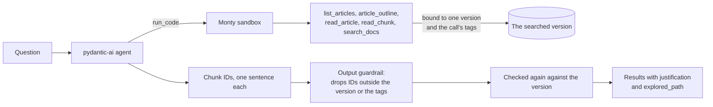

# Agentic search

!!! abstract "TL;DR"

    - `mode=agentic` hands the question to a pydantic-ai agent in a Code Mode sandbox; it is never chosen by default.
    - Every read is bound to the searched version and the call's tags, and every pick is checked again.
    - `[ai.agentic]` bounds each run; ending early answers with a cheaper mode.
    - `repo_guidance` lets the agent read a repository's `AGENTS.md` or `CLAUDE.md`; it is off by default.

With an `llm` role configured, `mode=agentic` (a call's, a library's or `EXACTDOCS_AI__MODE`; it is
never chosen by default) hands the question to a pydantic-ai agent on that model.

## How the agent works

The agent works in [Code Mode](https://pydantic.dev/docs/ai/harness/code-mode/). Its only tool is
`run_code`, a sandbox ([Monty](https://github.com/pydantic/monty), never IPython) in which it can
call `list_articles`, `article_outline`, `read_article`, `read_chunk` and `search_docs` (BM25),
each with a typed result.



Every read is bound to what the caller may see: the one version searched and the call's tags.
That scope is the agent's `deps`, never a tool argument, so no argument can name a library, a
version or a tag. The call's tags apply to every read, so the agent never sees an article they
exclude.

The agent answers with chunk IDs and one sentence each. An output guardrail (the harness
`OutputGuardrail`) removes every ID that is not in the version's manifest, or that the call's tags
exclude, before the answer leaves the agent, and the IDs are checked once more after it. A result
from another version, or a made-up ID, is dropped and never returned; only the number of rejected
picks is logged.

Each result carries its `justification` and `explored_path`: the read calls up to the one that
reached its article, such as `search_docs(retry)` or `article_outline(docs/guide/resilience.md)`.
Both are model output and are marked as such in the schema and the MCP notice. Control characters
are removed, a justification is cut at 600 characters, and a path keeps at most 50 calls with each
argument cut at 120 characters.

Only the question and what the agent reads are sent to the model, never a library name or a user.

## Limits

A run is bounded per search by `[ai.agentic]` (or `EXACTDOCS_AI__AGENTIC__...`) and by the budgets
above (the harness `SpendLimits`, counted to the instance, the library and the caller; a library's
own budgets apply where they are tighter than the instance's):

```toml
[ai.agentic]
max_tool_calls = 20          # read calls per search, run_code included (1 to 200)
max_requests = 8             # model requests per search (1 to 50)
max_tokens = 60000           # input and output tokens per search
sandbox_seconds = 5.0        # each run_code snippet's execution time (time awaiting a tool does not count)
sandbox_memory = 67108864    # each snippet's heap, in bytes
sandbox_suspensions = 500    # the sandbox's host calls per search
timeout = 120.0              # seconds per search, model calls included (more than sandbox_seconds)
max_repeated_calls = 3       # the same call (tool and arguments) this often is a loop (2 to 50)
```

`sandbox_seconds` must be less than `timeout`. A snippet still running when `timeout` passes stops
at its own `sandbox_seconds`, so a search can last up to `timeout` plus `sandbox_seconds`.

Ending a run early never fails the search. It answers with the best mode without an LLM step (BM25,
or hybrid when an embedding model is set) and a `fallback_reason`:

| What happened | `fallback_reason` |
|---|---|
| a limit above was passed | `agent_limit_reached` |
| a budget ran out during the run | `llm_budget_reached` |
| the same call (the same tool with the same arguments, `run_code` or a read inside it) was made `max_repeated_calls` times; the repeated read never runs | `agent_loop_detected` |
| the model failed or kept answering something unusable, or a read failed on the server (the database, the catalog) | `agent_failed` |

A loop whose arguments change each time is not detected as one; it ends at `max_tool_calls` with
`agent_limit_reached`. When a read fails on the server, its error is never shown to the model, only
a fixed text, and the run ends.

Failures are logged by kind, never with the question or the error's text. Traces show the run as
the `agent` stage, with one span per model request and per tool call (the read calls nested in
`run_code`, each with an `exactdocs.agent.read` event naming the version it was bound to and the
versions of what it returned), never with prompts, answers or tool arguments. `/metrics` shows its
tokens (`gen_ai.client.token.usage`).

## Answers over several libraries

The search playground (#428) also has the agent write an answer: `POST /api/v1/answer` runs the same
harness (Code Mode, the sandbox, the spend limits) over the default versions of the libraries you
choose, with the read functions `list_libraries`, `search_docs`, `list_articles`, `article_outline` and
`read_chunk`, each naming one library of that choice. Its output is the answer in Markdown and its
sources: a library, a chunk ID, a quote and a reason each. An output guardrail keeps only chunks of the
chosen libraries that the caller may read (roles and API token scope) and the tags allow, and a quote
is kept only when the chunk holds it verbatim. It is bounded by the limits above and counted like
any LLM search: to the instance, the caller and each library it reads, and once to
`llm_searches_per_minute`. A run that stops answers with no text and the chunks it had read, with
the `fallback_reason`s of the table above (a rate limit gives `llm_rate_limited`). A library with AI off
is never read. `POST /api/v1/answer/stream` also streams how many tool calls the run has made out of
its limit. See the [REST API](../rest-api/search.md#agentic-answer).

## Repo guidance

Many repositories describe how their docs are organized in `AGENTS.md` or `CLAUDE.md`. A library
can let the agent use these files with `repo_guidance` in its retrieval settings
(`PUT /api/v1/libraries/{owner}/{repo}/retrieval`). It is off by default.

| `repo_guidance` | What imports keep | What the agent gets |
|---|---|---|
| `off` (default) | nothing | nothing |
| `notes` | each version's root `AGENTS.md` / `CLAUDE.md` and those of every folder holding a selected file, also outside the selected paths[^guidance-files] | a folder's file and those of the folders above it, once it opens that folder (lists it, or reads an article or a chunk in it), as an untrusted user-channel note in a `<context_file>` block, never as system instructions |
| `trusted` | the same | as `notes`, and the root's file is also part of its system instructions: only for a repository you trust as much as your own instructions |

[^guidance-files]: At most 32 folders. A file over 32 KiB, a file that is not text, or a link that
    does not lead in one hop to a file inside the repository is left out and listed on the job; the
    others are kept. A link that does lead to such a file is kept as its target's text.

The files are repository content, so they are untrusted. They reach the agent through the harness's
[Repo Context](https://pydantic.dev/docs/ai/harness/repo-context/) over a read-only workspace that
holds only the searched version's files, read from the database, never from a checkout.

- The text is NFKC-normalized, control and invisible (default-ignorable) characters are dropped,
  and every `<` or `>` and their lookalikes (fullwidth, small form, angle brackets) are written as
  `&lt;` and `&gt;`, so a file can neither close its block nor open one. At most 16 files and
  24,000 characters go out per search.
- They cannot add a tool, reach another library or version, or lift a limit. The read tools, the
  pinned version and `[ai.agentic]` are fixed before the run, and every pick is still checked
  against the version.
- Their text counts toward the run's `max_tokens` and budgets like everything else sent to the
  model (a streamed response whose server reports no usage is counted with the judge's estimate
  above), and it is never logged or put on a span.

Turning guidance on (`off` to `notes` or `trusted`) queues a `reprocess` of the library: every
version is imported again at its commit and keeps its files, without a new upstream commit.
Switching between `notes` and `trusted`, or back to `off`, takes effect at the next search (with
`off`, nothing is sent; the kept files go with the next import).

!!! warning
    Only an `admin` of the library (or an operator) can edit its AI settings, so only they can
    mark it `trusted`.
