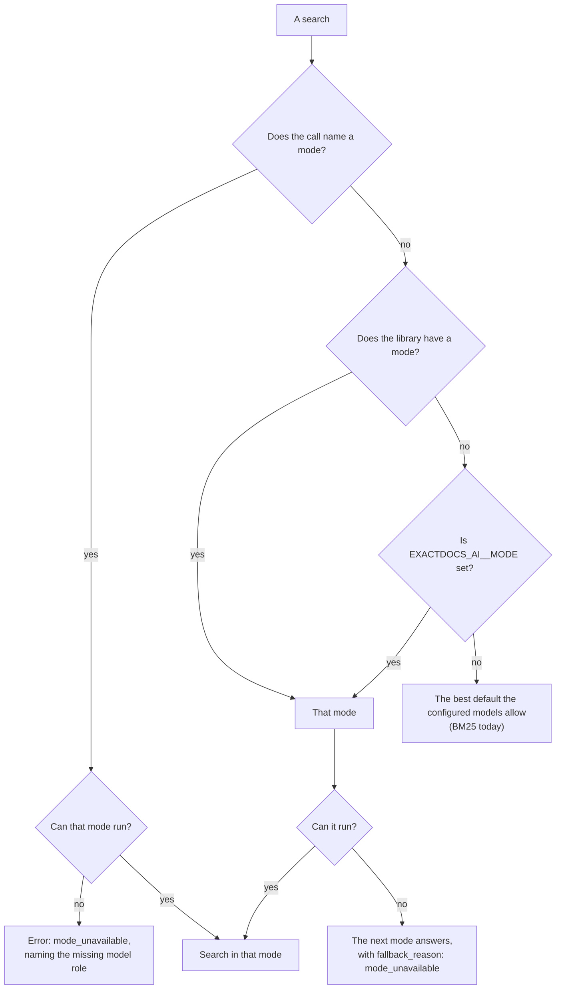

# Search and AI models

!!! abstract "TL;DR"

    - Every search is BM25 by default, pinned to one version, with no model and no network.
    - Models are opt-in: vectors, a reranker, HyDE, or an agent.
    - A mode that cannot answer falls back to a cheaper one and says why in `fallback_reason`.
    - BM25 stays the default until the eval suite shows another mode beats it.

By default every search is BM25, pinned to one version, with no model and no network. If you
configure model endpoints, or run the bundled local models, a search can also use vectors, a
reranker, an LLM that writes a hypothetical answer, or an agent that browses the docs. Each of
these is opt-in, and each one falls back to a cheaper mode rather than failing the search.

Which configuration to pick (no models, local models or hosted models), with the benchmark numbers
behind it, is on [Recommended defaults](../benchmark/defaults.md).

## Which page do I need

| You want to | Read |
|---|---|
| Change how articles are cut into chunks, or tag them | [Chunks and tags](chunks.md) |
| Connect a model endpoint and assign roles | [AI providers and model roles](providers.md) |
| Make the LLM think less (or more) | [Thinking level](thinking.md) |
| Embed the versions for hybrid search | [Background embedding](embedding.md) |
| Cap what models may spend | [Budgets and rate limits](budgets.md) |
| Rerank results with a cross-encoder or an LLM | [Reranker and LLM judge](reranking.md) |
| Let an agent browse the docs | [Agentic search](agentic.md) |
| Answer repeated questions from a cache | [Re-asked questions](answer-cache.md) |
| Run models with no network | [Local models](local-models.md) |

## Retrieval modes

| Mode | Needs | What it does |
|---|---|---|
| `bm25` | nothing | Full-text search: SQLite FTS5, or on PostgreSQL `pg_search` or full-text search. Identifiers are indexed whole and by their parts (`camelCase`, `snake_case`, `pkg.mod.fn`) |
| `vector` | an embedding model | Vector search alone: the version's chunks nearest to the query's embedding, with no BM25 half. Never a default; for comparing what the embedding model finds on its own |
| `hybrid` | an embedding model | BM25 and vector search fused with reciprocal rank fusion (`k` = 60, the top 50 of each), within the version |
| `hybrid_hyde` | an embedding model and an LLM | HyDE: the LLM writes a short hypothetical answer, whose embedding searches the vector half while BM25 keeps the query. Cached per query, version and model |
| `agentic` | an LLM | A pydantic-ai agent browses the version's tree and returns the chunks that answer the question, each with a reason. Never a default; see [Agentic search](agentic.md) |

On top of any mode, a search can be reranked by a cross-encoder ([Reranker](reranking.md#reranker)) or by an
LLM judge ([LLM judge](reranking.md#llm-judge)).

Every mode stays pinned to the version asked for. When a mode cannot answer, the search answers with
a cheaper one and says why in `fallback_reason`:

| Mode | Falls back when | `fallback_reason` |
|---|---|---|
| `vector`, `hybrid` | the version is not embedded yet | `embedding_in_progress` |
| `vector`, `hybrid` | the embedding model fails on the query | `embedding_unavailable` |
| `vector`, `hybrid`, `hybrid_hyde` | the vector store's extension cannot be loaded | `vector_store_unavailable` |
| `hybrid_hyde` | a budget is used up, the caller hit the LLM rate limit, or the LLM failed or timed out | `llm_budget_reached`, `llm_rate_limited`, `llm_unavailable` |
| `agentic` | a limit, a budget, a loop or a failure ended the run | `agent_limit_reached`, `llm_budget_reached`, `agent_loop_detected`, `agent_failed` |
| any | the library's or instance's mode cannot run (its model was removed) | `mode_unavailable` |

### Which mode answers

A mode becomes a default only once the [eval suite](../evals/index.md) shows that it beats BM25. None has
yet, so BM25 is the default: set `EXACTDOCS_AI__MODE=hybrid`, or a library's mode, to use hybrid
search. A library's mode is set with `PUT /api/v1/libraries/{owner}/{repo}/retrieval`, and setting
one whose model is not configured is refused.

A call that asks for a mode that cannot run fails, but a library or instance mode that cannot run
never fails a search. `vector_store_unavailable` means the hybrid modes cannot load the vector
store's extension (sqlite-vec on SQLite, pgvector's `vector` on PostgreSQL); `/healthz` names it in
`vector_store_missing`, and BM25 keeps answering.

Searching across libraries (`search_all_docs`, `GET /api/v1/search`) and `resolve-library-id`
ignore the library and instance modes: their scores must compare across libraries. They are BM25
unless `GET /api/v1/search` names `mode=vector` or `mode=hybrid` (the search playground does). Then
the query is embedded once, and every chosen library's default version that the configured model
has embedded is ranked by distance in that one space, so the distances compare across libraries;
`hybrid` fuses that ranking with the BM25 one, as within a version. Each result carries its
`bm25_rank` and `vector_rank`. A library with AI off, or not embedded yet, is left out of the
vector ranking and named in `libraries_without_vectors`; when none can be, BM25 answers with the
`fallback_reason`. [Flows](../flows/retrieval-modes.md) has more diagrams of the retrieval paths.

<figure class="xd-shot" markdown>

{ loading=lazy }
{ loading=lazy }

<figcaption>A library's versions, and the retrieval mode and embedding model it uses.</figcaption>

</figure>
