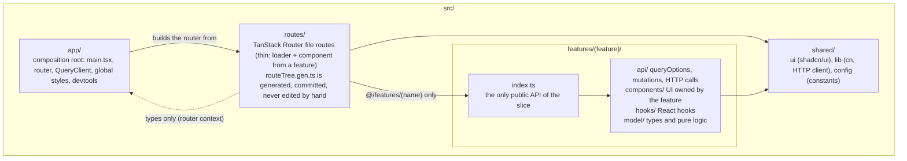

# ExactDocs web UI

React client served by the ExactDocs backend from `web/dist` in production.

Stack: Vite 8, React 19, TypeScript (strict), TanStack Router (file-based) and TanStack Query, shadcn/ui on Tailwind v4, Biome, react-doctor, fallow, Vitest.

Requires Node 26 LTS (`.nvmrc`) and pnpm 12 (`packageManager` in `package.json`).

```bash
pnpm install
pnpm dev          # http://localhost:5173, proxies /api and /mcp to http://localhost:3000 (override: EXACTDOCS_API_URL)
pnpm build        # typecheck + production build into dist/
pnpm test         # Vitest
pnpm lint         # Biome + fallow (architecture, dead code) + react-doctor
```

## Layout: vertical slices



The features are `ai`, `auth`, `browse`, `libraries`, `library-settings`, `search` and `tokens`. An
arrow is an allowed import; anything not drawn is forbidden (a feature never imports another
feature, `app/` or `routes/`; `shared/` imports nothing from the rest).

## Rules (enforced in CI)

| Rule | Enforced by |
|---|---|
| A feature imports only `shared/` and its own files (relative imports); never another feature, `app/` or `routes/` | fallow (`.fallowrc.json` boundaries, one zone per feature) and Biome `noRestrictedImports` |
| `shared/` imports nothing from `features/`, `app/` or `routes/` | fallow and Biome |
| Outside a feature, import it only through `@/features/<name>`, never a deep path | Biome `noRestrictedImports` |
| `routes/` composes features; it may import `app/` for types only (router context) | fallow `allowTypeOnly` |
| Every file in `src/` belongs to a zone | fallow `boundaries.coverage.requireAllFiles` |

When two features need the same thing, move it to `shared/` or compose both in a route; do not import one feature from another.
